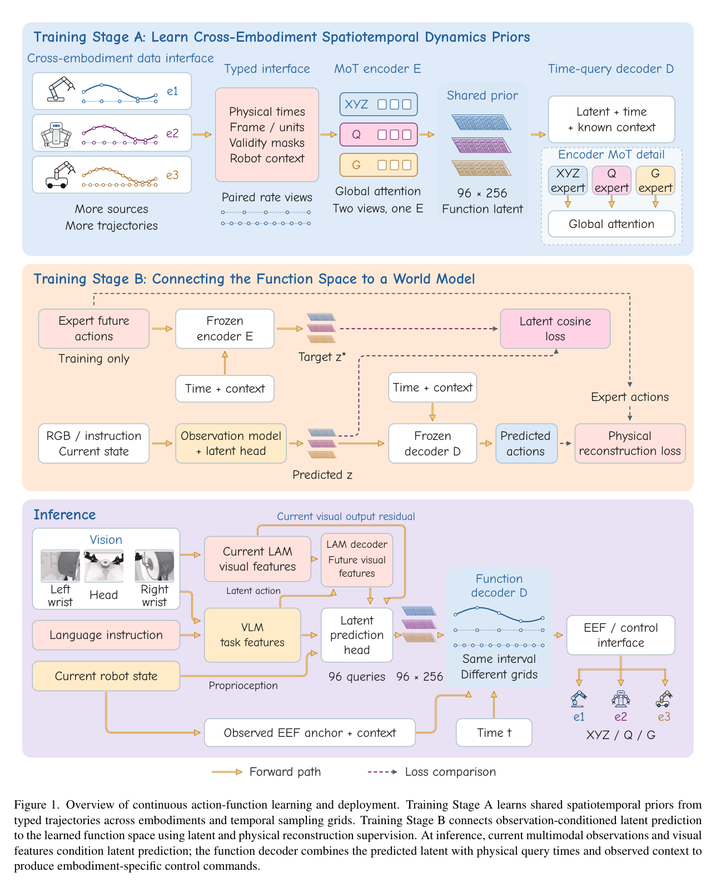
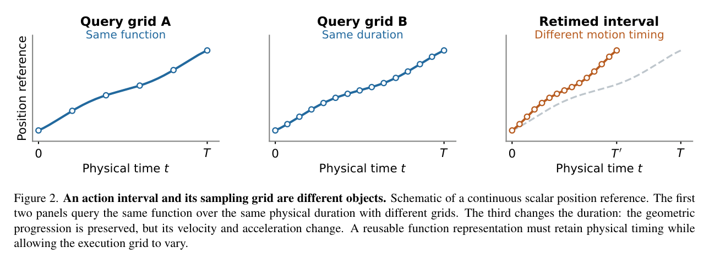
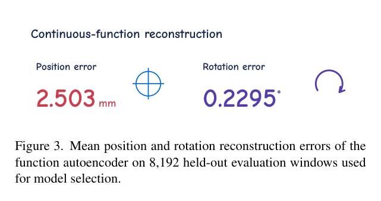
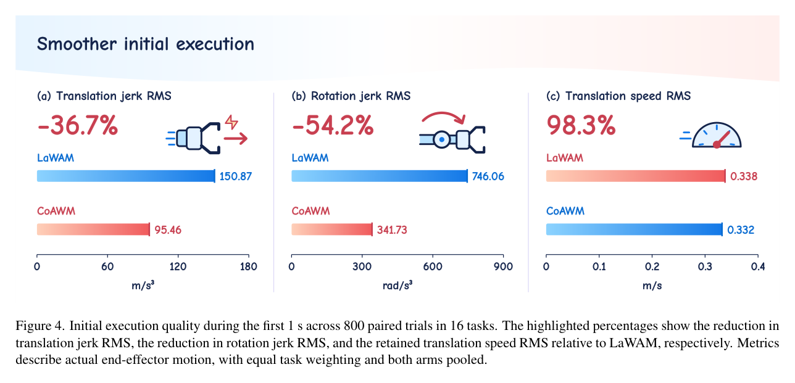
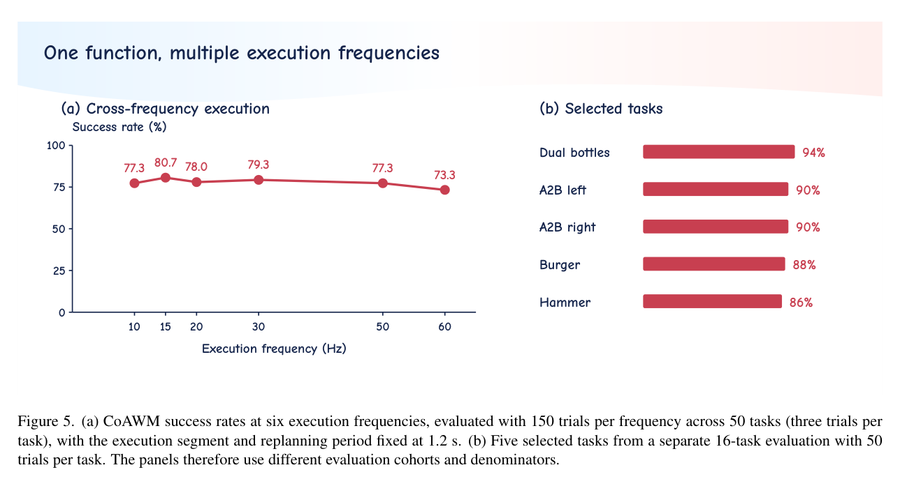
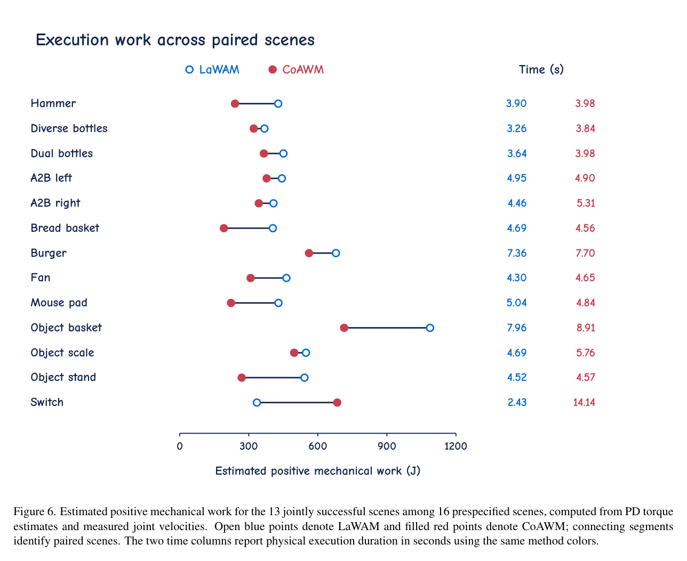

# CoAWM：把动作块学成连续时间函数，混频数据就能一起训练了吗？

Liangyu Li、Qingwen Liu · 同济大学 · **Continuous-Action World Models: Learning Cross-Embodiment Spatiotemporal Dynamics Priors** · arXiv:2610.40401v1，2026-10-29，12 页。整理于 2026-11-16。[论文 PDF](https://arxiv.org/pdf/2610.40401v1) · [arXiv 页面](https://arxiv.org/abs/2610.40401)

同样是让夹爪以 2 cm/s 向前移动，10 Hz 数据记录的相邻位移是 2 mm，30 Hz 则约为 0.67 mm。如果把它们当成同一种“每一步动作”混在一起，模型可能把采样差异误学成操作风格。统一插值到某个频率可以统一数组长度，但又引入一个问题：这条插值曲线是否保留了真实动作，尤其是接触和夹爪切换？

CoAWM 给出的核心操作是：**先把带时间戳的动作轨迹编码成一个固定大小的函数表示，再让解码器根据物理时间查询动作。** 训练时，同一运动的两种采样视图要得到接近的表示；使用时，同一个表示可以在不同控制频率对应的时间点上解码。之后，视觉、语言和预测未来视觉特征共同决定当前应该生成哪个动作函数。

这与我们讨论的 UMI、真机数据混合预训练直接相关，但需要先划清证据范围：当前版本展示了动作重建、双臂任务、10–60 Hz 执行与初始平滑性；**没有给出充分的跨机器人迁移实验，也没有公开完整的大规模预训练配方。** 截至本次检索，未找到可确认归属于作者的官方代码仓库；下面明确区分论文已说明的机制、由公式推导的实现含义，以及仍需要补齐的工程选择。

## 一、模型结构与方法定位：先学“运动怎么展开”，再学“当前应该做什么”

### 1.1 最小改动是什么？

常见动作块策略输出一串定长命令。CoAWM 的动作输出接口变成：先预测一个函数潜变量 Z，再调用 `D(Z, 时间, 已知执行信息)` 得到指定时刻的末端命令。这里的“末端”是夹爪所在的操作端，命令包括位置、姿态和夹爪状态。潜变量是压缩后的神经网络表示，并不是一条显式解析多项式。

作者把学习分成两个阶段：Stage A 只用动作轨迹学编码器 E 和时间查询解码器 D；Stage B 冻结 E、D，用当前观测预测专家未来轨迹对应的潜变量。这样可以让没有配套语言和相机观测的动作数据参与第一阶段，而把“看场景决定动作”留给第二阶段。[§3.1–3.4，PDF p.4–6](https://arxiv.org/pdf/2610.40401v1#page=4)

看总图时，先跟随上方的动作编码与重建，再看中间的专家标签路径，最后看下方部署路径。中间的专家未来动作只负责训练监督，不在部署时提供给模型。



图中的两个“latent”需要分清。原 LaWAM 分支预测的潜在动作，用于驱动未来视觉特征预测；新预测头输出的 **96×256 函数潜变量**，用于解码机器人末端动作。二者角色不同，论文没有把它们声明为同一个张量。

因此，它相对原 LaWAM 的关键变化，是接入一个预训练的连续动作函数空间及其监督接口。视觉世界预测分支被保留。标题里的 world model 不能理解为作者重新训练了一个覆盖所有机器人和物理交互的通用世界模拟器。

### 1.2 “不同频率”与“更快完成”是两件事

以一个 1.2 秒的到达运动为例：10 Hz 查询 12 个命令，30 Hz 查询 36 个，60 Hz 查询 72 个。运动的物理时间没有变，变化的是控制系统每隔多久拿到一个目标。

下面图的前两栏是同一段运动、同一物理时长、不同查询密度；第三栏才是把运动压缩到更短时间。



若把同一路径从 T 秒缩到 T′ 秒，位置虽然可能沿相同几何路径走，速度和加速度却分别按时间缩放的一次方、二次方变化。这是运动学推导。CoAWM 的跨频率实验固定 1.2 秒执行段和重规划周期，**并没有验证任意加速执行后仍满足动力学约束**。

这个区分也回答了混频训练的起点：要统一的是“时间戳和命令的物理含义”，不是把所有序列强行变成同一个长度。频率信息最终通过时间坐标进入模型，不能在预处理中被抹掉。

## 二、核心机制：时间、动作类型和当前状态怎样共同定义函数？

### 2.1 一条样本到底包含什么？

论文把轨迹表示为 `A={(τᵢ,aᵢ,mᵢ)}`：τ 是物理时间，a 是末端命令，m 表示有效分量。物理时间零点对应当前观测。另有已知执行条件 c，至少包含当前末端锚点和有效性信息：

```text
Z = E(A, c)
a(τ) = D(Z, τ, c)
```

在公开描述的双臂实现中，位置 XYZ 是 6 维，四元数姿态 Q 是 8 维，夹爪 G 是 2 维。四元数用四个数表示三维旋转；左右臂各一组。位置、姿态、夹爪的数值性质不同，因此作者没有把所有分量当作同一种 token 处理。

时间戳和有效性 mask 一起进入输入 token，用来避免把缺失观测当作合法命令。论文提出了跨机器人所需的坐标系、单位、有效分量和机器人上下文接口，但没有提供完整的数据集逐项映射表。**从关节动作得到末端轨迹、把增量动作转换成位姿参考、统一左右臂和夹爪语义，仍是数据接入前必须完成的工作。** 这些不能靠输入 padding 自动解决。

### 2.2 MoT 的分工：参数按动作类型拆开，注意力一起算

编码器首先用带类型的 Perceiver 模块，让学习得到的 latent queries 汇聚可变长度轨迹。之后使用 Mixture-of-Transformers：XYZ、Q、G 三条流各自拥有 Q/K/V/O 投影、归一化和前馈网络，但注意力在所有流之间联合计算。

可以把它理解为：位置流学空间移动，姿态流学转动，夹爪流学开合；同时它们可以互相读取信息，表达“到达抓取位置时闭合夹爪”这样的配合关系。这里公开的机制是按类型分配 Transformer 参数，不能因为名字里有 Mixture 就默认存在 top-k 专家路由或负载均衡损失。

瓶颈总共 96 个 token，每个宽度 256，三类各占 32 个。不同长度或频率的轨迹由此进入固定大小的函数表示。**固定容量方便后续策略预测，但容量是否足够保留快速接触变化，仍需要重建与闭环证据。** 当前论文没有提供 token 数或 MoT 结构的系统消融。[§3.2](https://arxiv.org/pdf/2610.40401v1#page=5)

### 2.3 解码时间独立查询，为什么能自由换频率？

每个查询由物理时间、时间的 Fourier 特征、动作类型 embedding 和执行条件组成。Fourier 特征把时间映射到一组周期函数，方便网络表达不同变化尺度。带类型的 cross-attention 用查询读取 Z，再输出 XYZ/Q/G。

承重细节是：**每个时间点分别对 latent memory 做查询，不依赖其他查询点的数量和排序。** 在确定性评估条件下，单独查 0.5 秒，或把 0.5 秒放进一组更密的查询里，按这个结构应得到相同结果。这是架构带来的性质；如果实现时增加查询之间的 self-attention，就可能破坏它。

它也有代价：独立查询本身没有显式限制速度、加速度或 jerk。不同时间点之间的协调主要依靠共享的函数表示与训练目标。不能从“连续时间输入”直接推出运动在所有时间尺度上都平滑，更不能推出满足碰撞、力矩和速度边界。

### 2.4 当前位姿锚定：作者怎样避免输出从错误位置起步？

解码器直接生成的轨迹可能在时间零点偏离实际机器人。作者用当前观测的末端位置 p₀ 硬锚定：

```text
p(τ) = p₀ + p̃(τ) − p̃(0)
```

p̃ 是锚定前的位置输出。假设原网络在零点输出 0.30 m、在 0.1 秒输出 0.31 m，而机器人当前实际在 0.40 m，那么执行参考应为 `0.40+0.31−0.30=0.41 m`。这段教学例子说明，保留的是预测运动变化，起点被对齐到真实状态。

姿态使用旋转组合而不是逐分量相减：

```text
q(τ) = normalize[q₀ ⊗ r(0)⁻¹ ⊗ r(τ)]
```

r 是归一化后的四元数输出，⊗ 是四元数乘法。中间两项提取相对转动，再从当前姿态 q₀ 出发组合。忽略数值误差时，时间零点恰好恢复 q₀。实际实现还必须统一四元数顺序与乘法约定；当前版本没有给出可核对的完整代码。

这个锚定只保证起点位姿一致。两次规划在边界处可以位置相接，速度和加速度却不同；传感噪声、执行滞后也会进入新的锚点。因此它不能代替动作块续接、延迟补偿或闭环控制器。论文也承认更长执行窗口仍有明显的 jerk 尾部。

### 2.5 夹爪为何不做同一种连续读出？

位置和姿态使用时间查询与锚定；夹爪采用单独的时间节点读出：先预测原生 knots 上的夹爪值，再为查询选择最近节点。这样可以表示突然开合，避免强迫一个开关事件变成缓慢连续变化。

但最近节点选择有时间量化边界；查得更密，不代表凭空恢复了训练数据没有记录的夹爪事件。节点怎样定义、边界并列怎样处理、开合值怎样映射到不同硬件，论文没有完整说明。对 UMI 与真机混训，这类事件语义需要显式对齐，不能只把开合数值缩放到同一范围就认为完成了适配。

### 2.6 时间偏移 Δt 是一个容易接错的接口

论文同时使用物理时间 τ 和实现中的外部时间 u：

```text
τ = u + Δt
Dphysical(Z, τ, c) = Dimpl(Z, τ − Δt, c)
```

Δt 表示当前观测到第一个动作目标之间的延迟。因此当前状态锚点对应的是 `u=−Δt`，不是 `u=0`。作者说明编码时间与解码时间分别在模块边界转换一次。实现时如果数据层已经加过偏移，模型层再加一次，就会整体错位。

推理在频率 f 下查询每个命令区间的名义终点：`τₖ=(k+1)/f`、`uₖ=(k+1)/f−Δt`。例如教学设定 Δt=1/30 秒，30 Hz 的第一个目标外部时间为 0；60 Hz 的第一个目标则为 −1/60 秒。这里仍应使用实际定义的 Δt，不能仅因换了执行频率就自行重设偏移。

还有一个需要复现时核实的边界：Stage A 的额外网格写成外部 `u∈[0,1.2]`，转换后覆盖物理 `[Δt,1.2+Δt]`；推理查询则覆盖 `(0,1.2]`。这两个支持区间并不完全相同。论文没有完整交代边界目标构造与 mask 规则，不能默默把训练网格也改写成物理 `[0,1.2]`。

## 三、训练与推理：不同采样视图究竟怎样改变优化？

### 3.1 Stage A：用同一运动的两个采样视图学习不变表示

取同一段到达并抓取的轨迹，构造不同采样率的两个视图 A¹、A²。注意，它们描述相同运动、共享物理时钟，并不是从两个机器人随便挑两条相似任务轨迹强行对齐。共享编码器输出 Z¹、Z²。

每个 latent 都在两类时间点上重建：一类是源视图的时间戳，另一类是额外网格。论文指定网格为外部 0–1.2 秒、60 Hz、包含两端共 73 点。两类重建损失分别归约、等权加入，再用 latent MSE 约束两种视图：

```text
L_A = ½ Σ(v=1,2) [E_source(v) + E_grid(v)]
      + 0.1 MSE(Z¹, Z²)
```

这几项各解决一个问题。源重建保留观测到的动作；额外网格要求表示能支持更多时间点的查询；跨视图 MSE 使编码器尽量关注运动本身，减少对采样密度的依赖。只用一致性可能让两个表示一起塌缩成常量，重建目标则要求表示保留足够的轨迹信息。

**论文没有详细披露两个视图的采样分布、额外网格真值如何产生，以及是否使用插值。** 如果原始轨迹只有 10 Hz，60 Hz 的监督不能凭空出现；复现时必须知道它来自更密的原始记录、明确的插值还是其他目标构造。这里是方法可实现性的重要缺口，不能用“统一到 60 Hz”一句话带过。[§3.3](https://arxiv.org/pdf/2610.40401v1#page=5)

### 3.2 重建损失：位置、旋转与夹爪如何一起计分？

论文的双臂写法是：

```text
E_S = masked_mean [ ||Δp||² / 6
                    + (θL² + θR²) / 2
                    + (ΔgL² + ΔgR²) / 2 ]
```

Δp 是两臂共 6 维的位置误差，以米计；θ 是 SO(3) 上的最短旋转角误差，以弧度计，不是四元数分量的普通欧氏误差；Δg 是夹爪误差。S 代表源时间点或额外网格，各自使用自己的布尔有效 mask，在 batch 与查询索引上平均。latent MSE 则在 batch、token 和 latent 维度上取均值。

源损失与网格损失先各自平均，再等权相加，意味着 73 个网格点不会仅凭点数多就占更大权重。但第一阶段三种物理量仍使用各自原生尺度：1 cm 误差的平方是 10⁻⁴，0.1 rad 的平方是 10⁻²。虽然每类内部除以维数，这并不等于三种物理量对优化同等重要。

对缺失单臂或部分维度，论文给出有效性接口，却没有完整写出所有缺失组合下的分母处理。迁移实现应明确按有效分量归约，并将其标为我们补齐的规则，而不是声称原论文已经公开了同样实现。

### 3.3 Stage B：视觉模型怎样预测一个动作函数？

第二阶段从头部与左右腕部 RGB、语言指令和当前机器人状态出发。沿图中的依赖顺序：

1. VLM 输出任务特征 h_vlm，以及原 LaWAM 的潜在动作预测 â_latent。
2. 当前图像产生 LAM 视觉 tokens h_t；保留的世界解码器用 h_t 和 â_latent 预测未来视觉特征 ĥ_t+1。
3. 新函数预测头将 VLM 特征、预测未来视觉特征和本体状态分别投影后拼成 memory。
4. 学习得到的 96 个 queries 对 memory 做 Transformer 解码，产生函数潜变量。

这里 LAM 指原有潜在动作建模分支；“未来视觉特征”不是必须渲染成 RGB 的目标图像。当前执行条件 c 仍独立传给动作解码器，用于时间解释与位姿锚定，不能与进入预测头的本体状态 s 混为一个接口。

形式上，主 memory 为：

```text
M = concat(Pv·h_vlm, Pf·ĥ_t+1, Ps·s)
H = LayerNorm(TransformerDecoder(learned_queries, M))
Ẑ = Wout·H + Wres·Attention(H, Pc·h_t, Pc·h_t)
```

最后一项是当前视觉输出残差，Wres 初始化为零。其合理作用是让主路径先对齐任务与预测演化，再逐步加入当前视觉细节；零初始化并不意味着该路径永久关闭。**论文没有单独消融当前视觉残差或预测未来特征，因此这只是结构层面的机制解释，不能独立归因到实验收益。** [§3.4，Eq.8–10](https://arxiv.org/pdf/2610.40401v1#page=6)

### 3.4 专家未来动作如何只用于监督，不造成未来信息泄漏？

训练样本有专家未来动作 A*，冻结编码器给出目标 `Z*=stop_gradient(E(A*,c))`。观测路径预测 Ẑ，二者比较全 latent 的余弦相似度：每个样本先把 96×256 展平成 24,576 维向量，再计算 `1−cos`，最后平均 batch。

这不是每个 token 分别求 cosine。全局方向对齐约束了整体表示，但对整体缩放不敏感：如果 Ẑ=2Z*，余弦损失仍可能为零，而解码出来的动作未必相同。因此作者又把预测 Ẑ 直接交给冻结解码器，在原生目标时间上监督解码动作。

```text
L_phys = ⅓ [ mean((Δp / 0.01 m)²)
             + mean((θ / 0.05 rad)²)
             + mean((Δg / 0.05)²) ]
L_B = L_latent + 0.1 L_phys
```

第二阶段显式使用物理误差尺度，和第一阶段的原生尺度重建不同。1 cm、0.05 rad、夹爪 0.05 是损失归一化尺度，并不是作者保证能达到的误差上限。按单类别教学例子，位置误差从 1 cm 变成 2 cm，归一化平方项从 1 增至 4，说明较大的物理偏差会得到更强惩罚。

部署时不输入 A*，也不运行专家动作编码器；Ẑ 的信息来自当前可获得的视觉、语言、本体状态和模型预测的未来特征。这才是训练用未来监督、部署不用未来真值的闭合路径。

### 3.5 冻结解码器，不等于切断物理损失的梯度

Stage B 的函数编码器和函数解码器都冻结，保留的世界预测分支也冻结；论文说明梯度经动作解码器训练 latent 预测路径及 backbone adapters。因此物理损失必须保留对 Ẑ 的导数。

教学伪代码如下，只说明梯度语义，不冒充作者公开代码：

```python
# E、D 的参数不更新；预测头与声明为可训练的 adapters 更新
with no_grad():
    target_z = E(expert_actions, timestamps, context)

pred_z = observation_path(current_observation, instruction, state)
pred_actions = D(pred_z, target_times, context)  # 此处不可整体 no_grad
loss = cosine_loss(pred_z, target_z) + 0.1 * physical_loss(pred_actions, targets)
loss.backward()
```

如果把 D 的整个前向包进 `no_grad()`，物理监督就无法纠正预测头；如果把 E 的目标分支也一起训练，表示空间又会随预测器漂移。作者选择冻结预训练函数空间，保留通过 D 的输入梯度，让策略学会进入这个空间。adapter 的具体形式、位置和参数量没有充分披露，不能自行写成 LoRA 配方。

### 3.6 推理的控制频率与重规划频率分开

每次重规划，用当前观测预测一个函数 Ẑ，以当前末端位姿锚定，然后按所需频率查询未来命令。原生执行为 30 Hz；跨频率实验固定执行段与重规划周期为 1.2 秒。

| 查询频率 | 每 1.2 秒的命令数 | 该实验中的重规划周期 |
|---|---:|---|
| 10 Hz | 12 | 1.2 秒 |
| 15 Hz | 18 | 1.2 秒 |
| 20 Hz | 24 | 1.2 秒 |
| 30 Hz | 36 | 1.2 秒 |
| 50 Hz | 60 | 1.2 秒 |
| 60 Hz | 72 | 1.2 秒 |

60 Hz 输出不表示视觉大模型每秒重新推理 60 次。当前设置大约每 1.2 秒选择一个新动作函数；段内命令查询得更密，但不会自动融入新的场景变化。端到端推理延迟、低层控制器适配、接触中的重规划策略没有足够公开细节，因此不能据此宣称控制延迟更低或已解决实时执行。

## 四、实验结果与细节：当前证据最支持什么？

### 4.1 表示能重建轨迹，但还没有证明能跨机器人泛化

先看动作表示能否保留原始轨迹。作者在 8,192 个留出窗口上报告位置重建误差 2.503 mm、旋转误差 0.2295°。



这个量级支持函数空间具备表示轨迹的能力，但图注明确这些窗口用于模型选择，因此不能直接称为完全独立的最终测试集。它也没有给出按机器人、任务、频率或接触阶段的误差分布，更没有以“在未见机器人上重建和执行”建立跨 embodiment 泛化证据。

更重要的是，重建时 E 看到了完整专家未来轨迹；闭环时预测头只有当前条件，需要猜测合适的未来。所以小重建误差只是表示基础，不等于策略一定能选对动作函数。

### 4.2 最直接的收益：初始一秒更平滑，速度基本保持

下面实验覆盖 16 个任务、800 对匹配初始条件，只测每次执行的前 1 秒。jerk 是加速度随时间的变化率；RMS 是均方根，反映变化强度。指标基于实际末端运动，任务等权，双臂合并统计。



相对 LaWAM，平移 jerk RMS 从 150.87 降到 95.46 m/s³，下降 36.7%；旋转 jerk 从 746.06 降到 341.73 rad/s³，下降 54.2%。平移速度 RMS 从 0.338 到 0.332 m/s，保留约 98.3%。这支持“在该初始窗口，运动变化更平稳，同时平均速度量级接近”的判断。

但它没有隔离到底是函数表示、锚定、预训练还是其他训练变化带来的收益。论文也承认更长执行窗口中仍存在显著 jerk 尾部。因此不能改写成“完整任务抖动减少一半”，也不能仅由初始速度相近推出整项任务完成时间不变。

该组评估报告 CoAWM 成功率 75.1%，没有给出足够完整的同口径 LaWAM 成功率对照来证明总体任务成功提升。平滑性改善与成功率优劣，需要分别判断。

### 4.3 一个函数能在六种频率执行，但高频未必更好

左图是 50 个任务、每任务 3 次，每个频率 150 次；右图是另一组 16 任务评估中挑出的五个任务，每任务 50 次。两个面板不能混用分母。



10/15/20/30/50/60 Hz 的成功数依次为 116/121/117/119/116/110，对应 77.3%/80.7%/78.0%/79.3%/77.3%/73.3%。这说明同一函数策略可以服务多个执行网格；它并不证明频率不影响控制结果，60 Hz 的聚合成功率反而低于 15 Hz。

论文没有给出足够的置信区间、逐任务配对结果或训练频率分布，因而不能把这些差异都解释成显著性能变化，也不能确定哪些频率属于未见频率泛化。每任务三次的评估足以做初步探索，尚不足以稳定排序模型。

右侧双瓶 94%、左右 A2B 各 90%、汉堡 88%、锤子 86% 是挑出的五项，不代表 50 项平均水平。正文还提到在另一初步比较中两种方法各有 30 个任务三次全成功，这同样不足以推出 CoAWM 全面优于 LaWAM。

### 4.4 机械功下降 22.6%，不能直接当作整机节电比例

作者预先指定 16 个场景，然后在两种方法都成功的 13 个场景上比较估计的正机械功。它来自 PD 力矩估计与测量关节速度；PD 是根据位置和速度误差产生控制力矩的控制方式。



平均值从 506.66 J 降到 392.13 J，下降 22.6%，其中 12 个场景更低。需要同时读右侧完成时间：switch 从 2.43 秒变成 14.14 秒，并且机械功更高；部分其他任务虽然功更低，时间也更长。功、完成时间、成功率并不是同一个指标。

正机械功反映正向机械输出的累计量，不包括全部电驱损耗、计算与外围设备用电，也不等于净电池耗能。只比较共同成功场景，还排除了另外三个场景，因此 22.6% 不能外推为所有任务的总体节能收益。它是一个有价值但有筛选条件的动作质量结果。

### 4.5 训练配方公开到哪一步？

这篇最明显的限制是方法写得比实验配方完整。为避免把工程猜测写成作者实现，把公开范围整理如下：

| 项目 | 当前版本能确认 | 仍缺少的复现信息 |
|---|---|---|
| 表示结构 | 三类动作流、96×256 latent、独立时间查询 | 完整层数、attention heads、Fourier 频率等 |
| Stage A | 两个采样视图、源/网格重建、0.1 一致性权重 | 数据集组成、机器人清单、样本量、视图与网格标签构造 |
| Stage B | 冻结函数空间、latent cosine、0.1 物理损失、误差尺度 | adapter 实现、可训练参数表、精确骨干配置 |
| 优化与算力 | 方法和损失公式 | 学习率、优化器、batch、训练步数、硬件和总耗时 |
| 执行与评估 | 原生 30 Hz、六种查询频率、1.2 秒窗口、主要评估分母 | 完整控制器设置、时延、环境与机器人复现配置、误差条 |
| 跨机器人能力 | 提供可接入异构轨迹的设计接口 | 留出 embodiment 迁移实验及规模化曲线 |

作者在 §4 与 §5 将当前结果定位为快速验证，并把扩大训练规模、引入更多机器人与采集频率、进一步全量微调列为后续工作。这里应区分**接口支持更多数据来源**与**已经用大规模异构数据证明收益**。当前材料支持前者的设计合理性，对后者还缺证据。

## 总结：对 XR1，优先借鉴物理时间接口和动作函数预训练

CoAWM 最值得借鉴的，是把动作本体、采样网格和当前状态锚点分别表达：轨迹进入一个固定 latent，时间查询控制输出网格，观测锚点决定执行起点。跨视图一致性提供了明确的训练操作，帮助模型减少对采样密度的依赖；视觉世界特征再把这个动作先验用于具体任务。

**以下是我们对 XR1 的迁移建议，不是论文已经做过的实验。** 如果 UMI 与真机都能转换成时间戳明确、坐标与单位明确的末端位姿轨迹，可以先做动作函数预训练。这一阶段不要求语言和图像配对齐全，因此适合作为异构动作数据的额外利用路径。只有关节动作或未知控制语义的记录，应先完成运动学转换与动作定义核实，不能直接塞进 XYZ/Q/G 流。

对保留 Lance 的新 infra，可以将原生时间戳、观测到目标的偏移、实际位姿与命令的区别、坐标系、四元数约定、夹爪语义、有效分量和数据来源绑定到 manifest。两种频率视图在训练时由同一原始窗口构造；额外网格的目标生成规则必须版本化，并保留哪些点来自测量、哪些来自插值。存储格式可以保持，样本语义需要补齐。

如果目标是利用噪声较大的 UMI 泛化能力，同时保持真机精确操作，**跨频率一致性本身不解决噪声质量问题**。同一条有偏轨迹的两个视图仍然共享偏差，重建目标甚至会要求模型保留偏差。需要另外定义质量标记、异常片段准入与来源权重，再观察这些规则是否改善精确任务；当前论文没有提供这一混噪声方案。

建议的最小验证顺序是：先比较固定频率插值、函数自编码器、加入跨视图一致性的函数自编码器，使用按 episode 分隔的评估集；分别查看位置/姿态/夹爪事件误差，以及未见频率与未见来源的误差。然后冻结合格的函数空间，接观测预测头，分别比较只有当前视觉与加入预测未来特征的配置。两阶段都应保留简单基线，才能知道收益究竟来自哪里。

最后才进入闭环：固定执行段和重规划周期，单独改变查询频率；同时记录完整任务成功率、初始与全程 jerk、块边界速度跳变、完成时间和控制延迟。论文只证明了初始一秒的平均改善，我们真正需要检验的是接触、夹爪切换和连续重规划中是否还能保持精度。

我的判断是：**它对 XR1 的数据接口与动作表示设计很有启发，尤其值得针对混频数据做受控实验；但当前版本还不足以支持整套照搬，更不能把跨机器人、低噪精确控制和实时部署都视为已经解决。**

### 来源与阅读材料

技术事实来自用户指定的 arXiv v1：§3.1–3.3 为函数空间及预训练，§3.4 为世界模型连接与梯度路径，§3.5 为时间查询执行，§4–5 为初步实验与限制。6 张原图均裁自论文并核对完整图注；版权归论文作者。正文、教学例子与 XR1 迁移建议为原创整理。未运行模型训练或推理，未独立复现成绩；未将引用文献中的训练配方移植为本文配方。

[Markdown 正文](report.md) · [来源与证据映射](source_map.json) · [图表核验清单](assets/visual_manifest.json) · [论文原文](https://arxiv.org/pdf/2610.40401v1)
