# Dyna-2 深读：百万小时视频如何变成机器人能力

解读模式：explain · 基于 Dyna Robotics 模型报告与配套基础设施报告 · 使用 paper-deep-reader

> **先抓住重点**：最值得关注的是“增加人类视频能改善机器人任务”的证据链，以及使这种实验能够反复运行的数据系统。百万小时规模、世界模型架构和生产效果属于不同证据层，不能互相替代。

## 1 核心思想一句话总结

用大规模人类视频学习世界与动作，并以机器人实验检验迁移收益。

## 2 论文背景与动机

### 真正的问题：人的经验能否成为机器人的可扩展训练资源？

机器人示教不仅需要拍摄，还需要机器人、操作员和现场，采集规模受硬件吞吐限制。人类第一视角视频可以覆盖更多场景，但只有图像并不等于有机器人动作标签：人的手与机器人的夹爪不同，相机位置不同，身体运动方式也不同。Dyna-2 要回答的是，这些差异存在时，扩大人类视频预训练，是否仍能稳定提高机器人能力。

报告把这个问题拆成三层：先检查同分布的人类留出集，再检查未参与预训练的机器人动作数据，最后让经过少量机器人后训练的策略实际执行任务。只有第一层变好，可能只是更会预测人的手；第二层变好提供迁移证据；第三层才接近机器人控制价值。生产部署另有实验，不应与这三个受控层次混为同一个结果。

### 必要概念与术语：先把几个容易混淆的词分开

**预训练**：先用大规模通用数据学习可复用能力。这里的 scaling 实验使用人类数据；后续机器人数据的介入阶段要单独看。

**后训练**：在预训练之后，用目标机器人和任务的数据调整模型。它解决身体结构、动作接口与任务分布之间的差异，不能省略后却沿用后训练的成绩。

**世界—动作模型（WAM）**：同时学习视觉世界的变化与动作的模型。这里的“世界”主要落实为未来视频预测；这个名字本身不保证已经掌握因果物理规律。

**视觉—语言—动作模型（VLA）**：接收图像和语言，输出机器人动作的策略。报告比较的是具体配方的 WAM 与 VLA，而非两个类别的所有成员。

**缩放规律（scaling law）**：研究能力如何随数据量等资源变化。Dyna-2 的主实验改变数据规模，不能直接推导最优模型大小或最优计算预算。

**零样本迁移（zero-shot）**：必须说明“对什么零样本”。离线机器人评估没有机器人微调；生产新站点测试是对新站点零样本，并不表示此前从未使用机器人训练数据。

### 数据到底有多少，百万小时又是什么？

主报告披露的是超过一百万小时的人类第一视角视频，主要使用头戴设备，来自合作伙伴和内部采集。通过手部姿态估计得到手腕运动等伪动作，拇指与食指开合被用于连续抓握信号。这些标签是视觉推断的结果，并非机器人电机、接触力或真实关节控制命令。

因此，回答“有没有达到 100k 小时的预训练数据”：**这个报告声称有，而且研究规模超过了 100k 小时；准确表述应是人类视频预训练规模，不是百万小时机器人示教。** 我们能确认公开报告的说法，无法从网页独立审计原始数据时长、去重结果与全部质量分布。

四档主实验为 1k、10k、100k、1M 小时，采用嵌套子集并保持来源比例。嵌套的意义是减少“规模更大恰好换了更好的来源”这一解释，但它不会自动控制动作多样性、重复程度或采集质量。留出的人类评估约 100 小时；多个后期 checkpoint 的均值与波动反映训练过程的变化，不等同于多个独立随机种子的置信度。 [数据与实验设计原文](https://www.dyna.co/dyna-2)

## 3 核心方法/模型详解

### 一个最小例子：从“人拿起杯子”到“机器人拿起杯子”

以下是帮助理解机制的示例，并非新增实验。输入是一段人戴相机伸手抓杯子的片段。预处理后得到同步的视觉序列、手腕轨迹和抓握开合信号；模型看到当前画面与相关条件，学习未来视觉变化和未来动作片段。中间产物不是一句“抓杯子”的描述，而是连续的视觉表示与运动表示。

例如把单个动作分量归一化后设目标 a=0.8，抽到噪声 ε=−0.2，在 t=0.25 时混合得到 aₜ=0.05，训练目标速度为 a−ε=1.0。模型要从当前条件和这个带噪动作估计朝目标移动的方向。真实训练处理的是高维序列，手腕位姿与抓握信号不能由这个标量例子替代。

迁移到机器人时，人的手腕运动只提供操作先验。还需要用机器人的画面、本体状态和动作数据后训练，把“接近杯子、闭合、提起”的经验适配到真实控制接口。执行阶段输出一段动作，机器人动作改变环境，再接收新观测继续控制。不能把人的像素轨迹原样发送给机器人控制器。

### 从直觉回到训练目标

**流匹配（Flow Matching）**：让模型学习把噪声分布连续搬运到数据分布的速度场。**DiT** 是以 Transformer 为骨干的扩散/去噪网络，在本文分别处理视频与动作。**本体状态（proprioception）** 是机器人自身的关节、姿态等观测，不是外部图像。

令 z 是未来视频的潜在表示，a 是动作片段，ε 是噪声，c 是可见条件；t 从 0 的噪声端走向 1 的数据端。主 scaling 配方可写成：

```text
z_t = t z + (1 − t) ε_z
 a_t = t a + (1 − t) ε_a

L_co = E[ ||u_vid(z_t; t, c) − (z − ε_z)||² ]
     + λ E[ ||u_act(a_t; t, c) − (a − ε_a)||² ]
```

u 是模型预测的速度，λ 平衡两类损失。关键不仅是“两个 loss 相加”，而是**动作分支的条件依赖**：这个 co-training 版本不需要把生成的未来视频作为推理前置步骤。视频任务通过共同学习改善表征，动作仍可反应式执行。联合预测版本允许的跨分支依赖则不同。

### 架构：训练看未来，不等于执行必须先生成未来

**阅读任务｜模型图3**：沿左侧文本条件、底部观测/带噪输入、右侧动作片段读；特别辨认标有联合目标的未来视频连接。

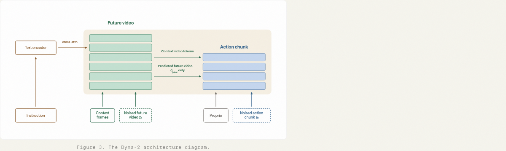

**关键观察**：视频与动作由不同深度的 Transformer 分支处理；动作较浅，接到视频网络较早层。图中把观测视频到动作的连接与特定联合目标下的未来视频到动作连接区分开。

**推理桥**：这意味着必须把架构可表达的依赖和某次实验实际启用的依赖分开。浅动作分支也解释了为何视频学习可以很重，而动作输出路径仍能相对短。

**证据边界**：不能从一张总架构图断言所有实验都先生成未来视频再决策。文本通过视频侧的交叉注意力进入，动作侧的本体状态与块状双向注意力也不应被简化为普通自回归语言解码。 [原图与上下文](https://www.dyna.co/dyna-2)

### 三种训练配方要分开记

| 配方 | 训练信号与依赖 | 要回答的问题 |
|---|---|---|
| Action-only | 主要学习动作预测 | 不加视频预测是否已经足够？ |
| Joint | 动作与未来视频联合学习 | 联合建模是否优于动作监督？ |
| Video co-training | 动作学习之外加入视频训练信号 | 大量额外视频是否带来跨身体泛化？ |

主 scaling 配方、目标消融中的具体联合形式、后面的生产模型不是一套完全相同的配方。读到“百万小时有效”之后，不能把生产系统的每个改进都归因于这个变量。损失权重、模型规模、完整训练调度等也需要完整配置才能复现，仅靠公式无法重建训练。

### 实现主线：一条人类视频如何变成两个学习目标？

**先划清可复现边界。** 以下前向关系来自官方模型报告 §2，数据与工程关系来自配套基础设施报告。当前使用的材料没有提供可逐函数核验的完整训练实现，因此这里给的是带缺口的实现重建；张量符号是本文说明约定，不能当成作者代码的变量名或默认尺寸。

以“手抓住杯子并提起”为例，一条原始记录需要同步图像、手部姿态及有效性信息。通过手腕位姿构造运动监督，通过拇指—食指开合构造抓握监督；模型学习的是视觉估计出的伪动作，尚不是电机控制。姿态估计若在遮挡时系统性出错，更多数据仍可能重复强化这个偏差。因此，手部质量过滤影响的是监督可信度，不只是数据吞吐。[模型报告：Pre-training data](https://www.dyna.co/dyna-2)

| 承重接口 | 输入 → 输出 | 为什么会改变学习问题 | 公开边界 |
|---|---|---|---|
| 数据同步 | 多路带时间戳记录 → 同一采样时刻的观测和未来片段 | 错位会把正确运动配到错误画面，制造条件标签噪声 | 完整同步容差、插值及丢帧策略未给出 |
| 视觉编码 | 观测与未来视频 → 视频 token / 潜变量 z | 把稠密像素变化转成可预测的序列 | 完整编码器、裁剪和张量尺寸不足以仅凭报告复现 |
| 动作编码 | 手腕与开合序列 → 动作片段 a | 给视频变化提供操作相关监督 | 归一化统计、坐标约定、有效维度掩码不能靠猜测补齐 |
| 分支交互 | 视频表示与带噪动作 → 动作速度场 | 决定动作损失能利用什么信息 | 不同目标的注意力依赖不同 |
| 机器人适配 | 机器人观测/状态/动作 → 后训练策略 | 学习人类操作先验与真实控制接口之间的映射 | 人类预训练不能替代机器人接口校准 |

设批量大小 B、未来动作长度 H、动作维数 D，动作 a 可以用 `[B,H,D]` 表示；视频潜变量可以抽象为 `[B,C,T,h,w]`。这仅表达结构，报告没有给出这些符号对应的完整默认值。特别要区分**物理采样时间**与流匹配噪声时间 t：增加 t 并不表示机器人多执行了一秒。

### 梯度路径：视频监督怎样帮助没有看到未来的动作策略？

最容易误读的是“预测未来帮助动作”究竟发生在训练还是执行。官方说明视频 token 使用因果掩码，动作 token 内部使用双向注意力，并读取观测视频；语言先通过交叉注意力进入视频侧，本体状态直接进入动作侧。动作分支较浅，只在视频早期层连接。Joint 目标另有未来视频依赖，不能把它套到所有配方。[模型报告 §2 与模型图3](https://www.dyna.co/dyna-2)

从计算图理解，**注意力掩码就是信息可见性约束**：屏蔽未来视频连接，动作仍可通过观测表示取得语言和场景信息。本文的机制推断是，若某些视频侧参数同时参与观测表示和视频预测，视频损失可以训练这些参数如何表达场景变化，动作损失再使用它们生成动作。这不要求执行时先解码完整未来视频，也不等于两个分支所有参数都共享。

可用链式法则理解这种训练关系：若动作预测 `a_hat=gθa(hθv(c))`，动作损失对视频参数的梯度为 `∂Lact/∂h · ∂h/∂θv`；视频任务还可能提供 `∂Lvid/∂θv`。这是**教学用计算图**，不是报告披露的完整梯度路由。是否冻结、是否 detach，以及哪些层共享，必须由具体配方确定，不能从“联合训练”四个字推断。

为什么视频目标可能有帮助？动作标签只约束少量运动量，视频目标还要求解释物体、遮挡、接触后场景变化，有机会抑制仅记住手腕局部轨迹的捷径。为什么也可能无效？大量背景像素的预测可以占据容量；人类相机运动可能成为比操作更容易学习的规律；两个任务的梯度也可能冲突。**“监督更密”并不等于“监督更相关”。** 后文固定动作数据、增加视频数据的实验，是判断这些解释的关键，而非装饰性结果图。

### 损失实现中不能略过的三个选择

前面的流匹配公式说明目标方向，但还没有指定可运行的损失。第一，视频与动作有不同元素数量；分别取均值后相加，与全部元素一起求和，会给两类任务完全不同的有效权重。第二，变长序列若补零却不屏蔽，模型可能靠预测填充区域降低损失。第三，动作归一化会改变不同物理量的相对代价。

例如某轨迹只有2个有效动作误差，平方误差为1和9，另外2步是填充。有效元素均值是5，误把4步都算进分母则是2.5。两个模型即使有效动作误差相同，也可能因为填充比例不同呈现不同 loss。这是本文的数值示例，**官方没有公开到足以确认上述归约与 mask 的全部实现**。

若动作量标准化为 `(a−μ)/σ`，标准化空间的平方误差等价于把物理误差按 `1/σ²` 加权。手腕平移、旋转、抓握等分量不能只因为都进入一个向量就默认权重合理。复现应先核对单位、坐标和统计范围，再比较网络结构。这里给出的是实现检查依据，不是声称作者已经出现这些问题。

### 系统改进如何真正转成更多有效训练？

基础设施报告的结果需要放回训练循环理解。GPU 等不到 batch 时，压缩、局部读取和缓存降低数据等待；多 rank 启动时，列式索引与内存映射减少重复解析；参数更新阶段，拓扑感知 Muon 分片减少跨节点通信。它们分别作用于不同时间项，不能把加速倍率连乘。

教学近似下，充分重叠的数据加载与计算满足 `Tstep ≈ max(Tdata, Tcompute) + Tunhidden`，最后一项是无法隐藏的通信/更新等耗时。若数据准备由80ms降至20ms，而计算固定60ms，忽略其余项时 step 从80ms变为60ms，收益是1.33倍，绝不是4倍。该例不是 Dyna-2 实测。

进一步衡量有效样本吞吐，还应扣除故障恢复、重复计算和启动时间。预热缓存的稳定态98% GPU利用率不能代表冷启动或所有工作负载，也不能单独证明到达同等质量更快。更有用的复现记录是固定数据清单、有效样本数和目标质量下的总墙钟时间，外加数据等待与通信尾延迟。[基础设施报告 §2.3–2.6](https://www.dyna.co/research/dyna-2-infrastructure)

### 因果判断：如何区分“记住人的动作”和“学到可迁移的场景规律”？

关键不是人类留出集误差是否下降，而是固定动作监督后，扩大视频监督是否改善未见身体的表现。后文模型图11–12提供这一类证据；动作单目标的人类指标也可能较好，说明源域误差并不是迁移质量的充分代理。

下一步可做的最小区分实验，是在固定数据量、训练步数和机器人后训练预算下，仅改变视频目标；同时看人类动作误差、机器人离线误差、闭环成功率。如果只改善第一项，就不能声称迁移机制成立；如果视频收益仅在特定相机或场景出现，还要检查背景捷径。这是建议实验，本文没有执行。报告已有结果支持受测范围内的视频价值，仍不足以推出任何人类视频都同样有效。


### 单步蒸馏：把昂贵生成压到一次网络计算

**蒸馏**：用较慢但较好的教师帮助训练更快的学生。**NFE** 是生成一次样本调用网络的次数。简单少跑几步会跳过原有迭代的修正机会；难点是一次大步仍要落到合理的视频分布。

报告的方法让学生追赶一个逐渐向数据分布移动的目标。学生更新较快，目标推进较慢；差距足够小时再推进目标，否则先等学生追上。加入噪声平滑是为了让分布距离更易优化。形式上可以理解为学生按带平滑的分布差异梯度更新，而目标位置 r 的推进速度依赖估计差距。这里是机制解释，公开叙述不足以唯一确定完整的差距估计器、权重函数与更新调度。

### 蒸馏机制：移动目标为什么比直接跨越更稳

**阅读任务｜模型图16**：先看多步教师的曲线路径，再比较一步捷径的落点与逐步移动的目标。

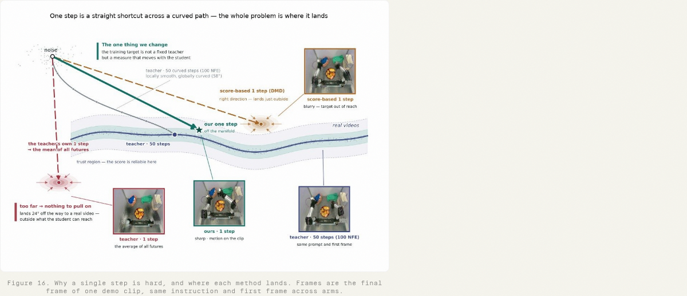

**关键观察**：图把一步生成困难表现为落点偏离有效样本区域；目标沿可追踪的路径移动，让学生逐段缩小差距。

**推理桥**：这意味着优化难度可能通过课程式目标推进降低，而非只修改采样器步数。

**证据边界**：示意轨迹不能证明数学收敛，也不能单凭几帧画面证明机器人控制更可靠；需要后面的速度与质量表共同判断。 [原图与上下文](https://www.dyna.co/dyna-2)

### 基础设施的核心：把“采到数据”变成“可反复训练的数据”

接下来这些工程改进解决五种不同时间：准备数据、构建索引、启动加载、运行时读取、参数更新。它们影响实验周转时间的不同部分。将各自加速倍数相乘，会得到没有意义的“总加速”。

### 数据生命周期：训练前就已经有一条生产线

**阅读任务｜基础设施图1**：从左向右看采集、原始落盘、训练格式、manifest 和 GPU 的边界。


**关键观察**：图把原始对象存储、训练就绪数据和训练清单分开。

**推理桥**：这意味着数据集应当是带版本的可执行输入选择，而不是训练脚本临时遍历一个不断变化的目录。

**证据边界**：这只是逻辑生命周期图，不能推出每一阶段的资源规模、时延或故障率。 [原图与上下文](https://www.dyna.co/research/dyna-2-infrastructure)

### 存储布局：让一个样本所需的数据靠近

**阅读任务｜基础设施图2**：比较组装同一时间样本需要的读取次数；区分相机与状态的读取时间范围。

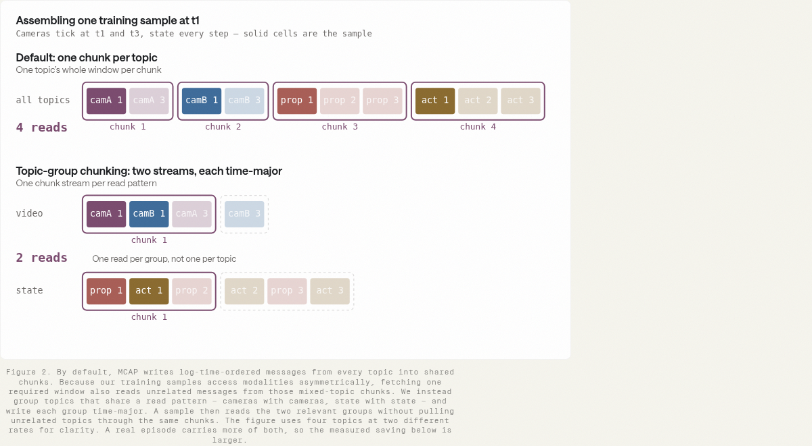

**关键观察**：按 topic group 分组并按时间排列后，示意样本从四次读取减少到两次。正文还说明相机短窗口与状态/动作长窗口的访问模式不同。

**推理桥**：这意味着物理布局应匹配采样器的共同访问关系，减少无用拉取与请求开销；H.264 的 GOP 则决定解码某帧需向前读取多少上下文。

**证据边界**：原图默认布局写 one chunk per topic，正文对默认 topic 交错的描述并不完全一致；这里采用读取局部性这一共同结论，不据此重建唯一 baseline 实现。 [原图与上下文](https://www.dyna.co/research/dyna-2-infrastructure)

### 压缩与局部性：三个指标对应三个收益

**阅读任务｜基础设施图3**：依次读每相机分钟存储量、每样本读取时间、chunk fetch 次数，注意单位不同。

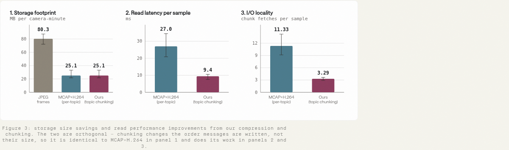

**关键观察**：JPEG 到 H.264 后体积由 80.3 降至 25.1 MB/相机分钟；分组布局不再减少体积，但读取约 27→9.4 ms，请求约 11.33→3.29 次。

**推理桥**：这意味着编码解决容量，布局解决读取放大。容量一样的两个文件组织仍可能有完全不同的采样性能。

**证据边界**：这些是特定访问负载下的测量，不能推出整个训练吞吐等比例增长；解码 CPU、缓存命中和 GPU 计算都可能成为下一瓶颈。 [原图与上下文](https://www.dyna.co/research/dyna-2-infrastructure)

### 流水线：把失败重试的粒度从整个作业缩到阶段

**阅读任务｜基础设施图4**：先看 master DAG，再看格式转换、metadata、labels、media 四组以及不同运行 profile。

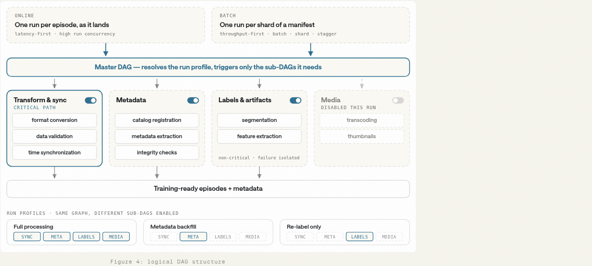

**关键观察**：Airflow DAG 把独立工作和关键路径分开；不同 profile 只触发所需子图。

**推理桥**：这意味着重新标注不必重复转码，非关键媒体处理失败也不必阻塞训练数据就绪。保存阶段状态和版本才使重试可追溯。

**证据边界**：DAG 的存在不能保证幂等性；每个输出的版本、完成标记、重试写入语义仍需实现。 [原图与上下文](https://www.dyna.co/research/dyna-2-infrastructure)

### 数据处理吞吐：整体改造的结果

**阅读任务｜基础设施图5**：横轴是时间，纵轴是每周处理的 episode-hours；按阶段理解增长。

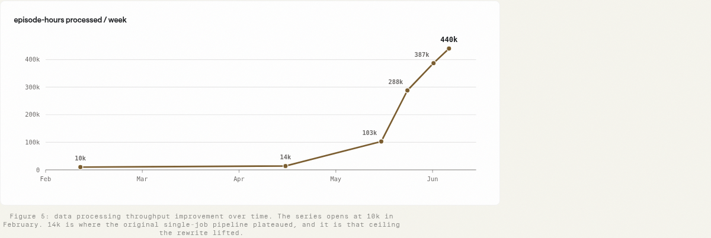

**关键观察**：披露吞吐从早期约 14k 小时/周增加到 440k 小时/周；错峰启动避免数据库突发压力，按字节打包减少任务偏斜。

**推理桥**：这意味着工程收益来自多处瓶颈的连续清除：任务更均匀、依赖服务更稳定，资源才能真正转成有效产出。

**证据边界**：时间趋势没有逐项控制变量，不能把约三十倍增长全归因于 Airflow 或某一个配置，也不能当成模型训练 samples/s。 [原图与上下文](https://www.dyna.co/research/dyna-2-infrastructure)

### 索引构建：把扫描海量对象变成查询元数据

**阅读任务｜基础设施图6**：先看优化前 walk files 与 step count 的长条，再看优化后一条查询。

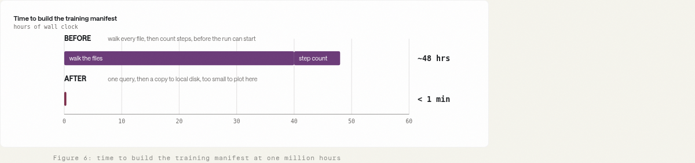

**关键观察**：训练 manifest 构建由约 48 小时降至一分钟内。生产数据库通过变更数据捕获 CDC 同步到数仓，所需计数与筛选可直接查询。

**推理桥**：这意味着最大的优化是改变计算位置：昂贵事实在写入时整理并持久化，读时只选取。海量 episode 下逐文件检查会产生请求风暴。

**证据边界**：这是构建清单的时间，不是首次下载训练数据、训练运行时间或 GPU 利用率；元数据新鲜度和漏同步仍需校验。 [原图与上下文](https://www.dyna.co/research/dyna-2-infrastructure)

### 索引加载：mmap 解决多进程副本放大

**阅读任务｜基础设施图7**：比较冷加载秒数与每节点驻留内存两幅柱图。

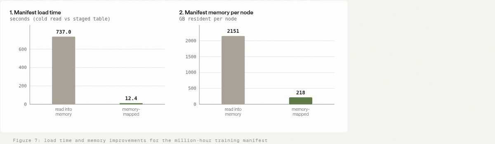

**关键观察**：加载约 737→12.4 秒，节点内存约 2151→218 GB；方案结合列式存储、本地一次下载、内存映射与按 rank 分片。

**推理桥**：这意味着避免每个进程都解析并复制一份巨大 Python 对象，能同时缩短启动和降低内存。mmap 将文件页映射到地址空间，由系统按需访问。

**证据边界**：不能把所有收益单独归因于 mmap；页面首次触达、随机索引与进程共享方式仍会影响实际内存和启动延迟。 [原图与上下文](https://www.dyna.co/research/dyna-2-infrastructure)

### 本地缓存：让反复训练不再反复跨云读

**阅读任务｜基础设施图8**：沿控制平面到不同集群，再到节点 NVMe 与云存储回源箭头读。

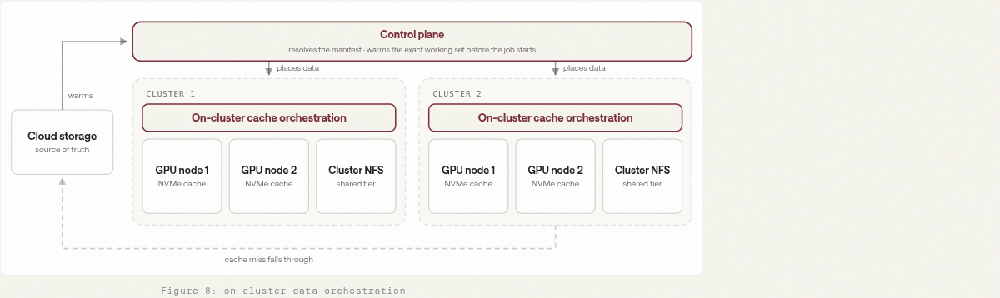

**关键观察**：Alluxio 缓存部署在集群附近，按工作集预热，未命中时再向云端取数；一致性哈希分配缓存归属。

**推理桥**：这意味着确定训练清单后可以提前准备数据，降低训练阶段外部对象存储的延迟与带宽不确定性。

**证据边界**：缓存不会消灭首次读取成本；工作集超容量、频繁换数据或预热不完整时收益会下降，也需要核算占用的节点资源。 [原图与上下文](https://www.dyna.co/research/dyna-2-infrastructure)

### 缓存性能：单读者估算不是整项作业工期

**阅读任务｜基础设施图9**：先读标题 one petabyte 和 single reader，再看 57.9 与 5.8 天。

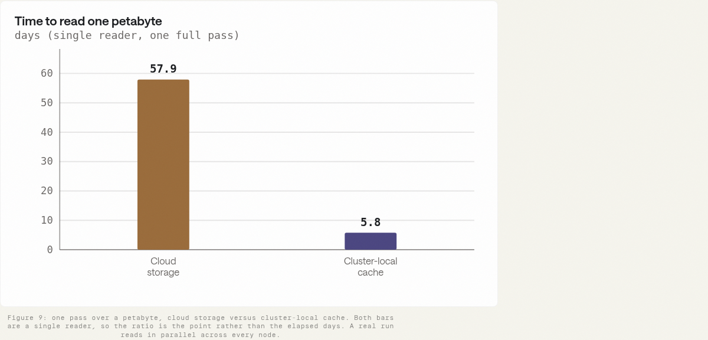

**关键观察**：图用云端约 200 MB/s 与集群缓存约 2 GB/s 的吞吐估算单读者读一遍 1 PB 的时间。

**推理桥**：这意味着数据复用可以明显缓解重复跨云搬运；合理的讨论对象是数据供给能力。

**证据边界**：不能说真实训练从 58 天缩成 6 天；并行读取、缓存填充、模型计算与重复采样会改变作业端到端工期。 [原图与上下文](https://www.dyna.co/research/dyna-2-infrastructure)

### Muon 优化器：用节点内重复计算换更少跨节点通信

**阅读任务｜基础设施图10**：左侧看结果跨整个作业广播，右侧看每个节点内部独立分片。

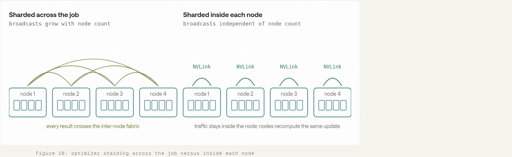

**关键观察**：Muon 的更新计算在节点内分摊，各节点重复计算相同更新，广播留在高速节点内互联；矩阵尺寸决定采用哪种策略。

**推理桥**：这意味着少算一点未必更快：当节点间通信昂贵时，多做局部计算反而降低全局等待。这里利用的是互联层级差异。

**证据边界**：这不表示整个训练不再跨节点通信；梯度同步等通信仍然存在。是否划算取决于拓扑、矩阵形状和优化器耗时占比。 [原图与上下文](https://www.dyna.co/research/dyna-2-infrastructure)

### 优化器耗时：平均值与尾延迟都要看

**阅读任务｜基础设施图11**：对比三种分片策略的中位数、均值与右侧广播量。

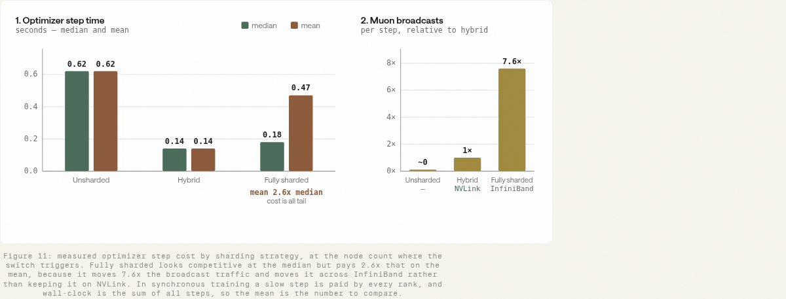

**关键观察**：未分片约 0.62 s；节点内混合策略约 0.14 s；全局分片中位数约 0.18 s、均值约 0.47 s，广播量更高。

**推理桥**：这意味着全局分片不仅平均更慢，还可能更不稳定；同步训练会被慢的一环拖住，中位数不足以描述等待成本。

**证据边界**：这只是优化器步骤。若它原占总步时一半，单项约 4.4 倍加速对总步时的理想收益仅约 1.63 倍：1/(0.5+0.5/4.4)，且未计重叠与新开销。 [原图与上下文](https://www.dyna.co/research/dyna-2-infrastructure)

### 可靠性：长期训练靠可恢复性维持有效吞吐

报告还描述 Slurm 预检、节点健康管理和自动恢复：区分本次启动可复位的硬件错误计数与终身累计计数；检查磁盘和容器日志；按每次尝试保存证据；对可恢复失败执行重排队；暂时隔离异常节点，并清理过期资源预留。Ansible 用于跨环境配置一致性。

这些机制的研究价值是缩短失败到恢复的时间，并避免恢复后又进入相同坏节点。系统“进程重新启动成功”与“训练数值和策略质量仍正确”是两回事，恢复还应核对 checkpoint、数据位置与随机状态。公开报告没有提供足够信息来证明所有恢复路径都严格保持训练等价。 [可靠性原文](https://www.dyna.co/research/dyna-2-infrastructure)

## 4 实验与结果分析

### 证据链先总览：哪一步支持哪一种主张？

| 问题 | 最强证据 | 本文判断 |
|---|---|---|
| 更多人类数据是否改善同域预测？ | 四档规模的人类留出集 | 在报告范围内强支持 |
| 能否迁移到机器人数据？ | 39 项离线任务，无机器人微调 | 支持跨域预测迁移；不等于控制成功 |
| 能否提升真实控制？ | 同后训练预算的 14 项闭环任务 | 中等支持，任务与试验数量有限 |
| 视频任务是否比仅动作监督更能扩展？ | 目标消融与固定动作数据实验 | 支持该配方下视频的额外价值 |
| WAM 是否普遍胜过 VLA？ | 早期模型、7 项任务的对比 | 证据有限，不能普遍化 |
| 基础设施能否使训练整体快几十倍？ | 多个不同阶段的局部测量 | 不支持这种合并解释 |

### 第一层：人类留出集上的规模趋势

**阅读任务｜模型图5**：横轴是对数尺度的数据小时；区分误差下降与阈值准确率上升。

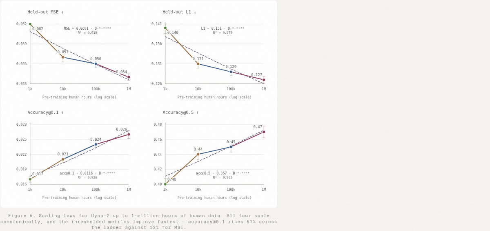

**关键观察**：四档数据上误差指标改善，严格阈值准确率的相对改善更明显；同一预测分布在不同指标上呈现的收益幅度不同。

**推理桥**：这意味着更多数据确实改善了人的动作建模，而非只让一个选定指标更好看。阈值指标更敏感于预测跨过可接受误差边界。

**证据边界**：四个规模点不能证明无穷外推的幂律，也不能给出计算最优配置；准确率的相对增加不能当作百分点增加。 [原图与上下文](https://www.dyna.co/dyna-2)

### 第二层：机器人离线迁移

**阅读任务｜模型图7**：分别看动作 MSE 与 accuracy@0.5，再分辨内部和外部任务曲线。

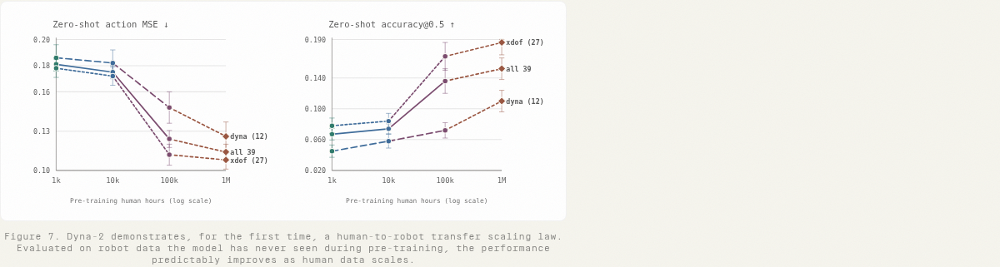

**关键观察**：预训练未见的 39 项机器人任务总体随人类数据增大而改善，包含 12 项内部任务和 27 项外部任务。

**推理桥**：这意味着收益跨越了人的身体与机器人身体，支持预训练表示存在可迁移结构，而非仅记住人类评估数据的局部统计。

**证据边界**：MSE 衡量预测与参考动作的差异，多种有效动作会让该指标不完美；离线误差改善也不保证闭环时误差不会累积。 [原图与上下文](https://www.dyna.co/dyna-2)

### 第三层：真实机器人闭环

**阅读任务｜模型图8**：先看 14 项任务平均归一化得分，再看下方示例任务；此截图只覆盖轮播默认可见任务。

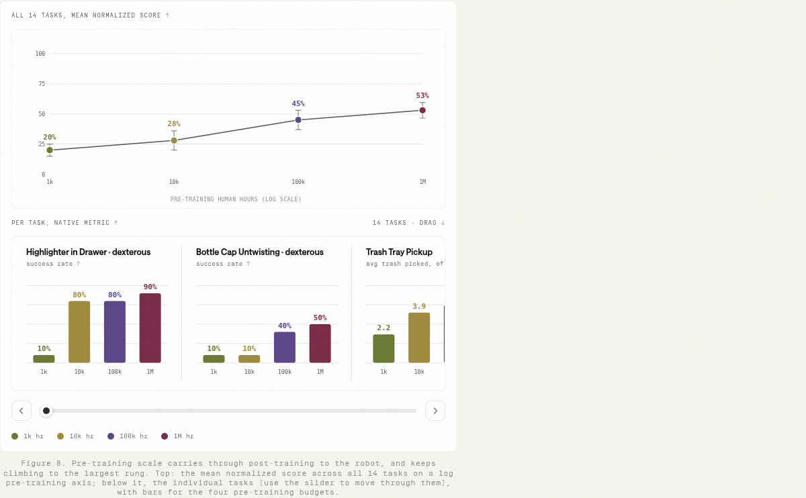

**关键观察**：四档预训练的平均得分约 20%、28%、45%、53%；后训练每任务至多约十小时。评估覆盖夹爪、灵巧手和带语言任务的半人形平台。

**推理桥**：这意味着在给定相同后训练条件下，更大人类预训练确实能转化为控制收益，比离线曲线更接近实际用途。

**证据边界**：这是归一化任务得分，不是统一成功率。单任务约十次试验、语言任务十二次，估计不够精细；不能把默认轮播截图说成已逐一核验全部任务表现。 [原图与上下文](https://www.dyna.co/dyna-2)

### 目标消融：为什么“联合”还不够？

**阅读任务｜模型图10**：横轴比较动作标注数据规模，三条曲线分别是动作单任务、联合目标和额外视频训练。

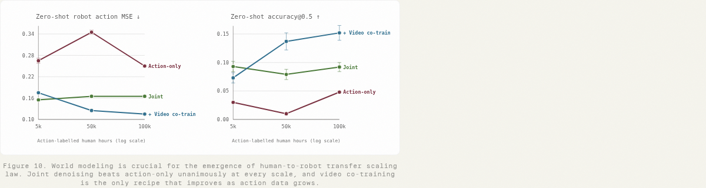

**关键观察**：联合目标优于只学动作，但并非随规模单调改善；加入视频训练的配方在更大规模上呈现更好的趋势。

**推理桥**：这意味着“存在视频分支”与“视频监督形成可扩展收益”不是同一个命题，数据混合和训练目标共同影响泛化。

**证据边界**：不能由这个消融断言任何视频联合目标都更好；计算预算、损失权重与混合比例若未严格对齐，仍可能参与解释差异。 [原图与上下文](https://www.dyna.co/dyna-2)

### 固定动作监督：额外视频本身有没有用？

**阅读任务｜模型图11**：分别看固定 50k 与固定 250k 小时动作数据的实验；横轴只增加视频数据。

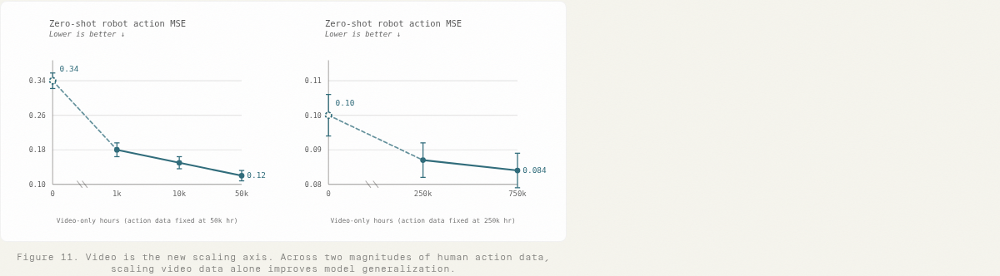

**关键观察**：固定动作数据时，增加额外视频仍降低机器人动作预测误差。

**推理桥**：这意味着迁移提升不能仅归结为更多动作标签；没有动作监督的视频也能贡献对机器人有用的视觉动态知识。

**证据边界**：这是特定数据与配方的效果，不等于随便加入任意互联网视频都会有效；视频来源和任务相关性仍需实验。 [原图与上下文](https://www.dyna.co/dyna-2)

### 关键辨析：人类指标可能不是机器人泛化的代理指标

**阅读任务｜模型图12**：同图比较各自归一化的人类与机器人误差，先看趋势而非跨域绝对数值。

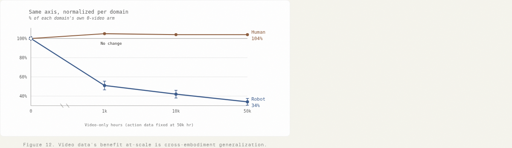

**关键观察**：增加视频后，人类动作误差近似不变甚至略差，机器人误差明显下降。

**推理桥**：这意味着只用人类留出误差选择配方可能错过更好的迁移模型；优化源域预测与学习可迁移表示并不完全一致。

**证据边界**：图中两条线按各自基准归一化，不能直接比较人类与机器人任务谁更容易，也不足以识别内部表征变化的因果机制。 [原图与上下文](https://www.dyna.co/dyna-2)

### WAM 对 VLA：有价值，但证据范围较窄

**阅读任务｜模型图13**：先看以 VLA 为 1 的归一化柱图，再看较宽的置信区间。

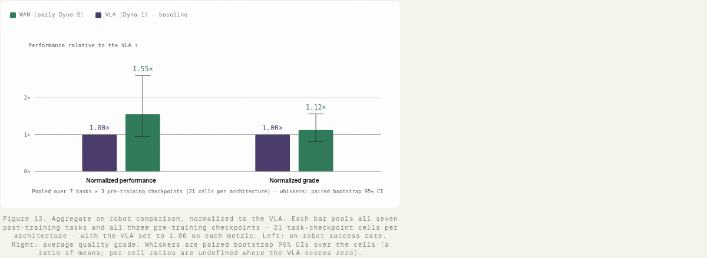

**关键观察**：早期 WAM 在七项任务上归一化成功表现约 1.55，分级得分约 1.12；比较使用三个预训练 checkpoint，并采用配对 bootstrap。

**推理桥**：这意味着世界模型路线在受测设置中值得继续投入，不同评价维度也表明收益并非同等强。

**证据边界**：这是早期 action-only WAM 与具体 Qwen3-VL 初始化基线的比较，不是百万小时最终模型对所有 VLA 的结论；checkpoint 配对也不能取代独立训练重复。 [原图与上下文](https://www.dyna.co/dyna-2)

### 新生产站点：泛化差距出现在分布变化时

**阅读任务｜模型图14**：先看两者在内部评估均为 100%，再看新客户站点。

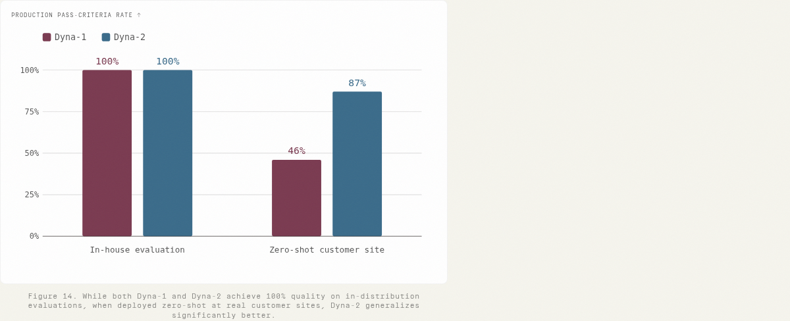

**关键观察**：内部测评无法区分两个系统，新站点约为 46% 对 87%。

**推理桥**：这意味着只在熟悉环境测评容易出现天花板效应；新场景能揭示表面相同分数背后的泛化差异。

**证据边界**：生产模型还包含不同配方与工程改进，不能把全部差值归因于数据小时数；新站点 zero-shot 不是完全无机器人后训练。 [原图与上下文](https://www.dyna.co/dyna-2)

### 语言遵循：得分定义影响结论

**阅读任务｜模型图15**：横向比较三种版本，纵轴是含部分得分的语言遵循分数。

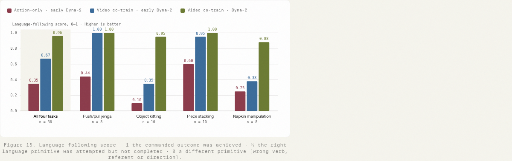

**关键观察**：总体约 35%→67%→96%；选对语言动作但执行失败可计部分分数。

**推理桥**：这意味着视频学习与生产改进可能改善指令对齐，但评价同时混合了选择正确动作与完成执行两个因素。

**证据边界**：96% 不能直接改写为任务成功率；必须分开语言选择正确率、条件执行成功率与最终完整成功率。 [原图与上下文](https://www.dyna.co/dyna-2)

### 单步生成表：速度提升以后，质量还剩多少？

**阅读任务｜表1（本文为原文未编号表加的编号）**：同时看 NFE、采样器毫秒、FVD、运动与闪烁。FVD 是生成与真实视频在特征空间的分布距离，通常越低越好；运动、闪烁都是代理指标，不能单独代表物理正确性。

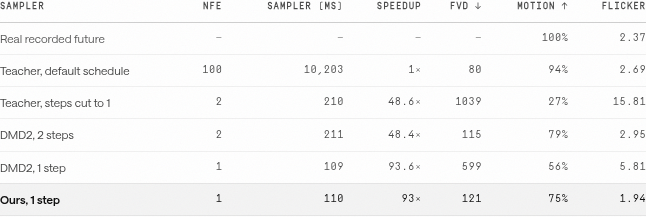

**关键观察**：在披露的 H100 测试中，多步教师约 10,203 ms，单步方案约 110 ms。直接砍步数会让 FVD 从教师的 80 恶化到 1039；报告方法为 121。DMD2 两步约 211 ms、FVD 115，单步约 109 ms、FVD 599，说明速度相同并不保证质量相当。

**推理桥**：这意味着主要贡献是让单次网络计算仍保持较好的视频分布质量，而非单纯减少调用次数。与两步蒸馏相比，单步方案更快，但 FVD 略差，应该按速度—质量权衡解释。

**证据边界**：这里测的是三秒三视角视频的采样器，不是端到端机器人控制延迟。低闪烁也可能来自不动的画面，必须结合运动指标与样例；这些视频指标不能单独证明动作策略更安全或更成功。 [表格原文](https://www.dyna.co/dyna-2)

## 5 论文的贡献与影响

### 真正值得带走的三件事

**研究上，数据价值应在目标域检验。** 最有启发性的结果并不只是百万小时，而是人类指标近乎不变、机器人指标继续改善。它要求重新思考预训练模型选择：源域最优 checkpoint 未必是机器人迁移最优 checkpoint。

**方法上，视频训练可以服务动作，而不必让动作等待完整视频生成。** 要区分训练时丰富监督与部署时必要计算。否则容易把一个有效预训练方向变成不可接受的控制时延。

**系统上，扩展性的前提是可以反复重建相同实验。** 数据格式、版本、清单、缓存与恢复共同决定实验周转。没有这些能力，规模更大的单次训练可能能跑通，却难以可靠消融和复现。

### 对当前训练速度优化：按实际瓶颈选择最小验证

下表是基于报告推导的迁移建议，并非声称已在 Xiaomi-Robotics-1 复现，也没有启动 GPU 任务。

| 观察到的现象 | 借鉴思路 | 最小验证与判据 |
|---|---|---|
| 启动前长时间扫描对象 | 预计算计数、列式 manifest | 固定同一数据选择，对比构建时间，并验证样本 ID 与权重一致 |
| 每个进程内存都随 episode 数增长 | mmap、共享数据、按 rank 索引 | 固定进程数比较节点 RSS、加载时间与索引正确性 |
| GPU 等数据，CPU 或网络繁忙 | 存储局部性、GOP、工作集缓存 | 固定采样序列，分别测冷/热缓存的 p50/p95 取样耗时和有效训练吞吐 |
| 优化器占步时较高且跨节点广播多 | 节点内分片、重复局部更新 | 先核对相同梯度下参数更新误差，再测总步时与尾延迟 |
| 长任务频繁重启，恢复结果不可信 | 按尝试留证据、恢复状态验证 | 用受控中断核对 checkpoint、数据游标与短窗口损失连续性 |

最小验证应先定位墙钟时间花在哪，再优化最大的可控部分。增加缓存前先测命中率；改优化器前先确认其占比；改变视频编码前先核对解码像素与时间戳误差是否影响监督。任何系统加速都需要确认采样分布和训练语义没有悄悄改变。

### 未来最值得补的实验

一是保持计算预算一致，对比更多独立视频与更多重复 epoch，以分离数据多样性和计算量。二是固定动作标签量和来源，系统改变额外视频的任务相关性，测“什么视频有用”。三是在机器人迁移指标上选择 checkpoint，并在另一组未见任务验证，以避免选择偏差。四是跨独立随机种子、更多站点重复闭环测试，报告完整失败分类，而非只给平均分。

## 6 结论

**最终判断：值得重点读，但要按证据层次使用。** Dyna-2 把大规模人类视频、机器人迁移验证和可重复的数据系统联系起来；最强的阅读主线是“人类数据增长 → 跨域预测改善 → 同后训练预算下闭环收益”。其证据仍受任务覆盖、重复次数和公开实现细节限制，不能据此推导所有机器人任务的通用规律。

如果只精读三处：先读模型图11—12，理解为什么视频监督的价值不能只看人类误差；再读图7—8，区分离线迁移与真实闭环；最后读基础设施图6—11，学习如何把索引、数据读取与优化器瓶颈分别定位。对于当前训练优化，工程报告更适合形成可测量假设；对于预训练路线选择，模型报告提供方向性证据，仍需自己的受控实验。

### 来源、版本与阅读范围

- [Dyna-2 官方模型报告](https://www.dyna.co/dyna-2)：数据、模型、训练目标、机器人实验与蒸馏。引用以“模型图 N”定位。
- [Dyna-2 官方基础设施报告](https://www.dyna.co/research/dyna-2-infrastructure)：数据系统、缓存、优化器与可靠性。引用以“基础设施图 N”定位。
- [本次使用的 paper-deep-reader skill](https://github.com/Linwei-Chen/paper-deep-reader-skill)：提供六段结构、关键图解读和可追溯检查流程，不作为模型事实来源。

两篇官方 HTML 的图号分别计数，没有 PDF 页码。本文嵌入 23 个关键图表，保留 29 张编号图的清单，另给一张原文未编号表添加本文编号。模型图1、4、6、9、17、18主要为展示或例子，图2为概览，未作为独立定量证据；未逐帧审核演示视频。图8的截图只包含轮播默认可见内容。正文中的工程迁移建议与标量例子属于本文解释，不是原文新增实验。
