# ε4P 深读：混合数据，分区监督

Imperfection for Precision: Upcycling Imperfect Data for High-Precision Robotic Manipulation · Hao Wei 等 · arXiv:2609.26672v1 · 2026-09-22 · 中文深读

> **先看重点**：ε4P把数据混合从“每种来源占多少”扩展为“每种来源在哪些噪声水平提供监督”。低精度同任务数据保留任务信息，高精度异任务数据提供动作监督；高质量目标数据贯穿全区间。关键是采样分布、边界诊断和有效性证据，而不是新动作网络。

## 1 核心思想一句话总结

按噪声区域分配不同来源的监督，用真实机器人对照检验低精度数据的价值。

## 2 论文背景与动机

### 真正的困难：正确任务与精确动作，不一定来自同一批数据

设目标是把ATX电源接头插进主板。昂贵的机器人遥操作示教既知道插在哪里，又提供较精确的动作；便携采集可能覆盖同一目标，却在轨迹恢复或执行细节上不够准确；另一项插头任务的遥操作动作很精确，但目标位置、物体和任务指令不同。直接把三类数据混在一起，会同时引入有用经验和不匹配监督。

这里讨论的是**动作示教精度**，不是FP16、BF16等数值计算精度。“低精度”也不是“失败轨迹”的同义词：任务可以完成，但示教动作与机器人精细控制所需的分布仍有差异。作者试图保留每类数据可靠的部分，降低不可靠部分对目标策略的影响。[正文 §I、III-A](https://arxiv.org/html/2609.26672v1)

### 必要概念与术语

**VLA**是根据图像、语言和机器人自身状态生成动作的模型。本文以预训练π₀.₅为基础策略，在机器人任务上训练；不能将这里数百条示教的结果解释成通用预训练缩放规律。

**动作块（action chunk）**是一段未来动作序列，记作a，形状为H×d；H是步数，d是每步动作维数。**条件c**包含视觉、任务指令和本体状态。本体状态指机器人自身姿态等观测。

**流匹配**让网络学习从噪声到动作的变化方向。**流时间t**控制噪声程度，本文t=0为干净动作、t=1为纯噪声；它既不是示教帧号，也不是训练进行了多少步。

**准入区间**是某个数据源允许采样t的范围。**AUC**衡量分类器对正负样本的排序能力；在这里接近0.5表示难以区分两种来源，不意味着已经证明分布完全相同。

### 图1：先看信息分工，再看时间区间

阅读任务：上排三栏分别区分任务匹配和精度匹配；下排横轴从干净动作走向噪声。绿色条覆盖全区间，蓝色与橙色只覆盖两端。

**阅读任务**：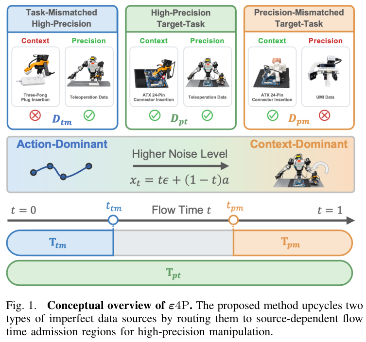

**关键观察与推理桥**：高精度目标数据D_pt始终参与；低精度同任务D_pm进入高t端；高精度异任务D_tm进入低t端。图中的“主导”描述模型预测对输入的相对敏感性，不是硬切换三个专家。模型参数仍然共享，两个辅助区间之间也无需填满：中间仍有目标数据监督。

**证据边界**：这张图定义了假设，不能单独证明分工有效。接下来要回答两个问题：这些边界怎样估计，以及相同数据量下改变区间是否真的改善控制。[图1，PDF p.1](https://arxiv.org/pdf/2609.26672v1#page=1)

### 相对普通混合训练，最小改动是什么？

| 环节 | 普通混合 | ε4P | 代价或前提 |
|---|---|---|---|
| 来源采样 | 按π抽数据源 | 保持对照中的π | 仍须确定实际来源概率 |
| 噪声时间 | 各来源覆盖全区间 | 按来源截取范围后均匀采样 | 需要额外离线诊断 |
| 动作监督 | 标准流匹配 | 保留原目标 | 不会自动修复错误标签 |
| 策略网络与推理 | 原策略 | 不新增推理模块 | 收益主要来自训练分布变化 |

## 3 核心方法/模型详解

### 一条样本：从数据源到带噪动作

用ATX任务贯穿说明。先按来源概率π抽到低精度目标任务数据，再取动作块a与其自己的条件c。假设该任务已估计出下界0.7，就在[0.7,1]均匀抽t。此处0.7是作者ATX实验的边界，不能直接用于所有任务。

抽标准高斯噪声ε，按正文式(1)构造：

```text
x_t = (1 − t) a + t ε
```

网络预测速度v̂(x_t,c,t)。沿这条线性路径，监督方向为ε−a；正文式(2)用`â=x_t−t v̂`构造动作空间读数。这个读数用于比较扰动造成的预测变化，不等于完整多步推理求解器。

教学标量例子：a=0.8、ε=−0.2、t=0.8，则x_t=0，目标速度为−1。如果网络恰好预测−1，读数`0−0.8×(−1)=0.8`恢复原动作。实际计算对整个动作块逐元素进行。噪声时间只决定训练输入的扰动程度，不能按t=0.8解释为“动作完成80%”。[正文式1–2，PDF p.3](https://arxiv.org/pdf/2609.26672v1#page=3)

### 两种边界：数据可分性与策略依赖性

阅读图2时，先比较两侧流程的输入：左侧问带噪动作能否暴露数据来源；右侧问策略对动作输入和任务条件分别有多敏感。它们针对两种不同的不匹配，不能共用一个质量分数。

**阅读任务**：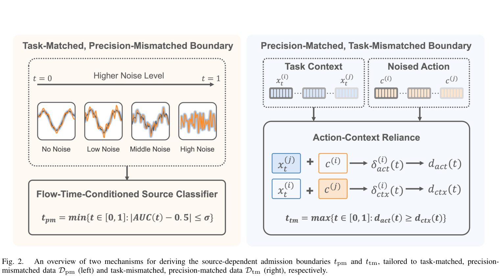

**关键观察与推理桥**：左侧随着噪声增大，两类动作的差别可能被淹没；右侧分别替换x_t和c，比较输出变化。**原图右上标题与符号存在错位**：Task Context栏下画的是x，Noised Action栏下画的是c。本文按正文定义与下方公式解释：x是带噪动作，c是条件，不沿用这个图示错位。

对异任务数据，分类器能分辨两类动作，可能仅因为它们确实在执行不同任务；因此不能把这个差异都解释成精度不足。这就是右侧需要策略探针的原因。[图2与 §III-C，PDF p.2–4](https://arxiv.org/pdf/2609.26672v1#page=2)

**证据边界**：这是一张诊断流程示意图，没有给出分类器校准误差或跨任务可靠性。

### 低精度边界：分类器到底看什么？

对D_pt与D_pm加同一流时间水平的噪声，训练来源分类器，得到留出集AUC(t)。正文式(6)选择最早满足`|AUC(t)−0.5|≤0.05`的t，记作t_pm；之后只在[t_pm,1]使用低精度来源。0.05在各任务固定，并非按机器人成功率搜索得到。

项目页链接的附录B补充了可操作细节：每个窗口30步，每步7维，表示相对末端位置xyz、姿态roll/pitch/yaw与夹爪；四元数先转换为欧拉角，角差折回[−π,π]。分类前使用训练集统计标准化，分类器为L2正则逻辑回归，C=1；多次噪声实现得到曲线，置信区间按episode整体bootstrap，而不是把同一轨迹的相邻窗口当独立样本。[附录B](https://varepsilon4p.github.io/appendix.pdf)

这些细节有直接影响：角度在π附近若不处理周期性，会人为制造大距离；按窗口随机划分可能把同一条轨迹泄漏到训练与验证；标准化不一致可能让分类器主要识别单位与幅度。附录并未给出所有加载、划分与分类器组织代码，不能声称已经获得逐函数可运行复现。

**本文判断**：AUC接近随机只是“此分类器在此特征空间中分不清”。逻辑回归能力不足、任务速度差异、坐标偏差，都可能影响边界。若曲线多次穿越阈值，首次进入也不保证之后一直不可分；这需要额外稳定性检查，原式没有解决所有这种情况。

### 异任务边界：怎样测量模型更相信动作还是条件？

固定样本i，在不同episode中选同任务样本j作为替换对象。先算原预测â(x_i,c_i,t)，再分别计算：

```text
δ_act(t) = || â(x_i,c_i,t) − â(x_j,c_i,t) ||²
δ_ctx(t) = || â(x_i,c_i,t) − â(x_i,c_j,t) ||²
```

第一项换动作输入，第二项换条件。按样本聚合，再除以“动作与条件一起替换”产生的共同变化量D(t)，得到d_act和d_ctx。二者是归一化敏感度，不是概率，不要求和为1；当D(t)>0时，共同除数不会改变两条曲线的交点。[正文式3–4、附录A](https://varepsilon4p.github.io/appendix.pdf)

阅读图3：横轴仍是噪声时间，蓝线是动作替换敏感度，橙线是条件替换敏感度。应关注交点和两侧相对大小，而不是把纵轴当注意力权重。


**阅读任务**：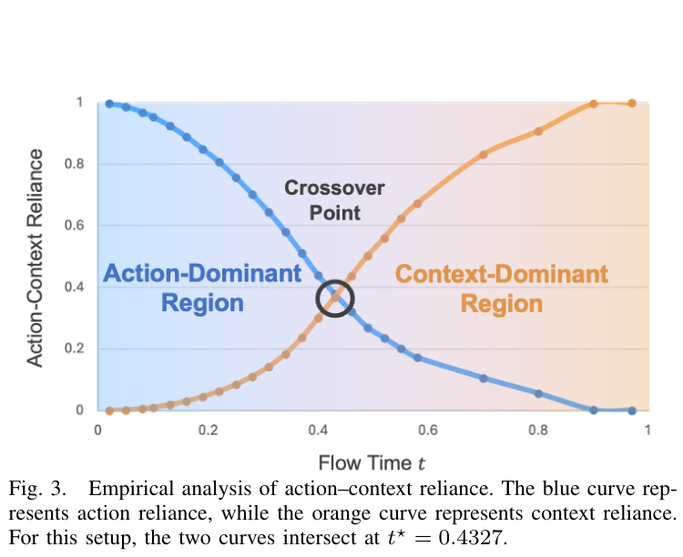

**关键观察与推理桥**：Cable设置下交点为0.4327。低t区动作依赖更强，作者据此允许异任务高精度数据进入；高t区条件更重要，因此限制异任务监督。**证据边界**：图支持这一特定模型与探针设置下的经验规律，不能证明所有策略、任务或训练阶段都有单一交点。[图3，PDF p.3](https://arxiv.org/pdf/2609.26672v1#page=3)

附录A的关键实现约束是：i与j使用**各自独立的噪声**，每个噪声在整条t扫描中固定；替换配对也固定，跨checkpoint复用同一组样本、配对与噪声。若共享噪声，两个输入的差会变成`(1−t)(a_i−a_j)`，在高t端必然趋零，人为压低动作敏感度。轨迹等权、轨迹内窗口均匀平均，避免长轨迹支配估计。

还有一个解释边界：式(2)的读数本身含有x_t的直接路径；t=0时â=x_t，天然不依赖c。因此低t动作敏感包含读数定义的结构影响。替换后的x_j与c_i虽然各自来自真实数据，组合却未必来自真实联合分布。这个探针可以作为实用诊断，但不能直接当作网络内部因果机制的完整证明。

### 离线校准：边界不是拿预训练模型一次就能确定

阅读附录表6：左列是仅用高质量目标任务数据进行校准的步数，中列是交点，右列是相邻记录的变化。它揭示边界会随策略学习而移动。

**阅读任务**：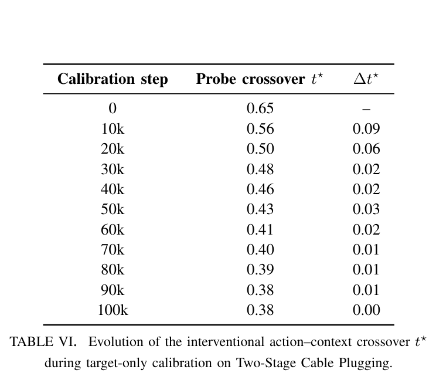

**关键观察与推理桥**：从初始0.65到50k步约0.43，再到100k步约0.38，说明异任务边界具有策略依赖性。附录明确使用50k校准checkpoint估计边界，100k仅用于额外诊断；50k时未四舍五入的交点0.4327按Δt=0.1向下取整为0.4，训练时仍在[0,0.4]连续均匀采样，**不是只在0、0.1、0.2等离散点训练**。[附录C、表6](https://varepsilon4p.github.io/appendix.pdf)

**证据边界**：因此实际流程至少包含高质量目标数据校准、探针计算、固定边界后的混合训练。校准是额外成本。原文没有充分给出完整作业脚本，混合训练初始化与校准权重的衔接、完整优化器状态等不能自行补齐。不同训练阶段重新估计边界可能有价值，但那是新实验，不是原方法已实现的在线调度。

### 采样实现：改变联合分布，而不是丢弃大部分样本

正文 §III-D规定先按π取源，再在该源区间均匀取t，边界离线计算后固定。ATX的示例可以理解为：目标高质量[0,1]；低精度同任务[0.7,1]；高精度异任务[0,0.3]。每个来源继续使用自己的动作及条件，没有把异任务动作偷偷配成目标任务指令。

以下为**教学伪代码**，不是官方源码。张量约定B为批量，H为动作长度，D为动作维度；mask与损失归约应沿用实际基座，正文没有披露作者所有掩码细节。

```python
# source_id: [B]；action: [B,H,D]
# bounds: 各来源的固定 [low, high]，由离线诊断给出
lo = bounds[source_id, 0]
hi = bounds[source_id, 1]
t = lo + (hi - lo) * torch.rand(B, device=action.device)
eps = torch.randn_like(action)
x = (1 - t[:, None, None]) * action + t[:, None, None] * eps
velocity_target = eps - action
velocity = policy(x, context, t)
loss = base_flow_loss(velocity, velocity_target, valid_action_mask)
loss.backward()
```

真实实现还要保证来源ID保留到batch、边界在[0,1]内且区间长度为正、t形状广播正确。不是给不同来源建不同专家，也不需要新增推理时质量分类器。论文只声明保留原有π；数据条数不等于采样概率，不能从表1按数量比例倒推出作者确切π。

如果先在[0,1]抽t，再丢掉不在区间的样本，来源接受率会变成区间长度；若三源原来等概率，两个辅助区间各0.3，这样丢弃会把相对来源比例改成1:0.3:0.3。区间内直接重采样则保持原比例。除非拒绝采样会一直重抽同一源直至接受，两种实现并不等价。

### 梯度机制：噪声减弱输入差异，却没有清除标签偏差

以下为本文推导。设低精度标签ã=a+δ，使用相同噪声，则输入差为`x̃_t−x_t=(1−t)δ`。例如δ=0.1，t=0.8时输入差缩小到0.02；但速度目标差仍是`(ε−ã)−(ε−a)=−δ`。所以“高噪声洗掉标签错误”并不成立。

更准确的理解是：方法限制不同来源在哪些条件分布下形成梯度。若单样本损失为ℓ，则期望目标可以由采样规则写成：

```text
L = Σ_s π_s / |T_s| · ∫_(t∈T_s) E_(a,c∼D_s)[ℓθ(a,c,t)] dt
```

这里|T_s|是区间长度。这是本文对采样分布的等价表达，不是论文新增公式。辅助源进入更窄区间后，源的总采样量未变，但区间内的监督密度上升；[0.7,1]相对全区间的密度为1/0.3≈3.33。没有增加显式loss权重，也可以改变有效训练分布。

共享网络的参数仍然接收所有来源梯度，时间条件并不会物理隔离参数。若不同t的梯度高度耦合，低质量数据仍可能影响低噪声输出。是否有效要看后面的控制实验，而不能从分区图直接推导“绝不污染精度”。推理沿原策略求解，仍要经过反归一化、动作接口与闭环执行；本文没有披露新的推理步数、控制频率或硬件加速方案。

## 4 实验与结果分析

### 图4与表1：实验究竟覆盖哪些差异？

先看图4的四个任务：前三个是目标任务，右下三孔插头是共享辅助任务。相同机器人平台有助于减少身体差异，但限制了结论外推范围。

**阅读任务**：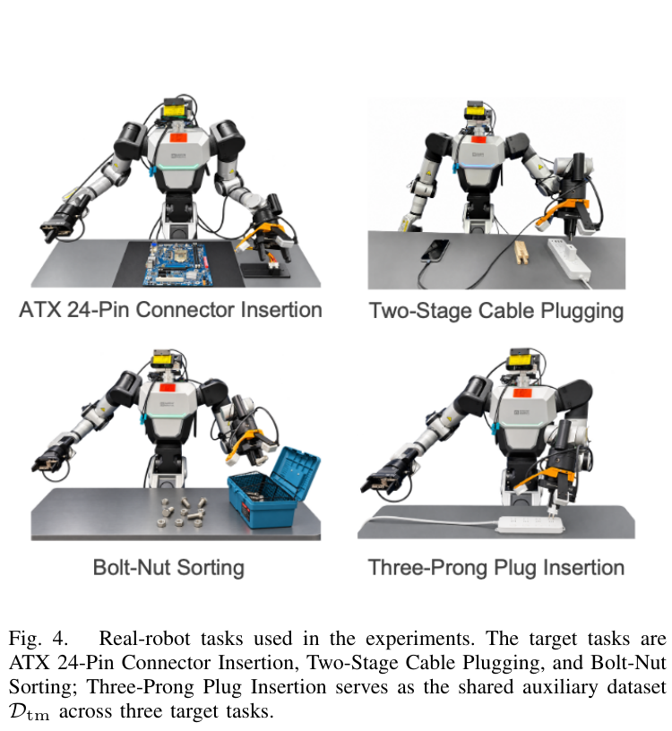

**关键观察与推理桥**：作者使用RB-Y1；高质量由遥操作采集，低精度由自建UMI系统采集。两路均使用D405视觉，UMI视角与夹爪配置尽量匹配机器人。ATX约0.2mm、Cable第二阶段约0.3mm是任务的名义几何间隙，**不是论文测得的UMI误差标准差**。Sorting用于检验较宽松任务；图不能说明方法已解决跨机器人、跨相机的大域差异。[§IV、图4，PDF p.4](https://arxiv.org/pdf/2609.26672v1#page=4)

表1先区分原有目标高质量D_pt与新增同类D_pt⁺：后者用于“以不完美数据替代新增高质量数据”的比较，不是从训练里删除全部高质量数据。

**阅读任务**：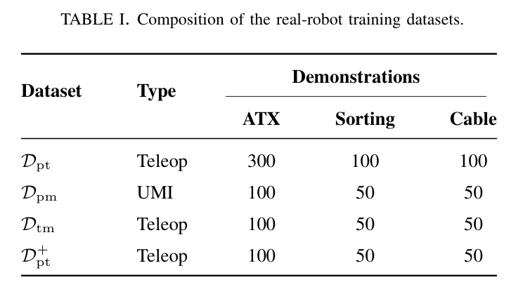

**关键观察与推理桥**：ATX基础300条，另有低精度、异任务、补充高质量各100条；Sorting和Cable各有基础100条，其余各50条。这是示教条数，不是小时、窗口数量或独立动作标签数。**证据边界**：它支持小规模目标任务适配实验，不能回答百万小时混合训练的收益或成本。[表1，PDF p.5](https://arxiv.org/pdf/2609.26672v1#page=5)

### 表2：直接混合真的有害吗？

阅读任务：以第一行“只用高质量目标数据”为基线，再看增加两种来源的变化。三列都是完整任务成功率，越高越好。

**阅读任务**：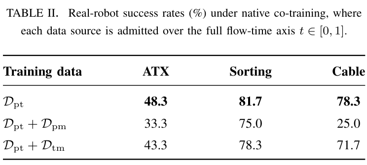

**关键观察与推理桥**：Cable加入低精度同任务数据后从78.3%降到25.0%，而加高精度异任务数据为71.7%。这表明两种不匹配的伤害不同，也说明更多目标相关示教并不必然更好。**证据边界**：它尚未证明坏处来自某段t；要归因到噪声区域，还需固定数据改变准入规则。[表2，PDF p.5](https://arxiv.org/pdf/2609.26672v1#page=5)

### 表3：同样的来源，改区间后发生什么？

看上下两组：上半部分是全区间混合，下半部分是按来源分区。Cable有Stage 1与Stages 1–2，完整成功应读最右列，不能把第一阶段100%当整个任务100%。

**阅读任务**：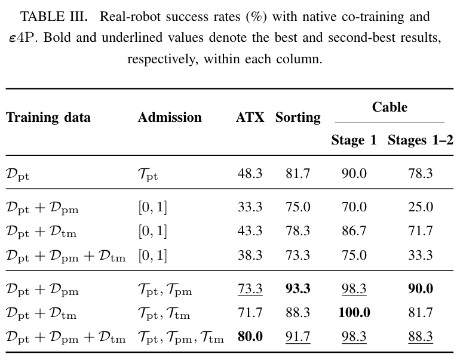

**关键观察与推理桥**：ATX三源直接混合38.3%，分区80.0%；与只用目标数据48.3%相比增加31.7个百分点，与相同三源直接混合相比增加41.7个百分点。这两个比较基线不同。Sorting与Cable的三源结果为91.7%与88.3%，却略低于只加入低精度来源并分区的93.3%与90.0%。因此，“来源互补”不等于来源越多成绩必然越高。[表3，PDF p.5](https://arxiv.org/pdf/2609.26672v1#page=5)

**证据边界**：作者每个任务通常60次试验，一次成败约对应1.67个百分点。93.3%与91.7%只差一次，不能仅据这点差异确定某组合稳定优于另一组合。主要提升幅度很大，但跨训练随机种子的方差、全部成功率置信区间和评估过程细节仍不足以支撑任意强的泛化结论。

### 图5：是不是仅仅减少坏数据权重就够了？

从左到右读三个问题：降低低精度来源的全局loss权重；扫描ATX边界；扰动Cable异任务边界。

**阅读任务**：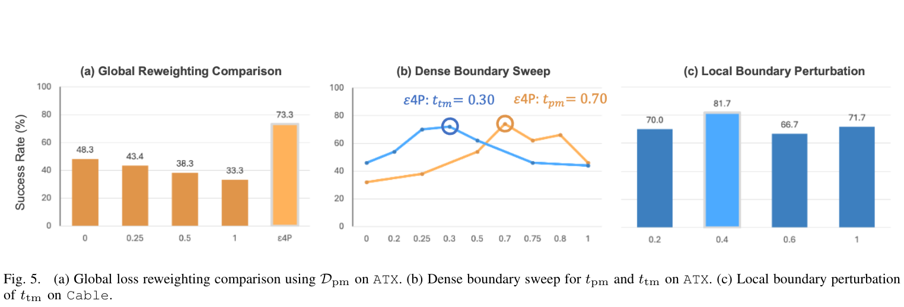

**关键观察与推理桥**：图5(a)所测非零全局权重均未超过目标数据基线48.3%，而分区达到73.3%。这支持“改变监督出现位置”在此设置下优于这些全局降权选项，不能推出优于所有动态加权方法。

**证据边界**：图5(b)给出ATX的t_tm=0.30与t_pm=0.70，落在各自较好区域；图5(c)中Cable的0.4为81.7%，相邻0.2和0.6为70.0%、66.7%。作者说明扫描是验证离线诊断，不是用闭环成绩选阈值。曲线没有完整不确定性带，不能把单个点解释成精确全局最优。[图5，PDF p.6](https://arxiv.org/pdf/2609.26672v1#page=6)

### 表4：选反区域会怎样？

这张表比较原区间与相反方向窗口，回答“是否随便截掉一段t也有用”。

**阅读任务**：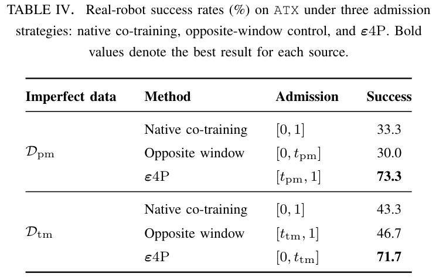

**关键观察与推理桥**：低精度来源在正确高t区域为73.3%，反向窗口30.0%；异任务来源正确低t区域为71.7%，反向窗口46.7%。方向性证据明确。**证据边界**：但ATX边界0.7与0.3使正确窗口长度0.3、反向窗口长度0.7，**窗口位置与宽度同时变化**；因此这不是严格等宽位置消融。更强的验证应对比等长滑动窗口，同时固定来源曝光和训练预算。[表4，PDF p.6](https://arxiv.org/pdf/2609.26672v1#page=6)

### 表5：平均只下降4.2个百分点，替代的是什么？

先找“基础高质量+新增高质量”的参考行，再与新增等量低精度或异任务数据比较；基础高质量锚点一直存在。

**阅读任务**：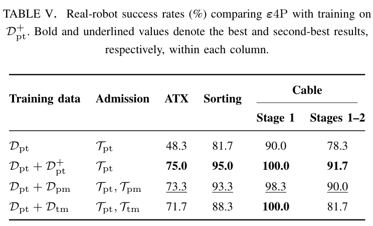

**关键观察与推理桥**：低精度分区相对参考在三项完整任务均约少1.7个百分点；异任务分区差距约3.3、6.7和10.0个百分点。两种来源×三个任务的六个差值平均约4.2，**不代表每一来源都只损失4.2，更不代表无需目标高质量示教**。**证据边界**：表中接近的分数也不构成统计非劣效证明；但它给出了减少新增高质量采集需求的有价值证据。[表5，PDF p.7](https://arxiv.org/pdf/2609.26672v1#page=7)

### 哪些结论更可信，哪些仍然薄弱？

| 主张 | 当前支持 | 关键边界 |
|---|---|---|
| 分区比同来源全区间混合更好 | 受测任务的直接对照较强 | 单平台、小规模与有限试验 |
| 两类不匹配适合不同区域 | 探针、扫描和反向窗口提供中等支持 | 探针结构效应、窗口宽度混杂 |
| 离线边界能定位有效区域 | 部分任务验证支持 | 依赖模型阶段与诊断器能力 |
| 任意跨身体数据也能这样混合 | 尚未验证 | 视角和身体在实验中尽量匹配 |
| 可以完全替代高质量目标数据 | 不支持 | 所有方案都保留目标高质量锚点 |

最可信的是所测设置下的策略收益，最容易夸大的是把“可用噪声区间”当作数据源固有、通用、精确的质量标签。

## 5 论文的贡献与影响

### 可迁移的贡献：把数据混合写成p(来源,噪声时间)

传统数据工程经常只讨论来源概率π_s。本文让人看到，同一条样本在不同t处提供的监督价值可能不同，因此可以设计`p(t|s)`。这个视角对其他流匹配动作策略也有启发，但从π₀.₅迁移到DM0.5或其他模型时，噪声方向、动作空间、基座时间分布、归约和参数更新范围都要重新核对。

尤其要注意：“保持原来源比例”与“保持原噪声分布”是两回事。若自己的基线使用Beta时间采样，直接改成区间均匀采样同时改变了整体时间分布；应该额外比较均匀全区间基线，避免把分布形状的收益全归因于来源准入。

### 后续最小验证与复现设计：让结论能被推翻

| 待检验问题 | 建议最小比较 | 应记录的结果 |
|---|---|---|
| 区域位置还是窗口宽度起作用？ | 固定长度，滑动窗口中心 | 成功率与各t段验证损失 |
| 弱分类器是否给出错误边界？ | 逻辑回归与一个更强分类器；保持episode划分 | AUC曲线、边界稳定性 |
| 模型阶段是否改变可迁移区间？ | 固定边界与不同校准checkpoint边界 | 额外校准成本、目标成功率 |
| 只在此机器人有效吗？ | 先统一接口，再增加一个视角或身体差异 | 分域成功率与失败类型 |
| 是否仍有跨t梯度干扰？ | 比较来源在各t段的梯度相似度与等预算结果 | 精度、遗忘与共享参数变化 |

这些是本文提出的实验，未执行。优先级应是先把样本接口与对照设定正确，再投入大规模训练。高质量目标数据要独立留出；来源诊断不能使用机器人测试成功率来反复挑阈值后，再把同一测试集作为最终成绩。

### 复现缺口与基础设施边界

本次核验时项目页仍标注Code coming soon；没有可据以核验的官方训练函数和完整配置。正文声明对照保持模型、checkpoint、optimizer、batch、来源概率与预算一致，但未公开足以完整重建这些设置的数值。GPU型号数量、精度、吞吐、完整训练耗时、来源概率、控制时钟等不应由π₀.₅常见配置补写。

实现成本分为数据接口与标准化、来源分类器、目标策略校准、敏感度扫描、正式混合训练。策略架构不变意味着没有新增推理模块，不意味着离线计算免费。附录与项目页属于独立网页快照：项目页带匿名/待发布字样，与arXiv实名版本的元信息不同；本文以v1正文为主要事实来源，把附录明确标为补充实现信息，不假定网页与论文存在可验证的发布版本绑定。

## 6 结论

ε4P值得借鉴的是按来源和噪声区域组织监督的训练设计，以及用诊断、扫描、反向窗口和真实机器人结果逐层检查这个设计。对精度混合，它提供了比简单加权更具体的操作接口。

同时，噪声不会修好标签，敏感度探针不等于完整因果证明，其他任务的精确动作也不保证适合任意身体。**最终判断：值得做小规模、等预算、有明确失败标准的复现，尚不宜直接推广为通用大规模数据混合配方。**

### 来源与核验范围

- [论文v1 PDF](https://arxiv.org/pdf/2609.26672v1)：主要依据，页码从1计数；5张图、5张表均嵌入解读。
- [官方项目页](https://varepsilon4p.github.io/)与[链接附录](https://varepsilon4p.github.io/appendix.pdf)：补充分类器、噪声配对、校准过程；附录表6一并解读。检索日期2026-11-03。
- 本文使用paper-deep-reader的六部分结构与实现核对流程。全部11项图表已查看原页和裁图；不把示意图当新实验。公式扩展、伪代码、反例及后续实验明确属于本文分析；没有运行训练、推理或真实机器人评估。

返回[观行主页](../../)，或对照阅读[DM0.5](../dm05/)、[VPP2](../vpp2/)与[Dyna-2](../dyna-2/)。
