# JevVLA：冻结动作策略之后，怎样学会“选得更好、改得更准”？

Wei Wang 等 · **JevVLA: Jev-Inspired Energy-Based Adaptation for Vision-Language-Action Policies** · arXiv:2610.35010v1，2026-10-26。本文对照 30 页论文与官方代码提交 `a8d9f138446467c35e6ff017263a08bf0e9f5e9c`；整理于 2026-11-13。[论文 PDF](https://arxiv.org/pdf/2610.35010v1) · [官方代码](https://github.com/ZJU4EmbodiedAI/JevVLA/tree/a8d9f138446467c35e6ff017263a08bf0e9f5e9c) · [项目页](https://zju4embodiedai.github.io/JevVLA/)

假设机器人要把橙色积木放进粉色碗里。已有 VLA 已经能提出几个看起来合理的抓取与放置动作，但哪个动作能让后续执行真正成功？重新微调整个策略，需要把反馈变成大模型的训练数据；只按策略概率选，又可能重复已有偏差。JevVLA 在这里插入一个很小的评估器：**冻结原策略，用执行结果、专家纠正或示范偏好，学习当前情境下动作的好坏。**

它的巧妙之处是只学习一个标量函数。比较不同动作的函数值，可以选动作；对动作求导，可以告诉机器人往哪个方向微调。标量称为“能量”，数值越低代表越偏好，并非物理做功。全篇围绕这个接口展开：评分怎样学出来？排序为什么还不够？如何让梯度能控制动作？最后，增加的成功是否抵得上破坏的成功？

先给判断：**这是值得研究的后训练适配方法，尤其适合已有策略、又积累了纠正反馈的阶段。当前证据支持小幅平均收益，尚不足以把它当作 XR1 预训练的必选模块。** 79,817 是适配器参数量；五个基准使用相同结构、分别训练权重。它没有证明一个适配器能跨机器人直接通用，也没有通过预测未来图像来实现评估。

## 一、模型结构与方法定位：给已有策略增加一个可微的动作评估器

### 1.1 从一条抓取样本理解接口

同一个场景与指令记为观测条件。冻结策略产生候选动作，包括原先会执行的 Direct 候选。一个候选可以是抓取和放置位置，也可以是连续多步的动作块。作者分别把条件压成 128 维，把动作编码成 32 维，再交给能量网络：

```text
c = χ(observation, instruction; frozen_policy) ∈ R¹²⁸
z = φ(native_action) ∈ R³²
Eθ(c, z) → 一个标量，越低越偏好
```

这里的 χ、φ 是连接不同基准的固定编码器；不是让 79,817 参数的小网络直接理解原始视频。视觉或策略特征由冻结模型提供；需要拟合的投影只使用训练数据。上下文还可以包含生成时间、执行进度或提案摘要。**不同基准输入语义不同，固定接口维度相同并不等于表示自动对齐。** [§3.1–3.2](https://arxiv.org/pdf/2610.35010v1#page=5)

看架构图时，先看右侧分叉：上面读能量数值，下面读能量对动作的导数。下面黄色部分是训练监督来源，不是部署时需要额外调用的专家。

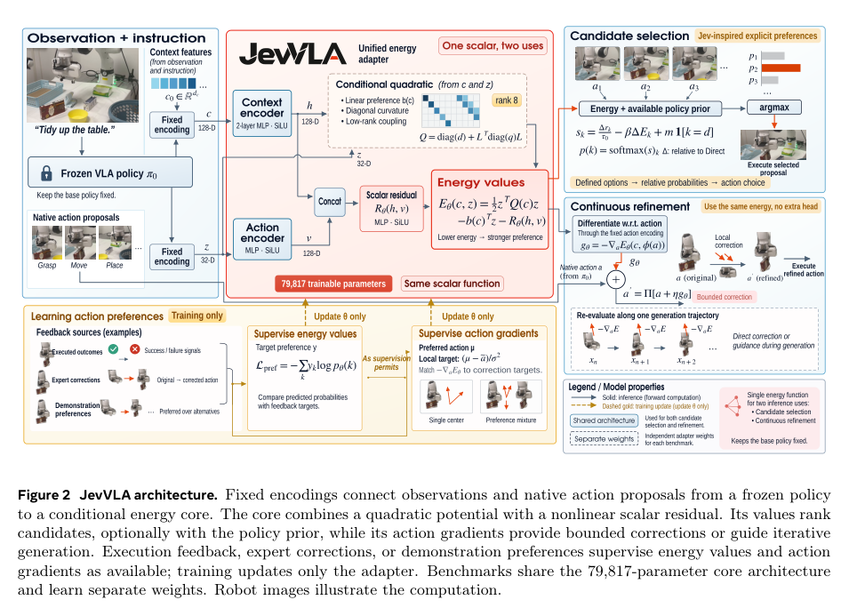

例如同一状态下有五个放置候选。训练时可以分别执行这些分支，再让冻结策略继续，记录完整任务成功与否；适配器据此学偏好。部署时不用先把五条分支全部试一遍，使用当前条件和候选直接预测偏好。论文中的 CLIPort 就用实际执行后的终局结果提供监督，因此“候选执行反馈”主要是数据生产成本，不能误算成所有部署步骤都需要的仿真搜索。

### 1.2 为什么要把动作评分与原策略分开？

原策略负责生成可执行提案，小网络负责根据额外监督改变提案的选择或局部走向。基础 VLA、视觉编码器、固定编码器均不由这一损失更新。这样可以复用已有能力，用少量可训练参数适配反馈；代价是评估器受原有表示与候选覆盖限制。如果原策略根本没有生成正确动作，有限候选排序无法凭空补出正确解；连续修正也只受到局部监督的约束。

论文标题中的 Jev 指“显式列出选项并表达相对偏好”的设计启发。作者在 §2.5 明确把机器人动作编码、能量训练与连续引导作为自己的实现，**没有复现 Jev 内部模型**。与已有 critic、偏好学习和生成策略引导相比，这篇的着力点是同一种能量结构同时支持离散选择和连续修正，而不是首次提出动作评分或梯度引导。

## 二、核心机制：为什么一个数既能排序，也能提供纠正方向？

### 2.1 二次项给出方向结构，残差补充复杂偏好

能量不是一个完全无结构的 MLP。令 h 为 128 维条件隐藏向量、v 为 128 维动作隐藏向量，作者定义：

```text
Q(c) = diag(d(h)) + Lᵀ diag(q(h)) L
E(c,z) = ½ zᵀQ(c)z − b(h)ᵀz − R(h,v)
```

d 有 32 个分量，q 有 8 个分量，都通过 softplus 保持为正；L 是 8×32 的可训练矩阵。b 是条件决定的 32 维向量，R 是非线性标量残差。条件网络为两层 width=128 的 SiLU MLP，动作网络一层 width=128，拼接后再经 width=128 的残差网络输出标量。[§3.2](https://arxiv.org/pdf/2610.35010v1#page=6)

逐项理解：对角二次项控制每个动作方向的曲率；低秩项让不同坐标之间发生耦合，例如某个方向的位置变化需要配合另一个方向的变化；线性项 b 移动偏好区域；残差表达二次函数覆盖不了的情境依赖。动作编码包含时间段时，耦合可以间接关联不同时刻，但不能仅从 rank=8 推出长时序规划能力。

如果先忽略非线性残差，对编码动作的负能量梯度就是 `b − Qz`；加入残差后：

```text
−∂E/∂z = b − Qz + ∂R/∂z
纠正原生动作：g(c,a) = −∂E(c,φ(a))/∂a
                       = Jφ(a)ᵀ [−∂E/∂z]
```

**纠正必须穿过动作编码器的 Jacobian。** 在编码空间里求出的方向，不能直接当毫米、弧度或归一化关节量来执行。Q 的正曲率让二次部分容易控制，但残差仍可能产生非凸结构，因此论文并没有一个保证真实任务成功的全局凸优化器。

### 2.2 先学排序：成功分支怎样变成训练梯度？

候选 k 的 logit 同时考虑原策略先验、相对能量，以及保留 Direct 的偏置：

```text
sₖ = (rₖ − rDirect) / τ₀ − β(Eₖ − EDirect) + m·1[k=Direct]
pₖ = softmax(s)ₖ，分母只包含有效候选
Lpref = − Σₖ yₖ log pₖ
```

r 是可获得的原策略提案分数；没有时置零。τ₀ 缩放先验，β 控制能量的影响，m≥0 给 Direct 一个保守优势。无效候选通过 mask 排除。偏好训练使用 β=1、m=0；部署的全局常数另由验证集选择。原动作不是被自动淘汰，替代动作必须有足够优势。

以放积木为例：如果两个候选最终成功、三个失败，监督可以给成功候选更多目标概率 y；如果标签来自示范距离 D，则使用 `yₖ ∝ exp(−Dₖ/τy)`。后者表示更接近示范，**不等于真实成功率更高**。两种监督都能训练同一个输出，但证据含义不能互换。

交叉熵对 logit 的梯度是 `p−y`，所以被低估的好候选会提高效用、降低能量。成对结果损失则比较成功候选与失败候选：`softplus(−(s好−s坏))`。官方实现先在每个有信息的 anchor 内平均有效对，再对 anchor 平均，避免候选对多的状态天然得到更大权重；全成功或全失败状态对该成对损失没有区分信号。[§3.3；losses.py](https://github.com/ZJU4EmbodiedAI/JevVLA/blob/a8d9f138446467c35e6ff017263a08bf0e9f5e9c/src/jevvla/losses.py)

### 2.3 排序好不代表导数好：作者怎样专门训练“往哪改”？

有限点上的分数正确，不能约束这些点之间的斜率。因此作者另外监督动作梯度。设 μ 是偏好动作中心，ã 是被扰动的动作或生成器中间动作，σ 是噪声尺度：

```text
gtarget = (μ − ã) / σ²
Lgrad = 加权平均 || M ⊙ (gθ(c,ã) − gtarget) ||²
```

M 控制哪些坐标有监督。μ 可以来自专家动作、选中的好分支，或 `aexecuted + α(aexpert − aexecuted)`。后者只沿专家纠正走一部分，MetaWorld 的 α=0.25。它给出一个可学习的局部方向，不要求每次直接跳到专家位置。[§3.3，Appendix A](https://arxiv.org/pdf/2610.35010v1#page=7)

一个教学数字例子：在统一的动作坐标中，μ=0.10、ã=0.06、σ=0.2，则目标梯度为 1。若训练后局部梯度接近 1，且该坐标纠正增益 η=0.01，那么一次未裁剪更新把 0.06 推向 0.07。这些数字仅用于说明机制，**不是论文超参数，也不能直接当真机米制动作使用**。

去噪分数匹配 DSM 是同一思想的另一种写法：先采样 `ã=μ+σε`，再最小化 `mean_coordinates[(σgθ+ε)²]`。正确的梯度应把扰动拉回偏好区域。官方 `gradient_matching_loss` 对坐标误差求和后平均样本，而 `denoising_score_matching_loss` 对坐标取均值；所以更改动作维度后，损失量级并不会自动保持一致。

如果存在多条可行分支，简单平均动作可能得到一条不可行的中间路线。作者使用高斯混合的局部分数：

```text
ωₖ(ã) ∝ ρₖ exp(−||ã−μₖ||² / (2σ²))
gtarget(ã) = Σₖ ωₖ(ã) (μₖ−ã) / σ²
```

ρ 是每个 anchor 的分支偏好权重，ω 还取决于当前动作离哪条分支更近。于是向左绕和向右绕的两条好路线不必被无条件平均成中间直走。它缓解了多模态监督的均值问题；当噪声很大或模式高度重叠时，仍不能保证始终保留清晰的多峰结构。

### 2.4 官方代码中最容易接反的符号

`model.py` 的 `raw_energy()` 与 `score()` 实际返回效用 U，越大越好；`energy()` 才返回论文意义的 `E=−U`。连续接口用 `grad(U, action)`，等价于论文的 `−grad(E, action)`。如果按函数名把 `raw_energy` 再取负梯度，就会朝错误方向更新。[固定提交 model.py](https://github.com/ZJU4EmbodiedAI/JevVLA/blob/a8d9f138446467c35e6ff017263a08bf0e9f5e9c/src/jevvla/model.py)

训练梯度匹配时，先对动作求导，再由损失更新参数，需要保留这次求导的计算图。官方训练路径使用 `create_graph=True`；推理只需动作的一阶导数。基础策略依旧冻结，不需要因为适配器训练涉及混合二阶导数，就对整套 VLA 做二阶优化。

## 三、训练与推理：数据怎么来，32 维动作又是什么？

### 3.1 五个基准的监督并不相同

小网络本身便宜，真正关键的是谁提供正确答案。论文附录明确区分如下来源：

| 基准 | 训练监督 | 部署方式 | 主要边界 |
|---|---|---|---|
| MetaWorld MT50 | 执行分支回报＋脚本专家纠正 | 在冻结 π0.5 的生成过程中引导动作块 | 依赖可用专家与分支反馈 |
| VIMA L1 | 执行候选结果＋专家对齐 | 候选选择 | 受候选覆盖限制 |
| LanguageTable | 当前及后续访问状态的脚本 oracle | 连续位移修正 | 后续状态用于离线监督 |
| LIBERO Plus | 与官方示范未来动作的接近程度 | 两个动作块候选中选择 | 模仿接近度不是执行成功标签 |
| CLIPort | 候选实际执行后完整任务终局结果 | 五个候选的选择 | 要生产分支执行数据 |

这里的“实际执行”包含基准仿真环境中的执行，不能理解为论文完成了同规模真机试验。特别是 LanguageTable 的 future supervision：作者在**后续状态上提取该状态的特征并配对专家动作**，扩展监督覆盖。它没有把未来图像塞给当前策略，也没有训练一个预测未来帧的世界模型。

代码 `prepare_future()` 还按 episode、branch 分配权重：一条分支的质量在它的多个后续状态之间分摊，再在 episode 内归一化。这样较长分支不会仅因存下更多状态而获得更大总权重。这一点比“额外加一些 future 数据”更具体，也更值得迁移。[language_table.py](https://github.com/ZJU4EmbodiedAI/JevVLA/blob/a8d9f138446467c35e6ff017263a08bf0e9f5e9c/src/jevvla/adapters/language_table.py)

### 3.2 对 XR1 最有参考性的两种编码：LIBERO 与 MetaWorld

**LIBERO 的 32 维来自压缩。** 官方代码接收每个候选 `8×7` 的归一化动作块，展平成 56 维，以训练数据拟合 PCA，投影到 32 维，再按投影标准差缩放并 tanh。动作标准差下限为 0.02。上下文从 2048 维冻结特征取 31 维主投影，加一个零填充位，再加 96 维残差空间投影，得到 128 维；上下文尺度下限为 0.05。这里投影的作用是降低小评分器输入难度，同时会丢失信息。[libero.py](https://github.com/ZJU4EmbodiedAI/JevVLA/blob/a8d9f138446467c35e6ff017263a08bf0e9f5e9c/src/jevvla/adapters/libero.py)

**MetaWorld 的 32 维来自选择执行段。** `guided_sample_actions()` 取动作张量的前 8 步、前 4 个物理维度，展平为 32 维，而不是把任意大动作块强行当 32 维。上下文来自冻结前缀 token 的 mask 加权平均：2048 维特征经固定汇聚形成 31 维，加生成时间 1 维，再加训练数据拟合的 96 维投影。编码输出随生成时间变化。

更容易漏掉的是：MetaWorld 的梯度监督默认跳过前 4 个坐标，推理也将该执行段第一步的纠正置零。也就是 8×4 中第一步保留，后面 7 步可受引导。代码明确体现了这个行为；**论文没有给出隔离这一选择的充分消融，所以不能把它解释成已证明必要的设计。** [metaworld.py](https://github.com/ZJU4EmbodiedAI/JevVLA/blob/a8d9f138446467c35e6ff017263a08bf0e9f5e9c/src/jevvla/adapters/metaworld.py)

因此接 XR1 时，必须先决定“评分的是全部动作块还是近期执行段”“各机器人有效维度是什么”“归一化和单位是什么”。32 维不是通用标准；如果使用固定线性投影，反向传回原动作的纠正也受投影子空间限制。这是由链式法则推出的迁移边界，不是作者在 XR1 上的实验结论。

### 3.3 一次训练更新究竟更新谁？

官方训练器消费已经整理好的 NumPy 数据档案。离散样本包括 `context[N,128]`、`candidate[N,K,32]`、`target[N,K]`，以及候选 mask、原策略 prior、Direct 索引；连续训练再提供原生动作、目标梯度，或偏好中心与噪声尺度。episode ID 可用于检查训练验证分割重叠。

以下是教学流程，概括代码依赖，不是作者完整运行脚本：

```text
冻结策略和特征模型 → 生成候选/采集分支反馈
训练 split 拟合固定 codec → 保存版本和归一化参数

每批 anchor：
  用固定编码构造 context、candidate
  离散：计算 U → logits → masked preference loss
  连续：构造 noisy_action → ∂U/∂action → gradient/DSM loss
  按该 benchmark 配方合并损失
  反向传播到能量网络 θ，梯度裁剪，AdamW 更新

验证 split：选择 checkpoint 与全局选择常数
测试 split：冻结所有选择，闭环执行并统计完整任务成功
```

CLIPort Full 用 1,032 个训练样本，258 个不重叠验证样本，测试是另外 1,800 个例子。训练标签构造、checkpoint 选择与最终测试不能混用。公开库提供训练器、编码器和评估接口，但 README 的闭环评估仍要求用户提供环境/策略 factory；检查到的仓库没有配套的论文训练数据档案和已训练适配器权重，不能把代码公开理解成一条命令完整复现全部结果。

### 3.4 训练参数应该怎样读？

下面原表给的是适配器优化参数，不是 π0.5 或 VIMA 的预训练配方。所有适配器使用 AdamW，weight decay=10⁻⁴，梯度范数上限 1。

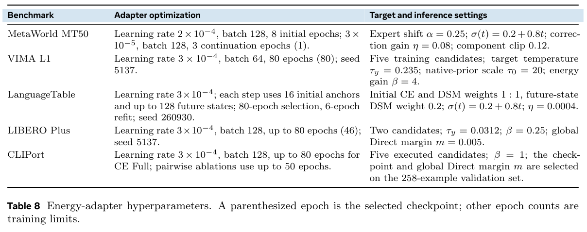

MetaWorld 先以 2×10⁻⁴、batch=128 训练 8 epochs，再用 3×10⁻⁵ 继续训练最多 3 epochs，括号中的 1 是验证选择的 continuation checkpoint。VIMA 用 batch=64，学习率 3×10⁻⁴，80 epochs；五个训练候选，τy=0.235、τ₀=20、β=4。LIBERO 用 batch=128，最多 80 epochs，选择第 46 个；τy=0.0312、β=0.25、Direct margin=0.005。

LanguageTable 同时使用初始偏好 CE 与 DSM，权重 1:1，后续状态 DSM 权重 0.2；每步 16 个初始 anchors，最多 128 个后续状态。80-epoch 选择后按选定长度做 6-epoch refit。**这不是所有基准都共享的三项联合损失。** 官方 `profiles.py` 中 MetaWorld 将 preference weight 设为 0、gradient weight 设为 1；连续与离散配方不能拼成一个“统一默认配置”。

论文实验服务器有八张 A100 80GB，但小型 VIMA、LanguageTable、LIBERO、CLIPort 适配器在 CPU 上拟合，MetaWorld 的 continuation 用一张 A100。冻结策略推理与仿真 rollout 仍使用 GPU 服务。因此低适配器训练成本成立，不代表数据生产与基础策略推理免费；论文没有给足端到端延迟、总 GPU 小时和真实控制频率，不能据参数量直接声称零开销。

### 3.5 部署时的三种使用方式

第一种是**候选选择**：计算每个候选 logit，取最大值。官方实现当 Direct 与最大分数相等时优先 Direct。这条路径不需要动作梯度，对现有策略的侵入小，但会付出候选生成成本；候选数多不必然按相同比例增加延迟，取决于能否批量生成和复用特征。

第二种是**生成后局部修正**：`a′=Πbounds[a₀+ηg(c,a₀)]`，还可使用坐标 mask 和逐分量限幅。论文用小步泰勒展开说明固定条件下负梯度局部降低能量；它约束的是学习出的能量，不是碰撞率或真实回报。下面的 LanguageTable 案例提供了实际闭环联系：相同初始状态，适配策略 41 步成功，Direct 在 200 步上限失败。

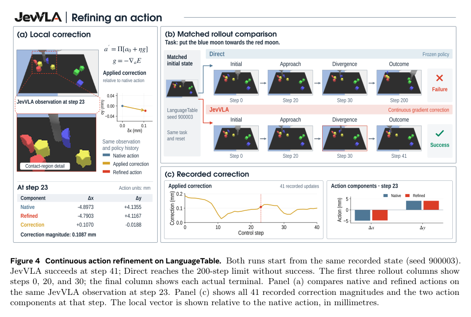

第 23 步的修正幅度约 0.109 mm，但后续观测与控制不断更新，轨迹逐渐分叉。这个例子说明小动作修正可以累积改变结果；它**不能证明每次微调都会改善结果，也不能把 200/41 当普遍执行加速比**。

第三种是**在 flow 生成过程中持续引导**：每个积分步把能量梯度加到动作变化中。

```text
xnext = x + Δt·vbase(x,t) + |Δt|·bounded(ηg(c,x))
```

MetaWorld 代码默认 10 个 Euler 步，`dt=−1/steps`，先把负的裁剪后效用梯度加进 velocity，再乘负 dt，最终实现朝效用上升方向修正。前缀 KV cache 与前缀特征停止梯度，逐步重算时间条件和动作评分。它沿一条生成轨迹纠正，并不要求每一步都额外生成多个完整候选。接入不同 flow 时间约定时，要按最后的动作变化检查正负号，不能照抄 velocity 中的加减号。

## 四、实验结果与附录细节：收益来自哪里，又付出了什么？

### 4.1 五个基准都涨了，但涨幅与任务分布要一起看

先比较匹配的冻结 Direct 基线。图中连续修正与候选选择分组展示，所有增量均为百分点 pp。

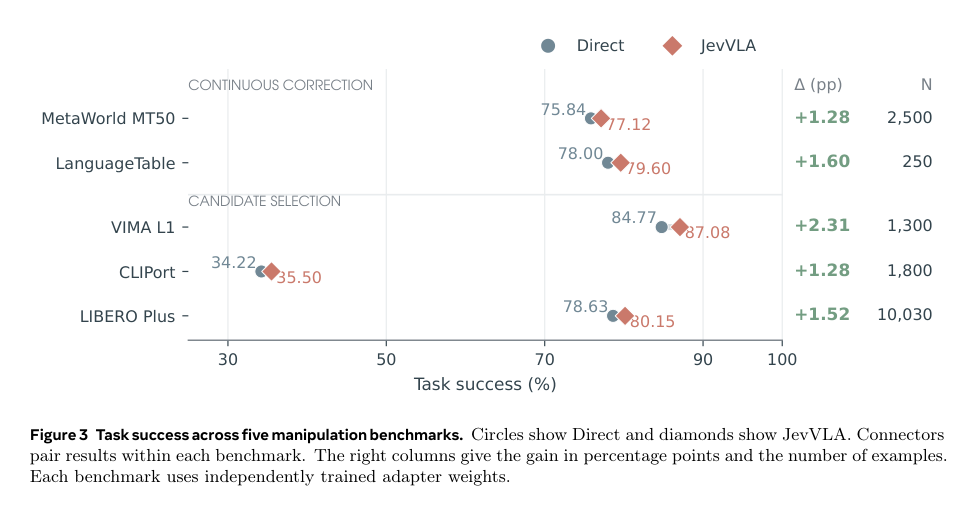

MetaWorld 从 75.84% 到 77.12%，VIMA 从 84.77% 到 87.08%，LanguageTable 从 78.00% 到 79.60%，LIBERO Plus 从 78.63% 到 80.15%，CLIPort 从 34.22% 到 35.50%。论文说明成功计数是五个评估 seed 的平均再四舍五入，比例由这些计数和表中分母计算。不要把表中 N 理解成展示了 5N 个独立试验的完整不确定性信息。

主表没有给出足以复核显著性的逐 seed 方差或配对置信区间。尤其 LanguageTable 的 1.6 pp 对应表中仅增加四个成功例子，因此判断应是“报告了平均改善”，不能进一步说已证明稳定显著改善。

再看任务粒度，负收益并不少：

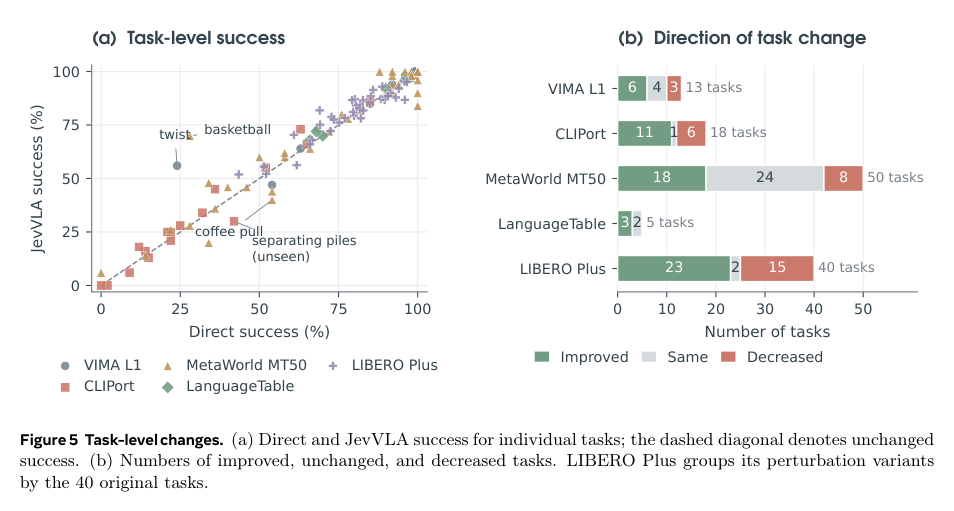

MetaWorld 的 50 个任务中 18 个提升、24 个持平、8 个退化；LIBERO 40 个原始任务中 23 个提升、15 个退化。VIMA 的 twist 从 24% 到 56%，单项增加 32 个成功，却超过整个 benchmark 净增的 30 个，意味着其他任务的损失抵消了部分优势。MetaWorld 沿用相同的 50 个训练/评估任务身份，留出 episode 与 seed，因此这里不能声称已验证新任务泛化。

### 4.2 学偏好，确实比随机替换或“小动作优先”更有用吗？

作者在相同 CLIPort 候选集合上只更换选择规则，排除“只要换一个动作就能改善”的解释。

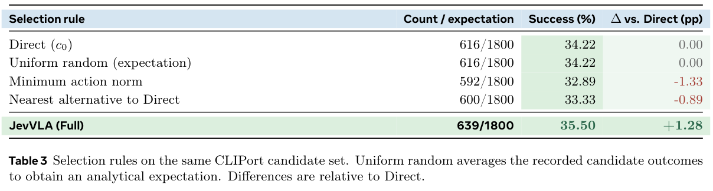

随机选择的解析期望为 34.22%，最小动作范数为 32.89%，最接近 Direct 的替代为 33.33%，学习出的选择器达到 35.50%。随机与 Direct 数字相同是这份测试结果平均并取整后的巧合，不是方法约束。这个对照支持情境化偏好带来价值；它没有隔离出能量结构是否优于所有其他监督评估器，后面还需要结构消融和分类器比较。

### 4.3 哪一部分有效？特别注意低秩消融的混杂

先看完整模型与随机初始化、打乱标签、打乱输入之间的差别，再看二次项、残差项和输入信息。

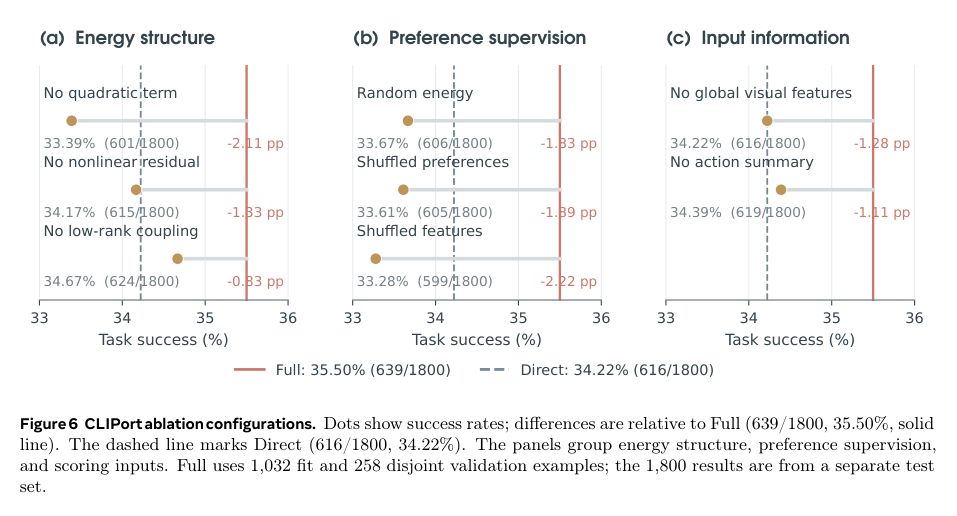

去二次项降至 33.39%，去残差降至 34.17%，去低秩耦合为 34.67%；随机能量、打乱标签和打乱输入均低于 Direct。说明“有一个网络”本身不够，输入与偏好监督的对应关系很关键。去全局视觉特征后为 34.22%，与 Direct 聚合结果相同，也说明仅凭动作几何不足以重建完整收益。

但论文 Table 4 明确注明：**低秩消融还把训练目标改成 pairwise，而 Full 使用 CE。** 这不是严格单变量消融，不能把 0.83 pp 差距全部归给低秩结构。正文对这项证据应保守解读，不能仅凭图标题把它讲成“rank=8 已经被独立证明必要”。

### 4.4 净增 23 个成功，背后是救回 82 个、破坏 59 个

下面这张图比平均成功率更接近部署决策。它把相对 Direct 的改变拆为 rescue 和 harm。

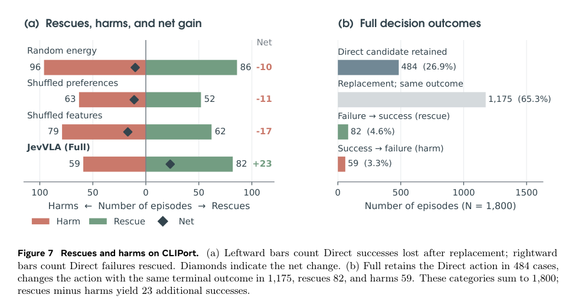

CLIPort Full 在 1,800 个例子中替换候选 1,316 次；其中 1,175 次最终成功/失败状态没变，82 次把失败救回，59 次把原来的成功变成失败。净收益为 `82−59=23`，所以成功总数 `616+23=639`。替换率 73.11% 很高，净提升却只有 1.28 pp。这里的启示是：**适配器需要同时报告“挽救了多少”与“伤害了多少”，不能只看纠正案例。**

论文也给出一对具体案例。先看上半部分成功救回，再看下半部分评分最高却选错物体的失败。

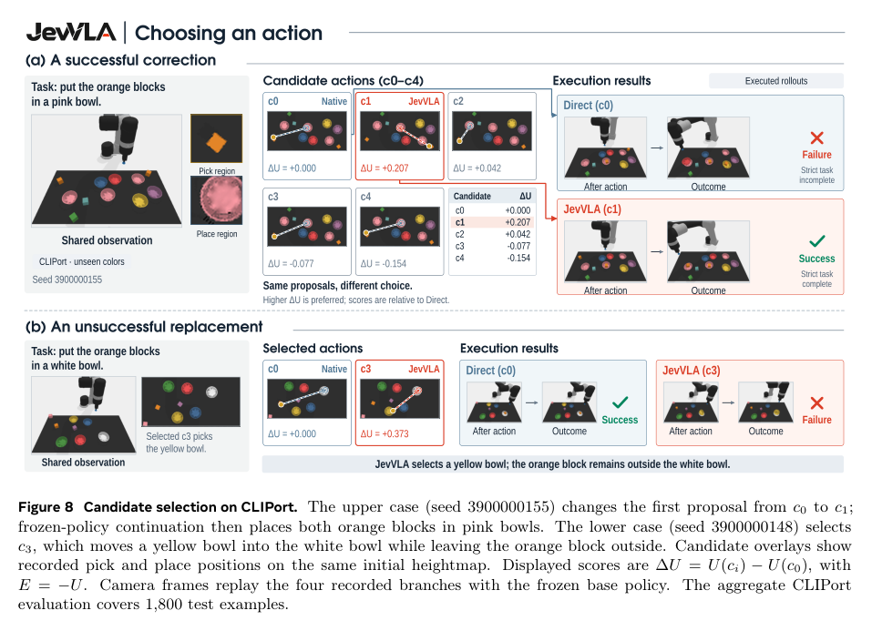

成功案例改选 c1 后，冻结策略后续把橙色积木放进粉色碗；失败案例把黄色碗搬进白色碗，却把目标橙色积木留在外面。更高的学习效用仍可能错判物体与目标，因此能量并不是一个完美任务验证器。Direct margin 提供保守选择的可调节手段，当前实验仍保留明显 harm；不能把 margin 描述成已解决该问题。

### 4.5 更换环境与其他评分器，能支持多大的外推？

LIBERO Plus 的扰动分组展示平均收益具体来自哪些条件。

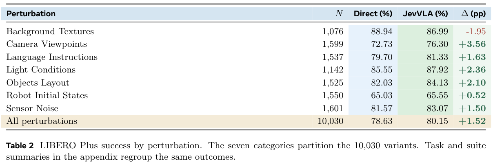

视角变化提升 3.56 pp、光照变化提升 2.36 pp，但背景纹理下降 1.95 pp。机器人初始状态变化只有 0.52 pp 提升，最终成功率仍最低。学习到的动作偏好对部分视觉变化有帮助，不能据此概括为解决了视觉泛化或动力学偏移。

另一个问题是：换成普通终局成功分类器行不行？作者在 CLIPort 比较多种表格模型和 MLP。

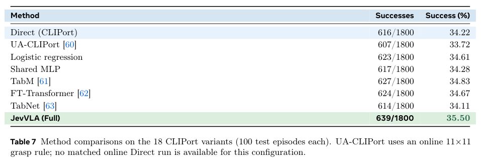

JevVLA 为 639/1800，最强替代 TabM 为 627/1800，相差 12 个成功。结构化能量在这组实验中领先，同时能量梯度带来连续控制接口；但候选选择结果本身不足以证明能量网络对所有监督评估器有稳定优势。UA-CLIPort 没有匹配的在线 Direct 对照，论文也提醒不要将该行差值解释为严格配对效果。MetaWorld 的 Table 6 还比较了线性 probe 与 RAS 规则；这是该实现和协议下的结果，不代表这些方法在原论文设置中普遍无效。

## 总结：对 XR1，最值得借鉴的是反馈接口和受限引导

JevVLA 把“当前动作是否值得执行”显式学成一个可微函数，用同一结构完成候选排名与连续方向修正。训练成败的关键不仅是 8 万参数的网络，还包括**同一状态下可比较的候选、可靠的反馈标签、动作编码与梯度单位、部署时对改动幅度的约束**。现有证据展示了五个基准的平均小幅提升，也清楚暴露了任务退化与错误替换。

**以下是对 XR1 的迁移建议，不是作者已经验证的结果。** 优先把它放在已有策略的反馈适配阶段：保留当前动作生成器，离线保存冻结特征、原始提案、候选、纠正动作与执行结果，先建立可复用的评分数据。只有示范轨迹时，可以借鉴 LIBERO 的示范接近度作为启动标签，但需要明确它学的是示范偏好；它不能自动识别 UMI 数据噪声，也不能替代跨来源动作定义与时延对齐。

第一步可比较原策略、同候选随机/简单规则、普通 MLP scorer 与结构化能量 scorer。在相同候选预算和相同 rollout 条件下同时观察成功率、rescue、harm、替换率和端到端延迟。先确认标签确实能教会模型选择，再考虑梯度引导；不要只靠候选排序训练，就把未受监督的动作导数直接接入控制环。

若进入连续引导，需要增加对偏好动作周围或 flow 中间状态的梯度监督，显式设计每个 embodiment 的有效维度、动作时间长度与固定编码。生成时间要进入条件；推理中只对动作求导，复用冻结视觉特征；依据真实单位设置限幅。论文 MetaWorld 的“8 步×4 维、第一步不纠正”可作为接口例子，不能直接当作 XR1 的默认配置。

对于我们正在讨论的新训练 infra，可把基础策略版本、codec、归一化、候选生成种子、反馈来源、episode/branch ID 和训练验证划分绑定进 manifest。这样后续能重建“哪个候选为什么被认为好”，也能避免同一轨迹的相邻窗口跨训练与验证泄漏。这是本文建议的数据协议扩展，论文没有提供百万小时混合预训练、Lance 供数或分布式恢复方案。

最后，**这篇不需要外挂世界模型才能运行，但也没有替代世界模型的未来预测能力。** 它主要用学出的动作偏好改善决策。对 XR1，值得先做受控的后训练小实验；是否升级成生产默认路径，要由反馈质量、净收益和控制延迟决定。

### 来源与复现入口

核心方法来自论文 §3，实验与边界来自 §4、附录 A–C；原图均裁自用户指定论文，图表版权归作者。本文公式解释、教学例子和 XR1 迁移判断为原创整理。官方代码核对固定在上述提交，未运行模型训练或推理，未独立复现论文成绩。

[阅读 Markdown 源文](report.md) · [来源映射](source_map.json) · [全部编号图表清单](assets/visual_manifest.json) · [官方训练器](https://github.com/ZJU4EmbodiedAI/JevVLA/blob/a8d9f138446467c35e6ff017263a08bf0e9f5e9c/src/jevvla/training.py) · [官方超参数配置](https://github.com/ZJU4EmbodiedAI/JevVLA/blob/a8d9f138446467c35e6ff017263a08bf0e9f5e9c/src/jevvla/profiles.py)
