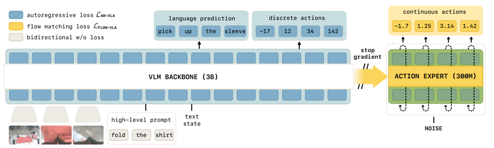
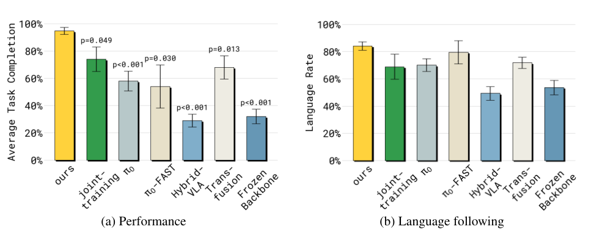
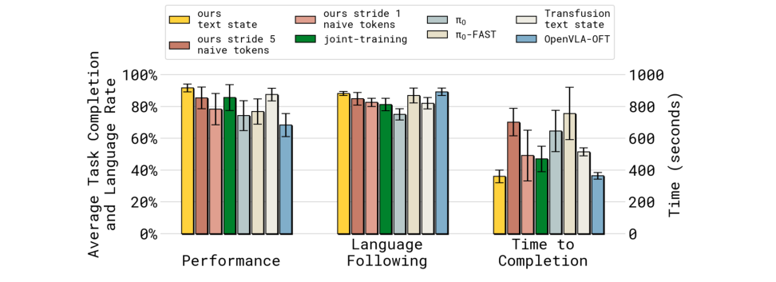
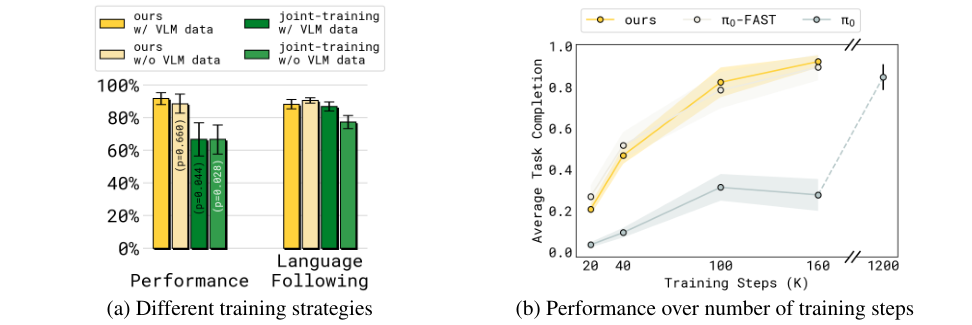
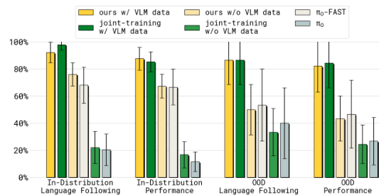

# Knowledge Insulation：让 VLM 学会动作，又不被动作专家的梯度带偏

Physical Intelligence · arXiv:2505.23705v1（2025-05-29）· 解读更新于 2026-11-25

## 一句话结论：训练表征与生成动作，可以使用不同的监督路径

这篇论文提出一种 VLA 训练配方：**VLM 用离散动作 token 和视觉语言任务学习表征；小型动作专家用 flow matching 学连续动作，但专家的梯度不回传 VLM。** 部署时由动作专家生成连续动作，不必先自回归生成离散动作序列。[论文 §5、图 1]

它最有价值的地方，是把“保留预训练语义能力”和“适应机器人控制”拆成可以同时实现的两件事。主干仍然学习机器人动作，隔离的是一个损失的梯度路径，而非冻结主干参数。

**阅读建议：A，值得精读。** 适合正在设计 VLA 训练目标、接入随机初始化动作头或研究语言遵循的人。真实机器人、消融和公开仿真基准共同支持这一配方，但“知识被破坏”的内部因果解释仍主要来自行为实验，而不是对知识表征的直接测量。

## 问题从哪里来：语义正确与控制精确，要同时成立

把场景固定为桌面清理：桌上有勺子、盘子和垃圾，用户要求“把勺子放进餐具箱”。模型首先要选对对象，再生成能抓住它并送入正确容器的连续轨迹。下面用这条**教学样本**贯穿流程；它不是作者公开的数据记录。

纯自回归 VLA 可以把动作量化为 token，再像写句子一样生成动作。这条路径与 VLM 的预训练目标接近，表征学得快，但逐 token 解码会拖慢控制。论文引用的 π0-FAST 在 RTX4090 上生成一秒动作块约需 750 ms；这是特定实现的动作块生成延迟，不是机器人关节控制频率。[论文 §4]

π0 一类方法给大 VLM 接一个较小的连续动作专家，减少每轮去噪的计算。问题是专家从随机参数开始，动作损失穿过它去调整预训练主干。作者观察到收敛慢、语言遵循变差，提出“新模块梯度干扰预训练表征”的解释。机器人可能学会清桌，却忽略“勺子”，先拿起别的物体。[论文 §4、图 2]

直接冻结 VLM 也不行：通用视觉语言表征未必包含精细机器人动作需要的空间和状态信息。图 4 的抽屉操作、图 8 的叠衣实验中，冻结主干表现很差。作者因此保留主干适配，只替换驱动适配的监督来源。

## 一条样本怎样经过两条训练路径

先看图 1：左侧约 3B 的 VLM 与右侧约 300M 的动作专家共享条件信息；蓝色目标训练 token 预测，黄色目标训练连续动作，二者之间的 stop-gradient 标志说明梯度的边界。

图中“3B”是整体 VLM 的规模表述，附录 B 单列语言模型为 2B、宽度 2048、18 层；不能把两种口径误认为互相矛盾。动作专家宽度为 1024，参数约 300M。图只说明结构；隔离是否有用要看后面的消融。[论文图 1、附录 B]

### 同一段真实动作，构造两个目标

一条机器人训练样本包含多视角图像、当前本体状态 q、语言指令，以及未来 H 步示教动作 a。附录 B 使用 H=50；这表示 50 个动作时间步，具体持续多少秒取决于数据控制频率，不能统一等同为 1 秒。

**离散支路：**对示教动作块做 FAST 编码：逐动作维度进行离散余弦变换，再量化与 BPE 压缩，得到离散 token。主干通过 next-token prediction 学习这些 token，使当前图像、指令和状态的表示足以预测“抓勺子”的行为。训练时可使用 teacher forcing，并非真的逐 token 运行慢速部署循环。[论文 §3、§5.1]

**连续支路：**把同一动作块与高斯噪声混合，动作专家根据带噪动作、流时间和主干条件特征，预测恢复动作需要的向量场。真实连续动作仍是监督目标，FAST 的有损量化不会直接限制连续输出的分辨率。[论文式 (3)、(4)]

### 核心损失：两种监督共存，但不更新同一组参数

式 (4) 的教学简写：按数据类型启用目标

L = L_token + α · M_act · L_flow

回答“没有动作标签的图文数据，怎样和机器人数据一起训练”。token 项内部仍有位置损失掩码，此处省略期望和求和以突出分工。

<dl class="formula-legend"><dt>L_token</dt><dd>被选中位置上的文字或 FAST 动作 token 交叉熵。</dd><dt>L_flow</dt><dd>连续动作向量场的平方预测误差。</dd><dt>M_act</dt><dd>当前样本是否有动作监督；纯图文样本为 0。</dd><dt>α</dt><dd>连续损失权重。论文在梯度隔离后取 1。</dd></dl>

机器人样本能同时启用两个目标；图文样本只更新 token 路径。对动作专家损失做隔离后，主干不会被它更新，但仍会被离散动作目标更新。

论文混合图像描述、VQA、目标定位及机器人规划数据。它们不需要伪造电机动作标签，只通过各自的 token 监督影响主干。机器人数据则把这些语义特征与具体行为联系起来。这解释了非机器人数据进入动作策略的通道，但不意味着一张网络图片就能教会机器人一种全新运动技能。[论文 §5.1、附录 A.3]

### Stop-gradient 应该放在哪里？K 和 V 两条路径都要处理

动作专家在每层 attention 中用自己的 query 读取主干的 key/value。作者对**专家读取到的主干 K 和 V**做 stop-gradient。前向数值完全保留，反向不再从专家返回主干。只 detach V 会遗漏 QK 相似度计算中的 K 路径。[论文式 (5)、(6)]

<figure class="svg-figure concept-visual">
<svg xmlns="http://www.w3.org/2000/svg" viewBox="0 0 800 220" role="img" aria-label="训练时主干收到 token 梯度，动作专家读取隔离后的条件特征">
<rect x="10" y="20" width="240" height="65" rx="8" fill="#e3f2fd" stroke="#1565c0"/><text x="130" y="58" text-anchor="middle" font-size="20" fill="#333">图像、指令、状态</text>
<rect x="290" y="20" width="220" height="65" rx="8" fill="#fff3e0" stroke="#e65100"/><text x="400" y="58" text-anchor="middle" font-size="20" fill="#333">VLM：token 监督</text>
<rect x="550" y="125" width="240" height="65" rx="8" fill="#e8f5e9" stroke="#2e7d32"/><text x="670" y="164" text-anchor="middle" font-size="20" fill="#333">专家：连续动作监督</text>
<path d="M250 52 L282 52 M274 45 L282 52 L274 59" stroke="#333" fill="none" stroke-width="2"/>
<path d="M510 52 L670 52 L670 116 M663 108 L670 116 L677 108" stroke="#333" fill="none" stroke-width="2"/>
<text x="610" y="35" text-anchor="middle" font-size="17" fill="#333">读取 K、V</text>
<text x="400" y="137" text-anchor="middle" font-size="18" fill="#c62828">sg(K)、sg(V)</text>
<text x="270" y="192" text-anchor="middle" font-size="17" fill="#333">专家损失不回传；主干仍学习动作</text>
</svg>
<figcaption class="read-guide">这张图怎么读：箭头表示前向条件传递。红字是反向梯度边界，不会删掉专家看到的信息。教学示意，依据论文 §5.2。</figcaption>
</figure>

这与“冻结 VLM”有本质差别：冻结会切断所有主干参数更新，KI 只挡住 flow loss 的回传。它也不是离线蒸馏：专家和主干同步训练，专家读取的是不断适应机器人数据的主干特征。

### 注意力掩码解决另一个问题：不能偷看另一种动作答案

训练时，真实动作的 FAST 表示和带噪连续表示同时存在。如果两种表示可以互相读取，模型可能依赖部署时不存在的答案信息。因此，前缀（图像、语言和状态）内部可相互读取；FAST token 读取前缀及前序 FAST token；连续专家读取前缀及整个带噪动作块；**FAST 与连续动作之间双向隔离，前缀也不读取动作专家。**[论文 §5.1、附录 B]

注意力 mask 控制“能看到谁”，stop-gradient 控制“谁能被哪个损失更新”。两者不可互相替代：只阻断梯度不阻止前向泄漏；只加 mask 也不阻止专家损失沿允许的条件路径回传。

### 推理时：保留条件路径，去掉离散动作解码

给机器人同样的当前图像、状态和“收走勺子”指令，先计算主干前缀特征；从高斯噪声开始，由动作专家反复估计向量场，积分生成连续动作块，再执行并用新观测更新计划。此时不需要 FAST 动作标签，也不需要先生成 FAST 动作 token。主干仍要计算；节省的是大模型逐 token 动作解码及在多次去噪中重复运行大主干的开销。[论文 §5、附录 B；缓存解释为由单向注意力结构得到的实现推论]

流时间 τ 与机械臂的物理时间是两回事。原文写带噪动作为 τa+(1−τ)ω，并以 ω−a 为预测目标；因此若沿 τ 从 0 向 1 积分，应使用预测场的负号。也可改用噪声时间 t=1−τ 并从 1 向 0 积分。这里是对原文符号的等价解释，不能把相反约定的加噪式、目标和采样器混用。[论文 §3、式 (3)]

## 实验究竟支持哪些结论？

### 1. 同时测任务完成和语言遵循，才能判断“听懂”了没有

图 4 分别报告静态机械臂在未见环境中把物体放入抽屉的任务完成度与语言遵循率。先看左图能否完成操作，再看右图是否选择了语言指定的行为。

完整方法在两项指标上均表现较好；去掉 stop-gradient 的 joint-training 变差。π0-FAST 的语言遵循较好，但整体操作不如完整方法，说明“听懂目标”不足以保证精确控制；冻结主干则几乎不能完成任务。[论文图 4、§6]

但不要把这一图改写为“没有 stop-gradient 必然失败”：图 5 的单机器人清桌任务中 joint-training 仍然表现较好。隔离的收益受数据混合、任务和共训练设置影响。

图 5 最右栏是完成任务的墙钟秒数，不是单次模型 forward 延迟。π0-FAST 的任务完成耗时约为完整方法的两倍；改造后的 OpenVLA-OFT 虽快、语言遵循较好，任务表现却更低。本文基线按作者数据重训，OpenVLA-OFT 未使用 FiLM 且保留 text state，HybridVLA 也加入了动作专家，不能等同为所有官方实现的最终排名。[论文 §6、图 5]

### 2. “Train fast”主要由收敛曲线支持

图 6b 的横轴是训练步数，并在后段断轴。作者报告在清桌任务上，π0 达到相近表现需要约 7.5 倍步数；KI 与 π0-FAST 的收敛速度相近。这个结论不能直接写成“任何任务都省 7.5 倍 GPU 时间”。论文 §7 还说明双输出训练约增加 20% 计算成本，只是更快收敛抵消了这项成本。总 GPU 小时与峰值显存没有给出足以统一比较的完整报告。[论文图 6、§7]

### 3. 新物体泛化：共训练数据的作用不能归功于隔离一个开关

图 7 的对象是移动机器人将新物体从台面移入已打开抽屉。重点看右侧 OOD Follow Rate：是否使用 VLM 数据对未见物体的语言遵循影响明显。支持的结论是“语义数据能经共享表征帮助已有动作能力识别新目标”；它没有证明策略可以执行任意未见技能，也没有单独证明预训练中的所有知识都被保留。[论文 §6、图 7]

这里 joint-training 加 VLM 数据也能有较好的语言遵循。因而应分别看待三项设计：离散动作提供机器人表征学习信号；VLM 共训练维持语义任务训练；stop-gradient 减少连续专家损失的干扰。

### 4. LIBERO 与 DROID：结果更完整，也更不整齐

| 模型 | Spatial | Object | Goal | Long（10） | 90 |
| --- | ---: | ---: | ---: | ---: | ---: |
| OpenVLA-OFT | 97.6 | 98.4 | 97.9 | 94.5 | — |
| π0 | 96.8 | 98.8 | 95.8 | 85.2 | — |
| π0-FAST | 96.4 | 96.8 | 88.6 | 60.2 | — |
| 本文 from scratch | 96.6 | 97.2 | 94.6 | 84.8 | 92.7 |
| 本文 from generalist | 98.0 | 97.8 | 95.6 | 85.8 | 96.0 |

数值是 LIBERO 成功率（%），转录自表 1。“from scratch”应结合附录理解为不从作者机器人 generalist 初始化，基础 VLM 仍使用预训练 PaliGemma。generalist 未在原始训练中见过 LIBERO，之后再微调；Spatial/Object/Goal/Long 联合训练，LIBERO-90 使用单独策略，不能把全部列当作一个统一模型的成绩。[论文表 1、附录 A.1、B]

本文在 Spatial 和 90 上较强，但 Long 的 85.8 明显低于 OpenVLA-OFT 的 94.5；Object、Goal 也未全面领先。泛化数据和初始化不同，使跨方法比较无法单独归因于 stop-gradient。

DROID 正文报告平均任务进度分：本文 **0.55 ± 0.09**，π0 **0.49 ± 0.09**，π0-FAST **0.45 ± 0.09**。这不是二元成功率，误差范围有重叠，不能据此宣称统计显著领先。还有一个复现疑点：§6 称该结果评估 generalist，而附录 A.1 描述 DROID specialist 仅在对应数据集训练；原文口径不完全一致，本解读保留此处不确定性。[论文 §6、附录 A.1]

真实任务每任务、每策略评估 10 个 episode，并使用双侧 t 检验。10 次试验提供了有用信号，但对部署可靠性和罕见失败的估计有限。真实任务常用分阶段得分：清桌最多 12 分、抽屉最多 5 分，图中的完成度不能一概称为“整段任务成功率”。[附录 A.2]

## 技术位置、复现要点与仍未解决的问题

### 它与 π0、π0-FAST、π0.5 的关系

π0 提供小型连续动作专家；π0-FAST 强调压缩离散动作带来的学习效率；π0.5 原始流程先进行离散动作预训练，再在后训练接入随机初始化专家。本文将 π0.5 的思路形式化并扩展为**单阶段同步训练离散与连续动作的配方**。因此，用户链接虽然叫 pi05_KI.pdf，它不是 π0.5 最初“开放世界泛化”论文的同名版本。[论文 §2]

增量的关键在训练信号与参数更新的组织，不是首次采用 flow matching，也不是首次把离散与连续目标放在一起。与混合训练近邻方法相比，动作表示之间的可见性和专家回传路径是值得精读的具体差异。

### 若要复现，先验证三件可观察的事

下面是实现建议，**没有在本次解读中运行训练**。

1. 只反传 flow loss，确认主干参数梯度为零、专家梯度非零；再只反传 token loss，确认主干梯度非零。这能区分梯度隔离与误冻结。
2. 固定前缀与带噪动作，替换 FAST 标签，确认连续分支输出不受影响；检查两种动作表示的 mask，避免训练答案泄漏。
3. 固定数据、训练步数与评估流程，对照 flow-only、joint-training、joint + stop-gradient，并独立切换 VLM 共训练。分别报告语言遵循、动作完成度、每步耗时与达到目标表现的总耗时。

附录披露 H=50、模型维度、adaptive RMSNorm 注入流时间、偏向低流时间的采样分布，以及 12 种机器人配置和 VLM 数据类别。但完整私有示教数据、精确混合比例、统一优化器/批量/学习率配方与全部训练预算没有在这份报告中充分给出。不能只凭网络结构重现全部结果。[附录 A.3、B]

### 最值得带走的判断

这项工作说明：当一个预训练模型要接上新模态模块时，值得把“主干应该学什么”与“新模块如何学习”分别设计。对 VLA，离散动作恰好提供了接近预训练形式、又包含机器人信息的替代监督，所以隔离之后主干仍能进步。

边界也很清楚：语言遵循仍不完美；主干仍可受数据相关性影响；梯度隔离是否保留了全部通用知识没有得到全面评估；在其他主干、数据规模或新动作头上能否得到同样收益，需要再做对照。这些限制不削弱它作为训练配方的价值，但限定了“Generalize Better”的含义。[论文 §7；研究迁移判断为解读者分析]

## 来源与版本

- [用户指定官方 PDF](https://www.pi.website/download/pi05_KI.pdf)：《Knowledge Insulating Vision-Language-Action Models: Train Fast, Run Fast, Generalize Better》，18 页。网页 PDF 读取可用，本地直链下载返回网页，因此图像与全文提取采用下述固定 arXiv 版本。
- [arXiv:2505.23705v1 PDF](https://arxiv.org/pdf/2505.23705v1)：2025-05-29；方法、表 1 与附录用于本文核对。图 1、4–7 已逐张查看渲染，表 1 已核对页面。
- [作者项目页](https://pi.website/research/knowledge_insulation)：供延伸查看演示；本文技术结论以论文为依据。

文中“论文”指上述版本，图表版权归原作者；示意图、教学样本、积分符号说明与复现建议为本解读所作。未运行模型训练或机器人实验，也未将当前 openpi 代码视为本论文版本实现的证据。
