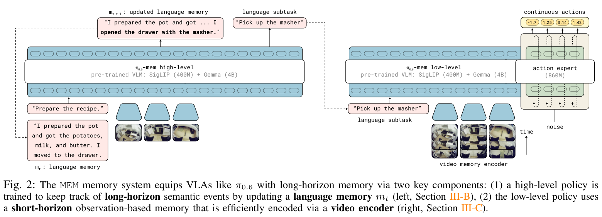
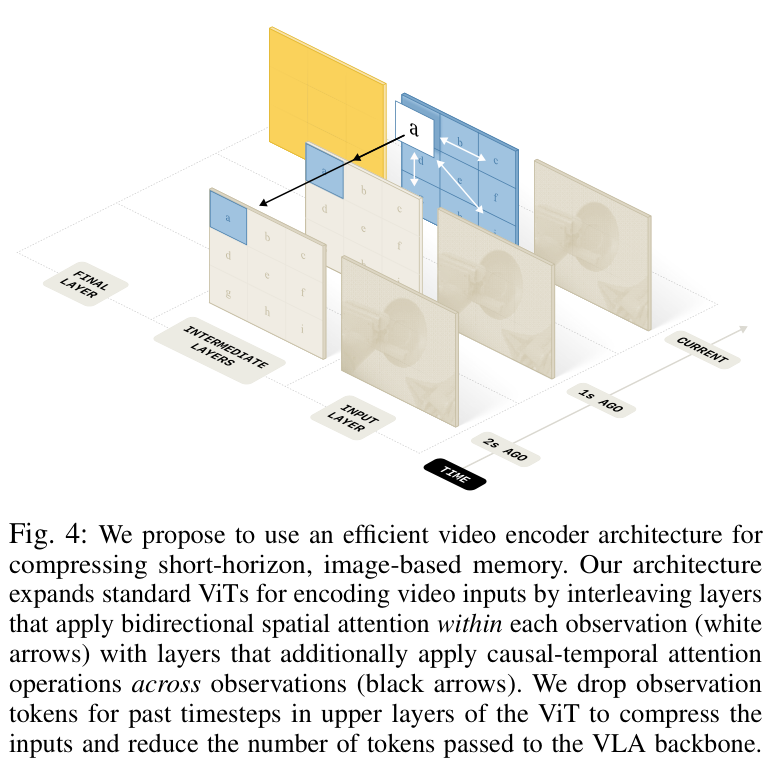
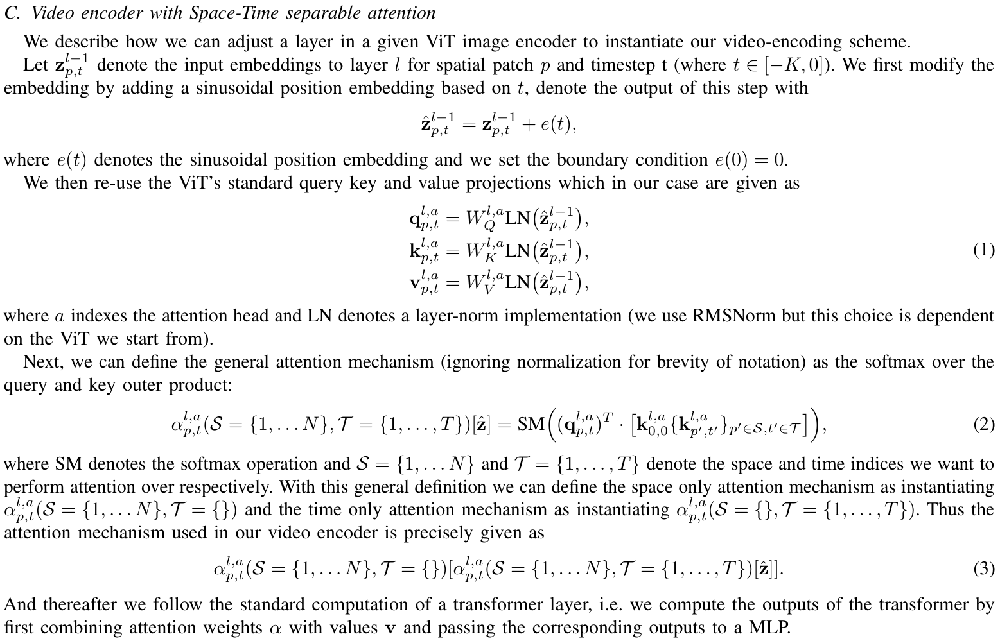
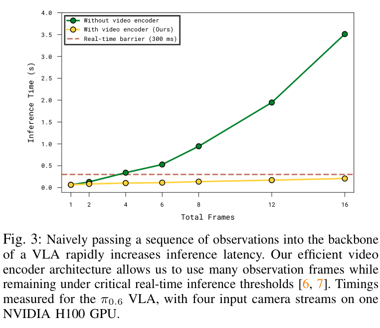
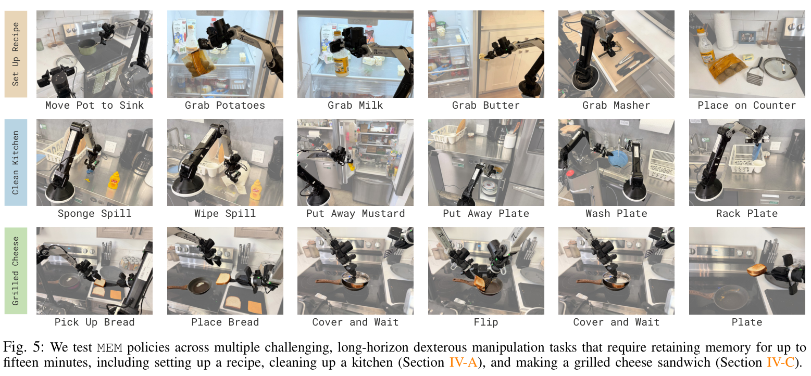
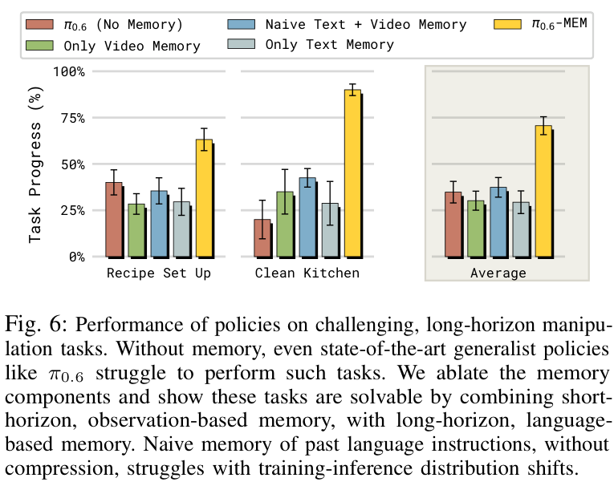
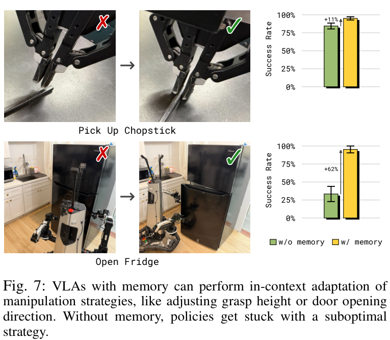
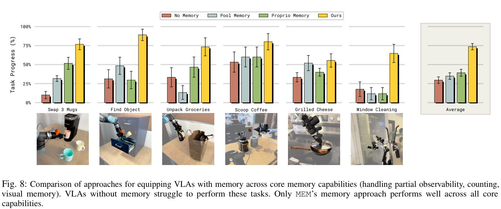
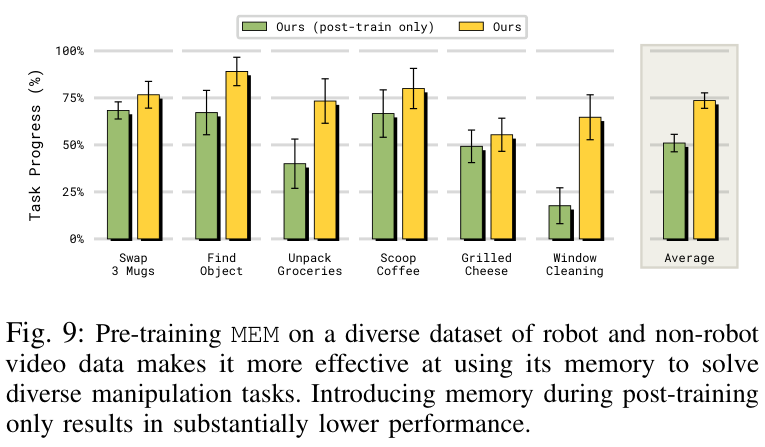
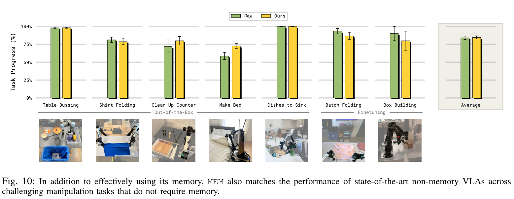

# MEM：机器人怎样记住刚才的失败，也记住十分钟前的任务进度？

Marcel Torne、Karl Pertsch、Homer Walke 等 · Physical Intelligence / Stanford / UC Berkeley / MIT。本文精读 **MEM: Multi-Scale Embodied Memory for Vision Language Action Models**，以用户提供的 15 页官方 PDF 为准；项目页发表于 2026 年 3 月 3 日，阅读整理于 2026 年 11 月 5 日。[论文 PDF](https://www.pi.website/download/Mem.pdf) · [官方项目页](https://www.pi.website/research/memory) · [arXiv 条目](https://arxiv.org/abs/2603.03596)

设想机器人正在整理厨房。它面前的碗看起来没有变化，但正确动作可能完全不同：刚才已经洗过，就应该放进沥水架；还没加洗洁精，就应该继续清洗。再看一次当前画面，未必能消除这种歧义。另一方面，如果夹筷子连续失败，机器人需要看到刚才夹爪落在什么高度、怎样滑脱，单独记一句“抓取失败”又太粗糙。

MEM 的核心判断是：**任务进度需要可压缩的语义记忆，动作调整需要保留细节的视觉记忆。** 作者让高层策略递推一段文字摘要，并选择下一子任务；低层策略把最近几秒的多视角图像和本体状态编码后，用来预测连续动作。短时信息在视觉编码器内部压缩，长时信息由语言摘要承接，两种记忆各自承担不同的信息损失。

对模型训练而言，本文最有价值的结果不止是“可以完成十五分钟任务”。作者比较发现：即使都从经过机器人数据预训练的 π0.6 出发，**到后训练才引入记忆，也明显弱于在预训练阶段就学习如何使用历史**。下面沿着“准备一份食谱”的样本，解释架构、记忆机制、训练信号和实验；纠错部分再用论文中的夹筷子任务说明为什么失败历史必须与纠正动作连在一起。

## 一、模型结构与方法定位：把完整历史拆成两种条件

### 1.1 高层维护任务状态，低层解决眼前动作

MEM 是记忆机制，π0.6-MEM 是作者将它接入 π0.6 后的实验模型。论文采用 Gemma3-4B VLM 初始化；图 2 将视觉与语言部分标为 SigLIP 400M 和 Gemma 4B，连续动作专家为 860M。VLM 是处理图像和语言的骨干，动作专家则把这些条件转成机器人未来一小段连续控制量。模型仍沿用 π0.6 的动作学习路线，核心改动发生在历史信息进入策略的方式。[§III-A、III-D，PDF p.3–5](https://www.pi.website/download/Mem.pdf#page=3)

先沿图 2 的箭头读：左边高层输出“更新后的记忆”和“下一条子任务”，右边低层接收子任务、近期视频，并由动作专家输出动作。文字摘要通过左侧的回环进入下一次高层调用。



图 2 的关键接口是子任务指令。按 §III-A 的分解，低层直接条件于近期观测、子任务和总目标；长期摘要通过高层对“接下来做什么”的选择影响动作，并非把全部历史文字直接塞给每一次低层去噪。这样，语义决策和精细控制可以拥有不同的时间跨度。

为了避开原文 K 有时表示历史长度、有时表示帧数的索引差异，下面用 **F 表示含当前帧在内的总帧数**。将原文的策略分解用更明确的接口改写如下；它是阅读用记号整理，不是额外算法：

```text
高层：(下一子任务 l，更新摘要 m') ← πHL(当前观测，旧摘要 m，总目标 g)
低层：未来动作块 A              ← πLL(最近 F 帧观测，l，g)
反馈：执行动作 → 新观测 → 刷新短期窗口 → 下一轮高层与低层
```

这里的动作块 A 包含若干未来时刻的动作。MEM 论文没有完整报告各任务的动作块长度、控制频率和一次实际消费多少动作，不能用六帧历史反推动作块是六步，也不能把一秒历史采样间隔当作机器人控制频率。

**原文有一处接口不一致值得保留：**§III-A 的分解及图 2 给高层画的是当前观测；§III-B 的概率式又将高层条件写成短历史 o(t−K:t)。可以确定高层读观测、旧摘要和目标并输出摘要与子任务，但论文不足以唯一确定所有实验中高层的输入窗口。本文不替作者指定高层用了多少历史帧。

### 1.2 同一份食谱，哪些信息应该留下？

以论文的备菜场景为基础，构造一个教学样本：目标是把锅、土豆、牛奶、黄油和捣泥器放到指定位置。机器人已经取出前三样，正站在放黄油的冰箱前。旧摘要需要保存“哪些物品已经放到哪里、哪个门还开着”；它没有必要逐帧保存走过厨房的图像。

此时如果夹爪挡住黄油，低层短期窗口仍可能保留遮挡前的位置。若抓取成功，高层根据新观测更新“已取出黄油，冰箱门仍开着”，再决定关门或继续搬运。这里**历史图像提供定位细节，文字摘要提供任务状态**。两者不要求保存同样的信息，也不能互相完全替代。

这也是部分可观测任务中的关键：当前观测 o 相同，不同历史 h 可能对应不同正确动作。增加有效历史条件后，模型有机会区分 p(A|o,h₁) 与 p(A|o,h₂)。这是机制解释；“模型真的利用了哪一段历史”还需要后面的消融，而不是由增加输入自动保证。

## 二、核心机制：视觉细节怎样压缩，文字记忆怎样更新

### 2.1 短期记忆：在视觉编码器中混合时间信息

直接将 F 帧各自编码、再把所有视觉 token 拼到语言骨干，会让下游序列长度随 F 增长。作者把时间融合提前到 ViT 内部：每帧先切成 patch，每个 patch 对应一个局部图像表示；普通层在单帧内部做空间注意力，每隔四层增加跨时间的注意力计算。时间注意力沿相同空间 patch 位置查询过去帧，并使用因果掩码。[§III-C，PDF p.4–5](https://www.pi.website/download/Mem.pdf#page=4)

图 4 中，白箭头表示同一帧内不同位置的信息交换，黑箭头表示同一空间位置的跨帧信息交换。重点看顶部：历史已经影响了当前表示，历史帧本身的 token 随后可以被丢弃。



假设每帧 n 个 patch、隐藏维度 d，进入编码器的每个相机输入可记为 F×n×d。空间注意力允许同帧的 n 个位置互相看；时间注意力让同一位置沿 F 个时刻交换信息。当前帧的查询可以读取过去，过去帧不能读取更晚时刻。最后只把当前时刻的 n 个表示交给 VLA 骨干。多相机数为 C 时，图像 token 的下游规模与 Cn 成正比，而不是 CFn；本体状态 token 另外计算。

**“相同 patch 位置”并不等于目标跟踪。** 物体可能从左边移到右边，所以一次时间注意力并不能直接对齐同一物体。交替的空间混合能先把邻域与对象相关信息传播到其他位置，后续时间层再利用这些表示。这个解释说明为什么层间融合比最后一刻平均所有图像更有表达力，但论文没有单独消融“每四层”是否最优，也没有证明它解决了所有大位移或相机运动。

从注意力矩阵规模看，联合时空注意力需要处理约 (Fn)² 个位置对；分解后约为 Fn²+nF²。比如教学设定 n=256、F=6，前者是 2,359,296，后者是 402,432，约为前者的 17%。这只是每头注意力关系数的粗算，尚不包含 QKV 投影、MLP、相机数及具体算子，**不能据此声称端到端快了六倍**。真正的延迟证据见后面的图 3。

### 2.2 沿用预训练权重，不代表无需再训练

作者复用 ViT 的 Q、K、V 投影，没有为视频编码器增加新的可学习参数；时间位置使用固定正弦编码，并令当前时刻 e(0)=0。附录的第一步是：给第 l 层输入 z 加上时间编码，再由原有投影产生查询、键和值。这使预训练视觉权重有了处理时间关系的入口。[附录 C，PDF p.15](https://www.pi.website/download/Mem.pdf#page=15)

下面保留附录原式，便于对照符号。p 表示空间 patch，t 表示相对时间，a 表示注意力头；LN 为归一化，作者在这里写使用 RMSNorm；WQ、WK、WV 是复用的投影矩阵。



这部分有两个必须分开的结论。第一，**没有新增参数不等于没有参数更新**：原来的注意力权重现在接收跨时间输入，训练仍需让这些权重学会提取历史中的有效信息。第二，作者声称单帧初始化与原 VLM 保持一致，e(0)=0 是其中一个条件；若自行实现时无条件额外叠加一条时间分支，仅将位置编码置零并不足以自动保证前向完全等价。

附录没有给出可以直接照抄的完整算子实现。尤其式 (3) 内层的索引同时包含空间与时间集合，而正文强调空间/时间分离；式 (2) 还显式列出一个 k(0,0)，却没有充分解释该特殊项与因果掩码的关系。式子也省略了部分归一化细节。**本文以正文和图 4 确定架构思想，保留附录记号歧义；不将它改写成所谓作者源码。** 具体残差、分支组合、单帧退化路径及丢弃历史 token 的确切层号，仍需官方实现才能确认。

### 2.3 长期记忆：学习摘要状态，而不是保存指令流水账

短期视频窗口无法覆盖十几分钟前的事件。MEM 为高层策略建立文字状态 m，每次根据观测、任务与旧状态，预测新状态 m'，同时选择下一子任务。这种递推把长历史压缩成与剩余任务有关的语义事实。

监督从哪里来？作者拿已有机器人 episode 的**子任务语言标注及执行成功/失败指示**，交给一个现成预训练 LLM，为各时刻生成记忆更新标注。提示要求保留对后续执行有用的信息，并合并、删去冗余细节。例如多个碗的颜色可以在不影响剩余任务时压缩成数量与存放位置。训练高层时，模型学习从旧摘要与当前条件预测这样的摘要更新。[§III-B，PDF p.3](https://www.pi.website/download/Mem.pdf#page=3)

这不是完全无标注的数据管线。LLM 自动写摘要之前，仍然需要任务分段和成功/失败信息。论文没有公开所用 LLM 名称、完整提示词、摘要长度上限及标签质检协议，不能写成“直接把原始视频喂给 LLM 就得到可靠记忆”。部署时，摘要由训练后的高层策略递推，不需要人工持续填写，也没有依据认为必须每一步远程调用标注用 LLM。

为什么不直接拼接过去所有子任务？人类示范往往一次就成功，记录可能是“拿碗→放入柜子”；部署会出现“拿碗→拿碗→拿碗→放入柜子”。朴素指令列表把重试次数带进条件，使推理输入偏离训练分布。MEM 可以在没有取得实际进展时保持摘要不变，成功后再记入结果。这样，同一物理进度对应的摘要更接近，而不是由指令重复次数决定。[§IV-A，PDF p.6](https://www.pi.website/download/Mem.pdf#page=6)

这解释了一个看似矛盾的问题：前面说失败很重要，这里又删失败？作者的例子是在**长期语义状态**中压缩无进展的重试；刚才怎样失败仍可留在**短期视觉窗口**，供低层调整抓法。不能把它推广成“所有失败信息都应删除”。哪类失败值得永久保留、错误摘要如何回滚，论文没有给出完整规则或独立评价。

### 2.4 压缩有没有真的改善延迟？

图 3 比较四路相机输入、单张 NVIDIA H100 上的 π0.6 推理延迟。横轴增加观测帧数，纵轴为秒；虚线是作者引用相关工作设置的 300 ms 参考线。



读图估计，16 帧时朴素方案约 3.5 秒，MEM 视频编码器方案约 0.2 秒；后者在该测试范围内维持在虚线下。收益来自两个环节：视觉内部避免完整联合时空注意力，下游语言骨干不接收所有历史帧 token。**历史处理并非零成本**，曲线仍上升，只是没有以朴素拼接的方式迅速放大。

这张图是特定模型与硬件下的推理证据，不是预训练吞吐或训练成本报告；也不能证明高层摘要、图像采集、通信和执行控制合在一起永远低于 300 ms。论文没有披露集群规模、训练 GPU 小时、通信并行策略或端到端 profiling，因此基础设施能确认到这里为止。

## 三、训练与推理：让记忆获得监督，而不是只给它一个缓存

### 3.1 预训练样本怎样切成历史窗口？

作者的预训练混合包括遥操作机器人示范、策略 rollout、人工纠正、视觉—语言任务和视频—语言任务，例如视频描述。预训练输入六个观测：五个过去时刻加当前时刻，间隔一秒，覆盖约五秒历史；相机输入为 448×448，最多四路，取决于机器人形态。[§III-D，PDF p.5](https://www.pi.website/download/Mem.pdf#page=5)

对于时刻 t 的动作样本，可把历史抽样理解为 t−5s、t−4s、…、t；对应动作目标则位于当前时刻之后。不同来源的原始视频频率可能不同，因此实现时应区分**按物理时间取帧**与“每隔相同帧数取一帧”。论文给了秒级间隔，没有公开全部跨源重采样、丢帧和 episode 开头填充细节。这些需要复现者另行定义，不能从主文补出默认值。

本体状态也需要历史。关节角等低维状态若逐项变成文字，F 帧会产生很多文本 token。作者用线性投影把每个历史状态映射到骨干嵌入空间，每个时刻一个 token，因此 F 个状态对应 F 个 token。状态线性投影是完整系统的一个改动；“不增加可学习参数”的表述针对视频编码器，不能扩大成整个 MEM 系统完全没有新增参数。

由此，一条低层机器人样本大致包含：多相机历史图像、历史本体状态、任务/子任务条件、未来动作监督。视频描述样本则提供视频—文字对应信号，不能凭空产生真实机器人动作标签。**混合不同任务使共享表示有机会学习时间语义；不同任务仍应使用各自有标签的输出。** 论文没有公布各类样本比例、任务采样器及具体标签掩码。

### 3.2 离散动作与连续动作：梯度必须分清

π0.6-MEM 同时采用 FAST 离散动作 token 预测和 860M flow-matching 动作专家。FAST 将动作序列编码成离散符号，让 VLM 可以像预测文字一样学习动作；连续动作专家则学习从带噪动作走向真实动作的向量场。作者明确说：**动作专家的梯度不流入 VLM 骨干。**[§III-D，PDF p.5](https://www.pi.website/download/Mem.pdf#page=5)

为何这与记忆训练有关？如果连续动作损失被隔离，那么不能说“flow matching 直接把视觉编码器教会了记忆”。按这一训练设计理解，VLM 侧的离散动作预测和视觉/视频语言任务承担表征学习；连续分支学习利用这些条件生成精确动作。梯度隔离不是冻结整个 VLM：被隔离的是特定损失的反传路径，骨干仍可由自身监督更新。MEM 正文没有列出所有参数组和 freeze 配置，不能进一步断言每层的实际学习率。

为了说明目标而非伪造公开配方，下面给出**教学用损失表达**。文本或离散动作标签为 y，有效目标位置集合为 V，则一种常见归约是：

```text
Ltoken = − (1 / |V|) Σ[i∈V] log pθ(yᵢ | 条件, y<i)
```

这里平均的是有效标签 token；提示词、填充位置是否参与损失，需要由实现的 label mask 决定。如果一个摘要含 20 个有效目标 token、另一个含 80 个，按全 batch token 平均和先按样本平均会得到不同权重。**论文没有给出这个分母及任务间权重**，上式只能用于理解 token 监督，不能作为作者配置。

连续分支可用以下标准直线路径说明 flow matching；同样是教学约定，时间方向、噪声分布和权重不代表 MEM 已公开设置：

```text
真实动作块 A ∈ R^(H×Da)，噪声 ε 具有相同形状，s ∈ [0,1]
Xs = (1−s) ε + s A
目标速度 U = A−ε
Lflow = mean有效动作元素 ||vφ(Xs, s, stop_gradient(Cθ)) − U||²
```

H 是示意的动作块步数，Da 是动作维数；Cθ 是骨干提供的条件表示。以单个归一化动作数值为例，A=0.6、ε=−0.2、s=0.25，则 Xs=0，目标速度为 0.8；模型若预测 0.5，该元素平方误差为 0.09。真正 batch 中怎样掩掉无效动作维度、怎样归约，论文未报告。stop-gradient 在这里概括正文确认的骨干梯度隔离，不声称对应官方某行代码。

高层摘要的监督也应单独理解：LLM 生成的是语言目标，高层学习记忆更新及子任务预测；这不等于把十五分钟任务末尾的奖励反传穿过全部语言递推。本文没有发现 MEM 报告这种跨整个任务的端到端梯度方法，也没有公开高低层是否共享一套训练权重、训练阶段如何调度的完整配置。

### 3.3 为什么预训练时就要引入历史？

作者先以六帧短窗口预训练，再在后训练扩大窗口；文中报告最多 18 帧、54 秒的观测记忆。这个实验现象说明模型能在适配后使用更长上下文，不能读成六帧训练后未经适配就自动支持任意长度。54 秒是作者报告的时间跨度，论文没有给出每个任务完整的帧时间表，不能简单据此固定为统一三秒 stride。

对训练的机制解释是：单帧预训练没有要求模型解决“现在很像，但历史不同”的条件歧义。即使权重初始化很好，后训练仍要用较少任务数据同时学习时间融合和目标技能。提前把历史放进多样化预训练，能让时间关系在更多任务中获得监督。这个解释与图 9 一致，但“是哪一种非机器人视频贡献最大”并未被单独消融。

还有一个常见陷阱是因果混淆：历史动作或姿态与下一动作高度相关，模型可能学会延续动作，而不是观察环境变化。作者没有增加专门反混淆辅助损失，而将没有明显平均性能退化部分归因于多样化数据——不同执行速度、控制频率、行为质量及互联网视频打破了简单相关性。**这是作者解释，不是通过独立数据多样性消融证明的唯一原因。** 对 UMI 与真机混训，MEM 也没有提供噪声估计或来源比例优化算法，不能将“混合更多数据”直接等同于解决来源噪声。

### 3.4 纠错学习：失败作为输入，纠正动作作为答案

夹筷子实验最能说明记忆如何改变监督。作者收集策略抓取失败后的人工接管：历史窗口保留刚才失败的尝试，接下来的动作来自人的纠正示范。冰箱任务还收集操作者初始不知道开门方向的探索轨迹，包含失败尝试与后续修正。[§IV-B，PDF p.7；附录 B.2，p.14](https://www.pi.website/download/Mem.pdf#page=7)

用教学样本表达：当前画面仍是桌上的筷子，历史显示夹爪刚才落点偏高并抓空，训练目标是接管后的调整动作。同一状态下，正确标签不再显得莫名其妙；模型能把“刚才的失败方式”与“这次该怎样修正”建立条件联系。部署遇到类似历史时，它可以在固定权重下改变策略，这就是这里的 in-context adaptation。

**这不是部署现场做梯度下降，也不是训练时模仿失败动作就能学会纠错。** 作者确认的是纠正样本使用失败历史作为上下文，并用相同接管数据训练无记忆基线。论文没有详述整个 episode 中失败动作是否进入其他训练项、介入边界采样比例或损失掩码；复现时必须把“允许作为历史输入”和“允许作为模仿目标”分开管理。

### 3.5 部署闭环里，条件由谁提供？

运行时，机器人维护最近观测窗口和上一轮文字摘要。高层根据可用观测及任务预测新摘要与下一子任务；低层将真实采集的历史视频和状态编码，条件于子任务生成动作块。下一次执行后的真实观测继续刷新窗口。**MEM 保存的是实际发生过的历史，没有训练一个预测未来视频的世界模型。** 这与本站 VPP2 的未来视觉预测路线承担不同作用。

作者所有真机实验采用推理时 RTC 或训练时 RTC 做异步 real-time chunking，减少计算等待对连续控制的影响。MEM 本文只给出这两种执行方案的引用，没有逐任务分配清单、高层刷新周期、摘要 token 预算、缓存调度或控制器配置。因此可以复述“异步生成并衔接动作块”，但不能写成作者固定每 N 步更新记忆。[§III-D，PDF p.5](https://www.pi.website/download/Mem.pdf#page=5)

## 四、实验结果与附录细节：哪种记忆在什么任务上起作用？

### 4.1 长任务：两种记忆共同作用，不能把进度读成成功率

图 5 给出三类任务的过程示例。备菜要记住已完成物品，清洁要记住哪些表面或餐具已经处理，烤三明治还要求等待。静态示例只展示任务跨度，性能判断要看后面的对照。



长任务主实验包含备菜和清洁厨房。备菜训练覆盖 42 种食谱，测试从其中选五种，使用未见厨房与物品。**这是已见食谱在新环境中的测试，不是未见食谱零样本泛化。** 备菜按正确取出并放到指定位置的物品计分，通常六到七分；清洁按子任务完成计分，平均约八项。正文说明每个策略、任务或食谱执行 10 次，图中误差条为标准误。[§IV-A；附录 B.1](https://www.pi.website/download/Mem.pdf#page=5)

图 6 横向比较无记忆、只有视频、朴素指令历史加视频、只有文字摘要和完整 MEM。纵轴是 **Task Progress**，即任务进度。



读图约值显示：备菜由无记忆的约 40% 提升至完整 MEM 的约 63%；厨房清洁约从 20% 到 90%。这些是进度的估计值，不是“90% 的整段厨房任务完全成功”。不同任务/食谱的汇总权重也不宜从两根柱子自行重算，本文不补造原始数值表。

单独视频记忆无法承担很久以前的食谱进度；单独文字记忆又不够细，可能无法判断刚才已经擦洗多久、怎样调整操作。朴素文本列表加视频的组合仍弱于完整 MEM，支持“摘要内容与压缩方式重要”，而不是只要有两个缓存就够了。不过该对照没有把摘要长度、成功信息、事件抽象分别独立控制，因此不能把全部收益精确分给其中某一个因素。

### 4.2 纠错：相同接管数据，历史让策略知道为什么要换动作

图 7 的比较使用相同人工纠正数据，对照有记忆与无记忆策略。筷子训练在桌高范围上半部分随机化，评估使用最低桌高；要完成抓取并放入箱中才算成功。冰箱任务要求不超过四次抓握就开门，用来限制反复随机试错也蒙对的情况。



原图对两任务分别标注 +11% 和 +62%；结合纵轴与柱间差读，应理解为约 **11、62 个百分点的成功率差**，不应宣传成相对百分比。开冰箱的差距尤其大，符合“当前外观没有明显铰链方向线索，刚才失败的尝试却有信息”的机制。

该对照比单独播放成功视频更有说服力：两组都接触纠正数据，记忆策略更能利用前因。但它验证的是两类特定、已通过纠正数据训练的策略调整，不能推出任意未知错误都能自行诊断，或推理时自动学会全新技能。

### 4.3 视觉历史与本体历史，保存的信息不同

图 8 的分析实验将所有方法重建在 π0.6 骨干上，并且去掉 MEM 的长期语言记忆，从而集中比较短期观测记忆。Pool Memory 把历史图像编码后平均压缩成记忆 token，当前图像另行保留；Proprio Memory 只提供历史本体状态；MEM 在视觉编码器层内做时间融合。



最能区分机制的是找抽屉里的物体：人把物体放入四个抽屉之一，机器人必须直接找对，不能逐个乱开。关节历史能告诉机器人自己的手臂如何动，却无法单独告诉它人把东西放到了哪里，所以本体记忆在这里不足。多杯交换、购物袋清空等任务则需要保留多个对象的历史，粗平均会丢掉对象区别与过程信息。

图中 MEM 六类任务均表现较强，平均进度读图约 74%，其他记忆方案约在三四成；但烤三明治上的差距较小，并非所有任务同等受益。附录规定每面烹饪 30 秒至 3 分钟可得对应分数，这是较宽容的时间区间，不能把这一任务解释成精密计时能力测试。[§IV-C；附录 B.3](https://www.pi.website/download/Mem.pdf#page=7)

### 4.4 对预训练最关键的证据：推理时加历史，不等于已学会使用历史

图 9 比较完整预训练路线与只在目标任务后训练时引入视频编码器。后者仍来自经过相同多样机器人数据预训练的 π0.6，所以它不是随机初始化的弱基线。



从图估计，平均进度约从 51% 上升到 74%；擦窗与清空购物袋的差距尤其明显。它支持的判断是：**让模型在广泛数据上提前学习时间信息，能帮助后续记忆任务。** 如果我们已经确定最终控制需要历史，最好在预训练数据接口和监督任务设计时就考虑历史，而不是把它当成部署末期的纯推理功能。

但不能继续推导成“视频描述预训练单独贡献了全部提升”。这里同时涉及记忆进入训练的阶段、可利用的预训练历史以及混合任务，论文没有分离机器人视频、互联网视频、训练预算和窗口长度各自的因果贡献，也没有提供所有训练算力匹配细节。读图数值为近似值，未公开的精确表格没有补写。

### 4.5 会不会损害原来的操作能力？

最后看图 10：前五项为 out-of-the-box 测试，后两项批量叠衣和折盒子属于目标任务后训练。这里比较无记忆 π0.6 与 MEM 在一般精细操作上的表现。



平均柱基本相当，约在八成以上；具体任务有升有降，折盒子和批量叠衣并非 MEM 全面更高。合理结论是，在作者的数据与训练条件下，记忆扩展没有造成明显的平均能力损失。它没有证明所有任务都无退化，也没有独立证明因果混淆已经被消除。

将实验串起来，证据较完整地支持三件事：两种尺度的记忆对所测长任务互补；失败上下文帮助利用纠正数据；短期视觉记忆值得在预训练中学习。证据尚不足以支持无限时长记忆、跨 episode 终身学习、任意失败自动修复，或完整公开可复现的工业训练配方。

## 总结：对我们的预训练，最值得迁移的是什么？

MEM 给出的最直接启发是把“历史”当成一种需要被监督的输入。结构上，短期视频在 ViT 内压缩，避免把所有帧交给大语言骨干；长期摘要把事件进度保留下来；训练上，通过多任务预训练和带失败上下文的纠正数据，教模型在当前画面不足时利用历史。模型学会更新的是有用的状态，而不只是拥有更大的输入窗口。

**下面是面向我们 UMI 与真机数据的迁移建议，不是论文的现成配方。** 最先可做的是保留 episode、时间戳和同步状态，构造一致物理时长的历史窗口；如果 UMI 没有与机器人一致的关节状态，不能伪造这一字段，应另行设计来源适用的状态编码与缺失标记。接着选真正需要记忆的评估：遮挡、重复操作、计数、失败后调整，再比较单帧、简单历史融合和 MEM 式编码，而不只看离线动作损失。

如果数据大多是顺利完成的短演示，优先补“失败过程→接管纠正”的连续片段，明确历史可见区域与动作监督区域；如果要做分钟级多阶段任务，再建立子任务及结果标注、摘要生成与人工抽检流程。不要先购买更长上下文的计算预算，却没有让历史决定正确标签的数据。

复现可用信息与缺口如下，方便回查：

| 环节 | 论文明确披露 | 仍不能据此确定 |
| --- | --- | --- |
| 视觉历史 | 每四层引入时间计算、因果时间注意力、固定时间编码、输出当前时刻表示 | 精确算子组合、完整 mask、历史 token 丢弃层号与单帧等价实现 |
| 基座与输入 | Gemma3-4B、860M 动作专家、448×448、最多四相机 | 训练集群、混合精度、显存、吞吐与训练成本 |
| 窗口 | 预训练六帧、一秒间隔；后训练报告最多18帧、54秒 | 各任务窗口表、缺帧与边界填充、全部跨源时间对齐规则 |
| 优化 | FAST 与 flow matching；动作专家梯度不流入 VLM 骨干 | loss 权重和归约、学习率、batch、步数、所有可训练参数组 |
| 数据 | 遥操作、rollout、纠正、图文与视频语言混合 | 总小时数、来源配比、过滤标准、纠正段采样和目标 mask |
| 文字记忆 | 子任务及成功/失败信息经 LLM 生成摘要标签；高层递推摘要 | 标注 LLM、完整提示、摘要预算、错误摘要恢复、高层更新频率 |
| 执行 | 真机采用推理时或训练时 RTC | 各任务采用哪种、动作块/消费长度、控制频率与调度细节 |

本次在论文、官方项目页及官方代码线索检索范围内，没有获得与该实验一一对应的 MEM 训练实现与配置。网上的第三方复现不作为作者实现证据。这里已明确的部分足够指导原型设计，但还不足以声称照搬即可复现论文成绩。

### 来源与阅读材料

- 一手主来源：[官方 MEM PDF，15 页](https://www.pi.website/download/Mem.pdf)。方法 §III，实验 §IV，评分协议附录 B，注意力原式附录 C。下载文件 SHA-256 为 `63413aa32bb2b070ae0a0cbc5d5a2eb77686308725e48f15bcaa338bd3d644aa`，避免动态下载链接后续更新造成版本混淆。
- 补充入口：[官方项目页](https://www.pi.website/research/memory)与 [arXiv:2603.03596](https://arxiv.org/abs/2603.03596)。技术数字与图表以本次官方 PDF 为准，未逐帧审计演示视频。
- 表达组织参考：梦落花的[π0.7 解读文章](https://zhuanlan.zhihu.com/p/2028423606628102667)，沿用已确认的章节职责与图文讲解节奏。本文正文原创，方法事实来自 MEM 原文；原图归论文作者所有。
- 本文工作材料：[Markdown 正文](report.md)、[来源映射](source_map.json)、[图表核验清单](visual_manifest.json)。全文包含九张论文原图与附录公式裁图；图 1 总览与图 2/任务图重复，未在正文再放一次。
