# π0.7 重读：混合质量数据如何学成可控动作

Physical Intelligence · π0.7: a Steerable Generalist Robotic Foundation Model with Emergent Capabilities · 官方项目发布于 2026-04-16 · 本文重读更新于 2026-11-05

> **这次抓住三条主线**：差轨迹仍贡献动作损失，质量条件怎样帮助模型选择好行为？世界模型生成的图像怎样进入动作训练？FAST、流匹配与条件丢弃怎样把训练接到推理？本文沿一条折衬衫样本回答，再用对照实验判断哪些解释成立。

依据[官方论文 PDF](https://www.pi.website/download/pi07.pdf)与[项目页](https://www.pi.website/pi07)。PDF 没有在链接中标注版本号，本文记录下载文件 SHA-256，页码按 PDF 文件从 1 开始计。方法事实以论文为准；教学例子与迁移建议另行说明。未运行模型训练或推理，未将其他版本的 openpi 实现当作 π0.7 官方训练代码。

## 1 核心思想一句话总结

π0.7用执行条件区分混合行为，以目标图像补足动作细节，并通过消融检验泛化收益。

它让同一个通用策略既能学习慢、快、成功、犯错等不同轨迹，又能在推理时被要求“高质量、较快、无错误地做”。但这些要求是**条件输入**，不是执行保证；后面的实验用于判断条件到底有没有被模型学会。

## 2 论文背景与动机

### 同一句“叠衬衫”，训练集可能给出相互不同的答案

设想两条示教：第一条快速、整齐地完成折叠；第二条抓错袖子、调整几次，最终也成功。如果都只附“叠衬衫”，训练目标就没有解释两种动作为什么不同。失败轨迹、自主机器人尝试和不同身体的数据进一步增加差异。直接删除所有不完美轨迹，又可能丢掉少见物体、困难初始状态和恢复动作。

作者采取的办法是**给行为补条件**：任务说明最终目的；子任务说明当前步骤；质量、速度和错误标签描述这段示教怎么做；控制模式说明输出动作的含义；目标图像展示下一阶段期望看到的场景。训练时这些条件帮助区分数据，推理时同一接口用于指定期望行为。[§I、V](https://www.pi.website/download/pi07.pdf#page=2)

先补齐几个必要概念。**VLA** 是从图像、语言和机器人状态预测动作的模型；**VLM** 是提供视觉与语言表征的基础模型。**动作块（action chunk）**是未来一串动作，本篇预测 50 步。**流匹配（Flow Matching）**让动作专家学习从随机噪声生成连续动作。**子目标图像（subgoal image）**描绘下一阶段期望的视觉状态，不是当前观测，也不是机器人必须逐像素复现的渲染图。**元数据（metadata）**在这里指速度、质量和是否犯错等行为描述。

### 整套系统中，三个模型分别负责什么？

先看图 2 上方的动作模型，再沿下方两条输入箭头看子任务和目标图像从哪里来。

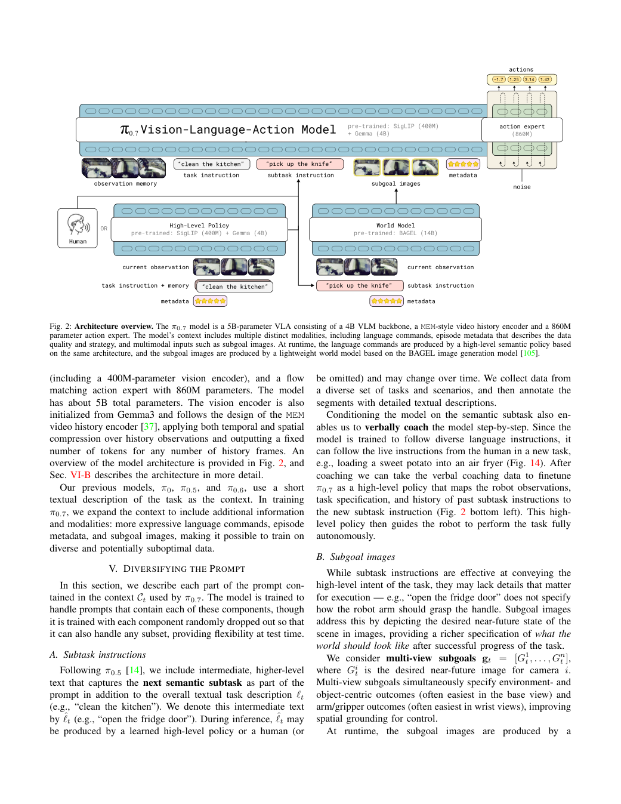

上方 VLA 总规模约 5B：Gemma3 4B VLM（包括约 400M 视觉编码器）加约 860M 动作专家。它根据观测历史和条件生成动作。左下高层策略给出下一条子任务，也可由人提供；右下 BAGEL 初始化的约 14B 世界模型生成多视角目标图像。世界模型的输出是**给 VLA 看的条件**，不是直接发给电机的控制量。[图 2、§IV](https://www.pi.website/download/pi07.pdf#page=4)

因此，“世界模型帮助动作”有一条具体路径：它先把文字意图翻译成当前场景中可供动作模型参考的未来视觉状态，再由 VLA 结合真实观测决定如何到达。图 2 本身仅给出结构，不能证明生成目标一定正确；图 10–12 的有/无目标图像对照才检验这条路径。

## 3 核心方法/模型详解

### 先把一条训练样本拆开：什么是输入，什么是答案？

用“把衬衫右袖折向中间”贯穿全文。假设当前帧中袖子仍摊开，机器人接下来会抓住袖口、移动并松开。训练样本需要包含三类信息：当前已经知道的观测、解释这段行为的条件，以及要预测的真实动作。下面是教学示意，数值与任务描述不代表作者公开的一条原始记录。

```text
当前已知：相机图像、近期历史、对应机器人状态
任务条件：折叠衬衫；当前子任务是把右袖折向中间
行为条件：这条轨迹的时长档位、质量分数、当前片段是否出错
动作语义：joint 或 ee
可选视觉条件：右袖已折入时的多视角目标图像
训练答案：从当前时刻开始的 50 步真实动作，及其 FAST 离散表示
```

**同一个未来图像，在两个模型里扮演不同角色。** 对世界模型，它是要生成的答案；对动作策略，它是已给定的目标条件，动作才是答案。这一区别决定数据怎样组成，也决定梯度在哪里结束。论文没有把“动作执行差了”经图像生成过程反传回世界模型的端到端训练写成其方法。[§V-B、VI-C](https://www.pi.website/download/pi07.pdf#page=7)

图 3 展示这些条件如何随阶段组合。关注图中观测、文字和目标的对应关系：它们共同描述这一时刻要学的行为，而不是互不相干的附加标签。

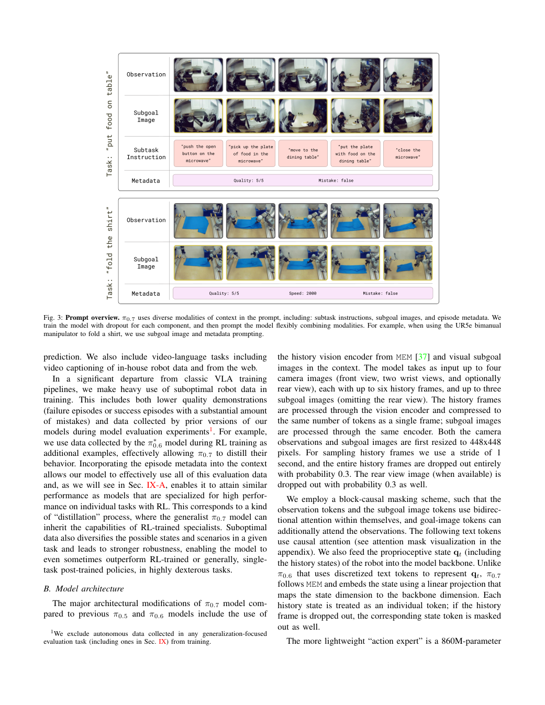

图中的阶段变化说明，同一总任务可以在不同时刻配不同子任务和目标；下方折叠例子还把执行属性放入提示。这证明的是接口能够表达什么，不能单靠这张示意图断定标签提高成功率。后文将分别看元数据与视觉目标的对照。

论文式 (1) 的目标是最大化 `E_D[log πθ(A | O,C)]`：`A` 是未来动作块，`O` 是观测历史，`C` 是上下文，`θ` 是策略参数。关键变化在 `C`。模型仍然学习数据里的动作，只是预测时拥有了更多解释动作差异的信息。实际连续动作训练采用流匹配，论文明确它不是直接计算闭式动作似然。[§III，式 (1)](https://www.pi.website/download/pi07.pdf#page=3)

### 质量条件怎样改变学习：差动作也有损失，为什么不一定拖垮好动作？

先考虑不加标签的情况。相似观测和同一任务下，平稳折叠、迟疑调整、抓取失败都可能进入训练。模型可以表示多种行为，但仅凭这些输入，不一定知道部署时希望选哪一种。作者补充行为元数据，让训练去拟合“在指定执行条件下的动作”。

下面是对条件化机制的数学解释，并非论文新增定理。把任务和观测合记为 `x`，把元数据记为 `m`：

```text
不提供元数据：p(A | x) = Σ_m p(A | x,m) p(m | x)
提供元数据：  学习 pθ(A | x,m)，部署时指定 m = 期望执行条件
```

第一个式子表示：看不到 `m` 时，动作分布混合了不同执行方式；第二个接口使我们能够请求其中一种条件下的行为。这里不应简单说“网络把好坏动作平均”，因为流模型可以表达多模态分布。真正的问题是**缺少选择期望行为的输入依据**。

作者的标签具体如下。时长是整个 episode 的属性；错误标签描述给定动作片段，二者不能都当作逐帧测量噪声分数。[§V-C](https://www.pi.website/download/pi07.pdf#page=5)

| 标签 | 训练时如何得到 | 部署时怎样指定 | 对学习的作用 |
| --- | --- | --- | --- |
| Speed | 轨迹总步数，按 500 步分档；1750–2250 归入 2000 | 对每个任务取轨迹长度的第 15 百分位 | 区分不同执行时长；并非末端速度 m/s |
| Quality | 人工粗标 1–5，5 为最高质量 | 设为 5 | 使执行质量成为动作预测的条件 |
| Mistake | 人工粗标动作片段中是否抓取失败、执行错子任务等 | 设为 false | 区分出错片段与期望行为 |

回到衬衫例子，低质量样本的真实动作仍会形成监督，只是附有对应标签。它可能带来少见衣物形态、物体摆放和操作状态的覆盖；高质量样本则约束相应条件下的动作分布。两者使用共享参数，因此不能保证梯度完全不冲突。模型是否真正利用了标签，需要同数据、同设置下有无标签的对照，后面的图 18 正在检验这件事。

**条件化与筛选、加权是三种不同操作。** 筛选决定样本是否进入训练；加权决定损失贡献大小；条件化决定网络预测时知道什么。π0.7 在这里披露的是第三种操作，不能据此编出“低质量 loss 自动变小”的实现。原文也没有给出完整人工评分手册、标签一致性统计或未知标签处理配方。

部署时使用高质量标签，是在调用训练中学到的相关行为，而非给模型一条必然遵守的约束。新任务没有轨迹长度分布时怎样设置第 15 百分位，论文没有完整交代；这一空缺应留给复现方案解决，而不是随意填一个速度值。[§VII](https://www.pi.website/download/pi07.pdf#page=7)

### 数据到底怎样贡献能力：行为覆盖与动作正确性要分开看

策略训练使用多机器人示教、包含失败和错误的示教、历史模型自主评估轨迹、人的干预以及开源机器人数据；还包含人类第一视角视频和定位、属性预测、视觉问答、文本、视频描述等辅助任务。此前 RL 专家的轨迹也成为训练样本，使通用策略可以学习专用策略表现过的行为；这不等于对每个新任务再次运行 RL。[§VI-A](https://www.pi.website/download/pi07.pdf#page=6)

这批经验有两层价值：示范具体动作，以及扩展模型见到的场景与状态。作者借助条件标签尝试保留第二层价值，同时让部署选择更好的执行方式。但论文没有证明每一条失败轨迹都改善恢复能力，也没有完整公开每类无动作数据的训练目标、采样比例和损失权重，不能把它们统一写成机器人动作监督。

对我们关心的 UMI 混训，必须再加一个区分：**操作不熟练与测量不准确不是同一种问题。** Quality 可以描述抓取笨拙，却不负责修复坐标偏置、时间错位或夹爪标定。一条成功轨迹即便标为 5 分，错误动作数值仍可能成为错误监督。π0.7 的实验支持混合行为质量的利用，没有验证任意传感噪声都能靠标签消除。

### 世界模型补什么：从“折右袖”到当前场景中的目标状态

总任务“折衬衫”没有指定当前阶段，子任务语言先解决“现在做哪一步”。但同一句“把右袖折向中间”，在不同衣服位置、尺寸和折叠状态下对应不同的空间结果。作者再给动作模型提供目标图像，让它同时看到当前状态和希望到达的状态。外部视角描述衣物整体形状，腕部视角提供手和物体的局部关系。[§V-A–B](https://www.pi.website/download/pi07.pdf#page=4)

这会缩小动作预测需要自行推断的范围：低层策略不用只凭一句文字同时猜终态和到达方式，可以专注学习当前状态到给定目标的动作关系。论文称它接近“逆动力学”任务，即由前后状态反推动作；多视角图像不能唯一决定每个关节动作，真实动作监督仍不可缺少。作者报告有目标图像时训练更快，但没有给出可直接用于预算规划的统一加速倍数。[§V-E](https://www.pi.website/download/pi07.pdf#page=5)

世界模型以 BAGEL 的约 14B 模型初始化。训练时选取具有高质量分段语言的机器人或人类视频片段，用当前观测、子任务和元数据预测该片段末时刻的多视角图像。**这里强调的是分段语言标签质量**，不能直接改写成“只使用 Quality=5 的轨迹”。还混入图像编辑和视频数据，以保留原有语义能力。[§V-B、附录 C](https://www.pi.website/download/pi07.pdf#page=22)

实现上，当前三视角图像各走两条编码路径：ViT（视觉 Transformer）提取语义，VAE（图像潜变量编码器）保留生成所需细节。ViT token 进入约 7B 的理解主干，VAE token 进入约 7B 的生成主干；目标图像在潜变量空间接受生成监督。ViT 输入为 448×336、patch 14；VAE 输入为 512×384、patch 16。这些尺寸服务于两条编码路径，不能与动作策略侧统一的 448×448 混用。

训练这一路时，片段末图像是生成答案；部署时末图像不存在，必须由模型预测。其作用是为动作模型提供可用的视觉目标，并不是保证物理可达的仿真器。原文将标准流匹配 loss 写在 `max E[L_CFM]` 中，正负号存在歧义；没有实现佐证时不能照着最大化通常的平方误差。

### 训练看到的目标，怎样过渡到部署时的生成目标？

如果动作模型只见过完美的真实未来帧，部署时生成图像中的纹理变化、位置误差或不够精确的手部状态就可能造成分布变化。作者采取两步处理：训练时改变真实目标的时间距离，并让策略同时接触世界模型生成的目标。[§VI-C](https://www.pi.website/download/pi07.pdf#page=7)

对真实目标，25% 概率选片段末帧，75% 概率在当前之后 0–4 秒均匀采样。末帧与世界模型的生成监督一致，近期帧则让策略接触不同进展幅度与延迟。作者还生成大量子目标，替换真实未来帧构造额外训练样本，从而让生成图像也进入策略训练。

需要区分三个不同问题：

| 问题 | 论文披露 | 实现含义 |
| --- | --- | --- |
| 哪些策略样本提供目标？ | batch 中 25% 的样本 | 其余样本继续学习无视觉目标的动作预测 |
| 使用真实目标时取哪个时刻？ | 25% 末帧，75% 为未来 0–4 秒 | 这是目标时间采样，分母不是整个 batch |
| 真实目标与生成目标各占多少？ | 采用两者，但总体混合比例未给出 | 不能从上述两个 25% 推出 |

保留无目标样本使同一策略可以在部署时不启用世界模型。带目标的样本提供较明确的动作学习问题，无目标样本仍要根据观测与其他条件推断行为。两类训练共享参数，但论文没有证明目标分支的全部收益都能自动迁移到无目标分支。

在生成目标与原动作不一致时如何筛选、重采样或调整监督，原文没有详细披露。这是实际复现的重要缺口：不能默认把任意生成图与同一动作块配对都正确。若要建立自己的过滤方案，应作为工程建议另行验证。

### 梯度怎样走：离散动作教主干，连续动作教专家

图像与文字进入 Gemma3 4B VLM，约 860M 的动作专家读取其激活，并预测连续动作。作者沿用 knowledge insulation（知识隔离）：主干由 FAST 离散动作 token 的交叉熵训练，连续动作专家由流匹配训练；连续动作损失不向 VLM 主干反传。[§III](https://www.pi.website/download/pi07.pdf#page=3)

可以把计算与梯度分工画成下面的教学示意。FAST 将动作表示为离散 token，使主干能通过类似预测文本的目标学习机器人任务；这里不补造其编码器的具体参数。

```text
观测 + 文字 + 可选目标图像
              ↓
           VLM 主干 ──→ FAST token 预测 ──→ 交叉熵，更新主干
              │
              └──→ 主干激活 ──[阻断该路径的反向梯度]──→ 动作专家
                                                        ↑
                                             加噪动作 + 流时间
                                                        ↓
                                               流匹配，更新专家
```

**主干仍然在学。** 如果只复制“动作梯度不进主干”，却没有 FAST 或其他有效主干监督，就没有复现这套训练分工。反过来，冻结全部主干、仅降低主干学习率、缓存激活，也都不能直接等同于论文的知识隔离。

为理解流匹配，下面给出常见直线路径的教学展开，不是作者完整 sampler 或未公开配置：真实动作块为 `A∈R^(50×d)`，噪声为 `ε`，取流时间 `τ∈[0,1]`，构造 `Aτ=(1−τ)ε+τA`，目标速度为 `A−ε`。专家根据 `Aτ`、`τ` 和上下文预测这一方向，平方误差使其学会从噪声向动作移动。若一维 `A=2、ε=−1、τ=0.4`，则输入为 0.2，目标速度为 3。`τ` 是去噪过程位置，不是机器人执行时间。

在这个示意中，质量标签改变专家预测所依赖的上下文，不会自动改变目标 `A−ε`。真正的噪声时间分布、有效动作维掩码、loss 归约、各损失权重与优化器设置，本文没有从 π0.7 报告中获得完整配方，因此不能把示意式称为可复现训练代码。

专家的 50 个动作 token 彼此双向注意力，流时间通过 adaptive RMSNorm 调制层输入。机器人状态线性投影为主干 token；历史状态分别编码。视觉历史最多来自四个相机、每视角最多六帧、间隔 1 秒，经 MEM 编码压缩到相当于一帧的 token 数。它使模型能够区分当前画面相似、之前过程不同的状态，同时控制历史输入的序列开销。[§VI-B](https://www.pi.website/download/pi07.pdf#page=6)

图 19 要核查两类隔离：训练时答案 token 是否泄漏给连续动作分支，推理时有无条件分支是否互相读取。

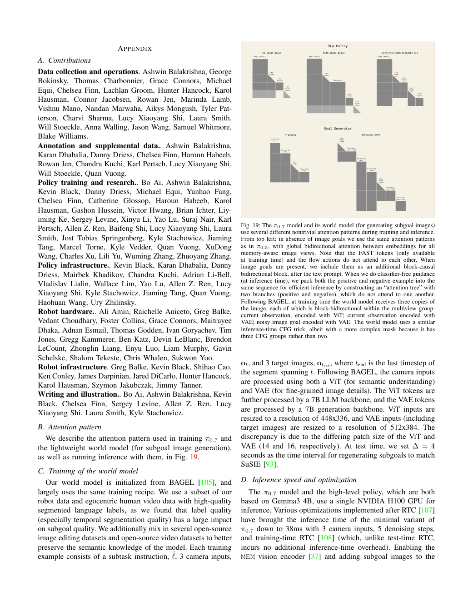

FAST token 与连续动作不互相 attend，避免连续专家直接读到训练答案；这与阻断梯度是两件事，分别控制前向信息和反向更新。观测、目标内部使用双向块，其他访问由块因果掩码控制。CFG 时正负分支打包为 attention tree，但彼此隔离。正文 §VI-B 的顺序概述与图注中目标图像位于文字之后的表述不完全一致，精确序列布局仍应查实现，不能自行确定。[附录 B、图 19](https://www.pi.website/download/pi07.pdf#page=22)

### 条件丢弃与 CFG：训练中的缺省输入，怎样变成推理中的控制手段？

如果标签总是齐全，部署时突然缺一项就会改变输入分布。作者在训练时主动丢弃条件，使模型学习同一观测在条件充分和条件不充分时的预测。

| 条件 | 训练操作 | 为什么需要 |
| --- | --- | --- |
| 子目标图像 | 只在 25% batch 样本中提供 | 兼容有目标与无目标策略 |
| 子任务文字 | 有目标图像的样本内，以 30% 概率丢弃 | 让图像承担部分阶段信息 |
| 元数据 | 整组以 15% 概率丢弃，字段另各以 5% 概率丢弃 | 支持缺省条件和引导分支 |
| 控制模式 | 始终保留 | joint/ee 改变动作的解释方式 |
| 历史图像 | 整段以 30% 概率丢弃，同时 mask 对应历史状态 | 防止“无历史”输入仍从状态读取历史 |
| rear view | 存在时以 30% 概率丢弃 | 兼容后视图缺失 |

假设 batch 有 100 个样本，平均约 25 个提供目标，其中约 7.5 个会丢掉子任务文字。这是期望数；不能把条件概率写成全 batch 有 30 个丢文字。[§V-E、VI-B](https://www.pi.website/download/pi07.pdf#page=5)

这个训练分布还支持 CFG（无分类器引导）。推理时一次使用期望的质量、速度、无错误条件，另一次移除元数据；比较两种预测方向，就能增强指定行为相对于缺省行为的差异。论文用动作 score 表达为 `s条件 + β(s条件 − s缺元数据)`，`β` 取 1.3、1.7 或 2.2。score 是动作 log-policy 的梯度；缺元数据并不等于清空观察和任务。[§VII](https://www.pi.website/download/pi07.pdf#page=7)

例如教学标量 `s条件=2、s缺元数据=1、β=1.3`，引导结果为 3.3。这是在推理时偏转生成方向，不更新权重，也不代表物理动作直接放大到 3.3 倍。论文的 score 表达如何映射到具体流速度 sampler 需要实现核验。至此，训练时记录标签、丢弃标签，部署时指定标签并做引导，才形成完整的可控行为链条。


### 部署时两个速度不同的循环怎样配合？

动作策略推理用 5 次去噪产生 50 步动作，但每次只执行 15 或 25 步后重新规划。在 50 Hz 的教学换算下，这分别是 1 秒的预测窗口、0.3 或 0.5 秒的执行窗口；5 次去噪是网络计算次数，不是电机只运行 5 步。[§VII](https://www.pi.website/download/pi07.pdf#page=7)

世界模型明显更慢。作者令其在**子任务改变或距上次生成达到 4 秒**时刷新，并独立线程异步运行。动作模型继续使用最新可用目标，而不是每次生成动作都等世界模型。在切换子任务后、新目标尚未生成的间隙，如何避免旧目标和新指令冲突，论文没有给出完整的版本一致性协议。

算法 1 的阅读顺序是：先准备条件，再看第 7–9 行的慢速目标刷新和第 11–14 行的动作规划/执行。两个循环都服务于真实观测反馈。

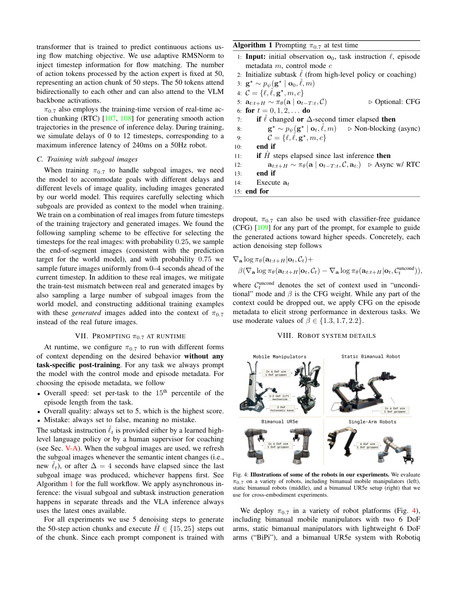

同页图 4 展示移动双臂、静态双臂、UR5e 与单臂系统，区别不只在关节数，还包括底座运动和工作范围。因此控制模式提示提供了动作解释上下文，但这个平台示意本身不能证明跨身体迁移；相关结果在图 12–13。

为降低推理延迟导致的动作衔接不连续，作者使用训练期 RTC（实时动作分块），模拟 0–12 个时间步延迟；50 Hz 下最多 240 ms。算法的下一轮预测还以正在执行的动作序列作为条件。论文披露了这个训练扰动与运行框架，但具体 prefix masking 等实现细节需要继续查对应 RTC 工作，本文不把常见实现猜成 π0.7 的已公开代码。[§VI-B、算法 1](https://www.pi.website/download/pi07.pdf#page=7)

| 模块 | 作者报告的配置 | 延迟含义 |
| --- | --- | --- |
| 最小 VLA variant | 单 H100，3 相机，5 次去噪，训练期 RTC | 约 38 ms；不是所有配置都达到 |
| 带 MEM 与目标图像的较重配置 | 同类 VLA 推理 | 最坏约 127 ms |
| 世界模型 | 14B，近 10k token，4×H100 tensor parallel；大矩阵乘法 8-bit；修改的 SageAttention | 25 次去噪，包含文本/图像 CFG，生成约 1.25 s |

因此论文所称“轻量世界模型”不能理解成比 VLA 小或可免费运行。它生成稀疏的子目标而不必生成整段视频，但单次计算和硬件开销仍很大。异步降低了控制阻塞，不等于消除了目标变旧和条件延迟。[附录 D](https://www.pi.website/download/pi07.pdf#page=23)

### 能重建机制，不等于获得完整训练配方

上述步骤可以重建条件、监督与运行接口，但报告没有给出机器人总小时数、逐源采样权重、完整训练 batch/步数/学习率/优化器及总 GPU-hours。4×H100 是世界模型推理配置，不能当成训练集群规模。本文没有用其他版本 openpi 源码补齐这些空缺。

论文也明确，泛化评估任务所收集的自主数据被排除在训练之外。此前策略的评估轨迹进入训练，与把当前泛化测试回灌训练不是一回事；大规模语料中的语义重叠仍无法被完全穷尽。[§VI-A 脚注](https://www.pi.website/download/pi07.pdf#page=6)

## 4 实验与结果分析

先检验本文最核心的混合质量机制，再看通用操作、视觉目标和迁移能力。这样可以区分“整个系统表现好”与“某项设计确实有贡献”。

### 更多低质量数据，到底是在帮忙还是在拖累？

图 18 是混合训练最直接的证据。左图横轴是按质量和速度选取的训练数据比例，纵轴是折衣任务每小时成功次数；右图比较移除同样 20% 数据时，移走高任务多样性数据和随机移除有什么不同。

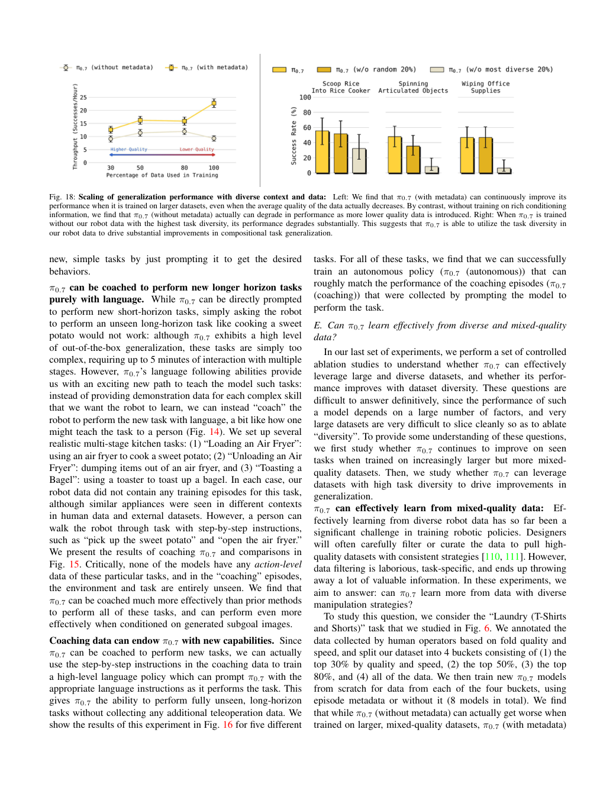

左图构造 top 30%、50%、80%、全部数据四组，每组有/无 metadata，共 8 个模型。随着低质量数据加入，带 metadata 的总体表现提高，全部数据时明显更好；没有 metadata 的曲线在全量数据处退化。50%→80% 的带标签曲线近乎平台，因此不宜将其写成每个增量都显著提升的严格单调定律。[§IX-E、图 18 左](https://www.pi.website/download/pi07.pdf#page=14)

这回答了第 2 节的问题：保留低质量轨迹并不必然让模型只能复制低质量行为，前提是条件帮助区分执行模式，并在推理时选取期望模式。它不证明每种来源的噪声都可由同一种标签消除，也没有给出 UMI 最优采样比例。

右图在未见短程任务上，移除最多样的 20% 比随机移除 20% 退化更明显。这个对照把简单“数据少了”与“多样性减少”部分分开，支持不同任务经验被用于组合泛化。仍不能保证人工定义的多样性与数据质量、任务相关性完全独立。[图 18 右](https://www.pi.website/download/pi07.pdf#page=14)

### 通用模型不做任务专门微调，能做到专家水平吗？

图 6 上半比较 RL 专家，下半比较 SFT 专家。上半同时看成功率和 throughput；后者是每小时成功次数，并相对专家归一化。下半是任务进度，表示完成评分步骤的比例，不等于整任务成功率。

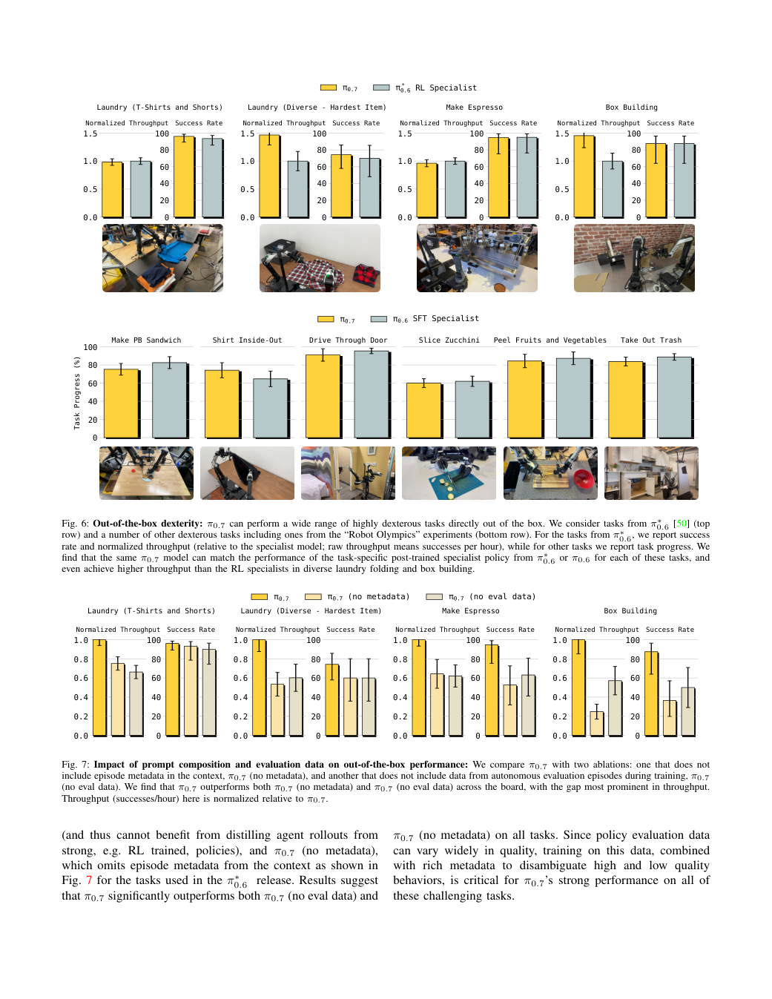

π0.7 在这些已有技能任务中整体接近专门训练的专家，在多样衣物折叠、纸箱搭建的吞吐上更高，但并非每项成功率或任务进度都领先。其意义是一个通用策略能覆盖多项精细技能，不能把这些**预训练中出现的任务**称为未见任务泛化。[图 6](https://www.pi.website/download/pi07.pdf#page=9)

图 7 进一步回答收益与条件/数据是否有关：去掉 metadata，或移除自主评估轨迹，表现都下降，吞吐差异尤其明显。机制上，前者拿走区分执行方式的信息，后者拿走包含旧专家行为的经验。它们支持两部分都重要，但不是把全部架构、数据量、元数据质量独立穷举的因果分解。[图 7](https://www.pi.website/download/pi07.pdf#page=9)

### 历史信息有没有真正进入操作能力？

图 8 比较换杯追踪、寻找物体、舀咖啡、擦窗等需要上下文的任务。看的是 π0.7 与已为相同任务微调的 π0.6-MEM 专家，不是无记忆与有记忆的纯消融。

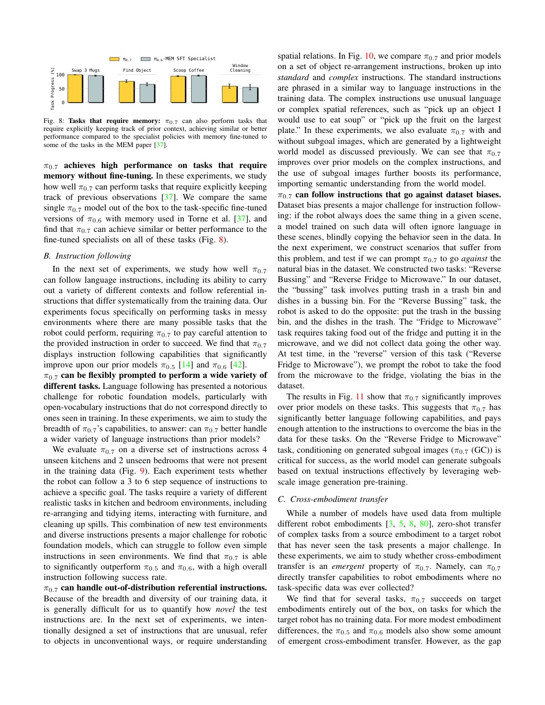

结果显示通用模型可以达到相近或更好的任务进度，支持它没有在多任务训练中丢掉这类能力。但因基线本身也有记忆，这张图不能单独量化 MEM 相对无历史输入的净收益。[图 8、§IX-A](https://www.pi.website/download/pi07.pdf#page=10)

### 世界模型是否真的补足语言里的执行细节？

先读图 9 的陌生厨房/卧室，再看图 10 的复杂指代，最后看图 11 的反训练偏好任务。带斜纹的 GC 版本表示用了生成目标图像（goal-conditioned），不是另一个人为提供真实未来图像的策略。

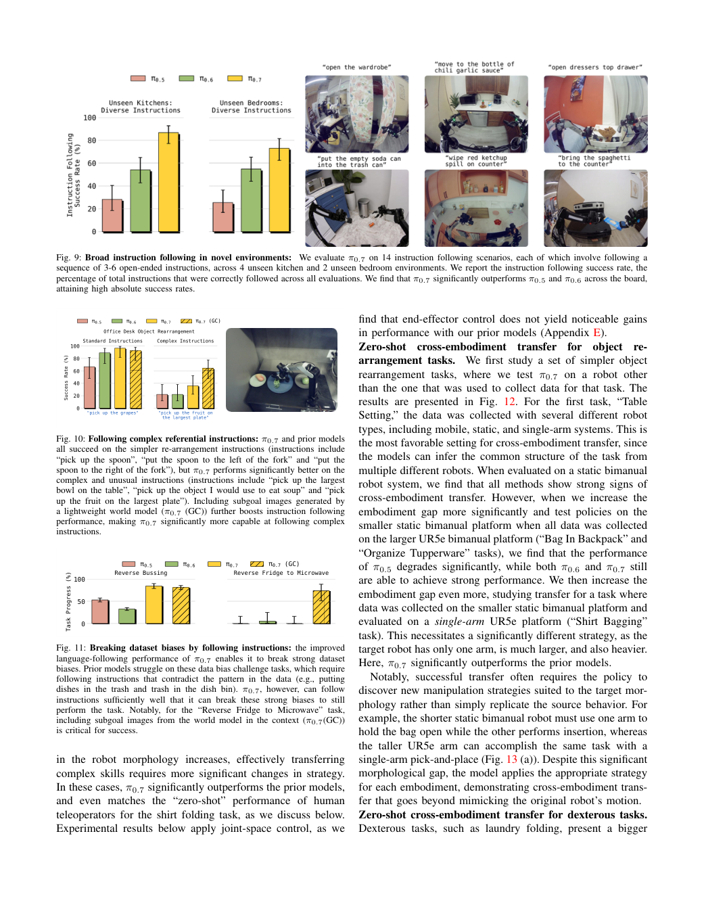

图 9 在 4 个未见厨房、2 个未见卧室的 14 个场景中评估每组 3–6 步指令，指标是正确执行指令的比例。π0.7 明显优于旧模型，但这并非要求每段长程任务所有步骤都成功的更严格指标。

图 10 将普通物体指令与“拿最大盘子上的水果”这类复杂关系分开；生成目标在复杂指令上帮助更明显。图 11 进一步要求模型反转常见数据关联，例如把食物从微波炉放回冰箱。该反向任务上，不带目标的几个策略几乎无法推进，GC 明显改善。这些比较支持的解释是：视觉目标为当前文字意图提供了更强的场景条件，帮助动作策略脱离单纯重复训练中的常见流程。实验支持这些任务上的收益，不证明世界模型永不幻觉，也没有单独隔离“互联网知识”这一因素的全部贡献。[§IX-B、图 9–11](https://www.pi.website/download/pi07.pdf#page=11)

### 换机器人时，是复制动作还是改变操作策略？

图 12 每组下方给出来源和目标机器人；左侧是物体重排，右侧是折叠这类更精细技能。图 13 则看同一任务在不同身体上怎样实际执行。

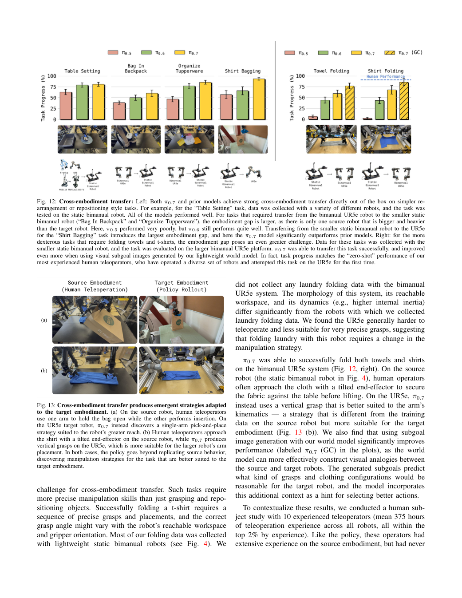

Table Setting 在多种来源机器人上有数据，各模型都有一定迁移；身体和任务差异扩大时，π0.7 的优势更清楚。作者未在双臂 UR5e 上采集衣物折叠任务数据，策略仍可执行折毛巾和衬衫，生成目标进一步改善任务进度。

图 13 给出具体变化：源机器人需一只手撑袋子、另一只手放物体，较大工作范围的目标机器人可用单臂放置；折叠时，源身体倾斜夹爪压住布料，目标身体采用更适合运动学的垂直抓取。这些定性案例说明策略不只是逐关节轨迹复制；但它们不是所有任务都有这种适应的统计证明。[§IX-C](https://www.pi.website/download/pi07.pdf#page=12)

读附录图 20–22 时先区分三个问题：控制坐标是否解释收益、人工基线是否有经验、模型与人工实际差多少。

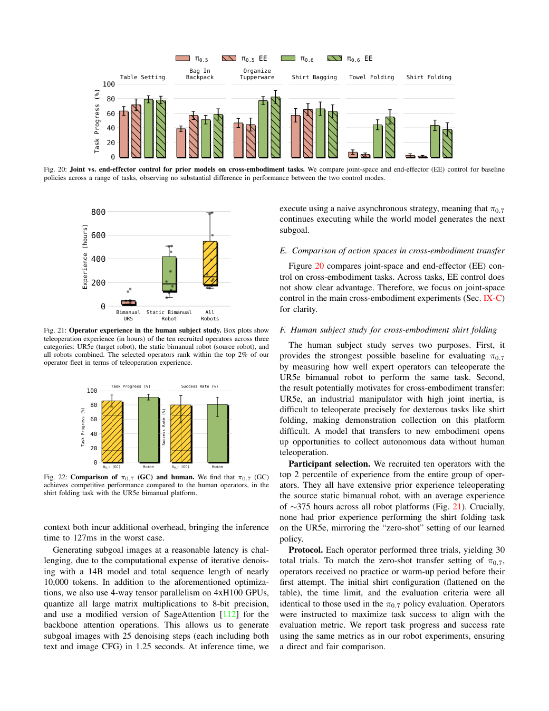

图 20 比较的是**旧模型**的 joint/EE 控制，未见末端控制稳定占优，因此主实验采用关节控制；不能外推为所有机器人都无需动作对齐。图 21 的 10 名操作员位于经验前 2%，跨平台平均约 375 小时，但没有 UR5e 衬衫折叠经验。每人 3 次，无热身，总共 30 次。图 22 及正文报告人工任务进度 90.9%、成功率 80.6%；π0.7(GC) 为 85.6%、80%。这是相近水平，不能说超过人类。[附录 E–F](https://www.pi.website/download/pi07.pdf#page=23)

原文 30 次协议与 80.6% 的成功率如何汇总并未在此完全解释；不能强行把 80.6% 换算成某个整数成功次数。应保留作者报告口径，并将其作为进一步复现所需的细节。

### 新任务能直接执行到什么程度？什么时候仍需要教？

图 14 展示语言 coaching：人逐步指示抓空气炸锅把手、开门、拿红薯、放入、关门。随后看图 15 的带指导表现、图 16 的自动高层策略，以及图 17 的短程新任务。

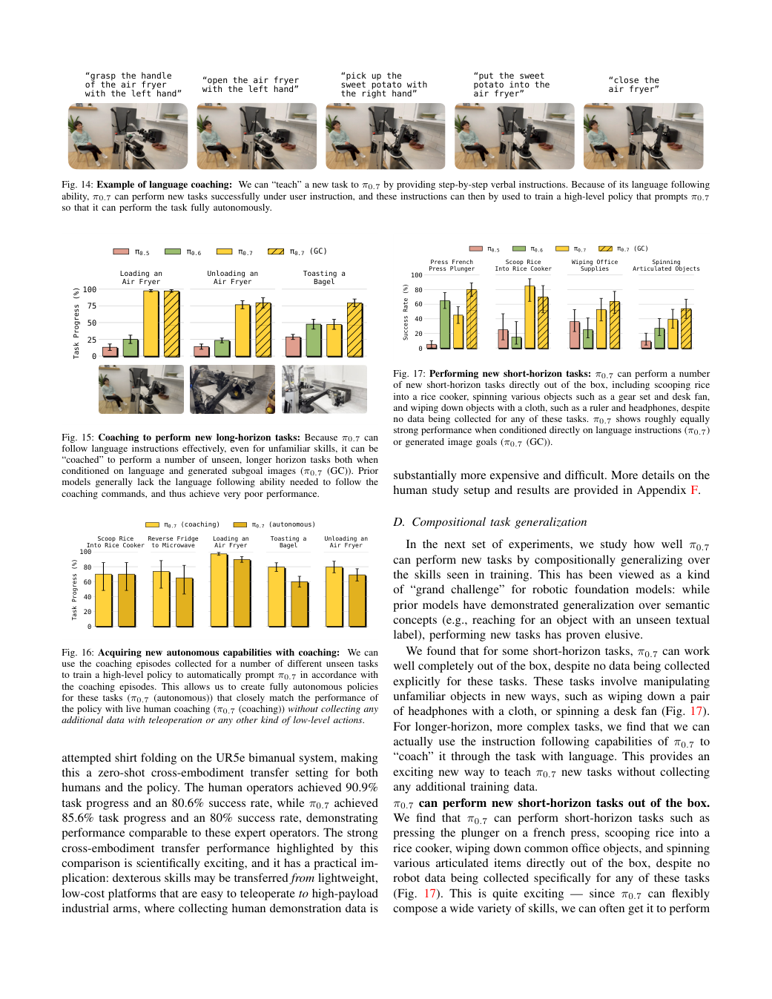

短程任务中，如压法压壶、舀米到电饭煲、擦办公物品，π0.7 可在未专门收集这些机器人任务数据时直接尝试；GC 在多项任务上更好，但并非每个柱子都高于无 GC，例如图 17 的舀米。这说明视觉目标是一种有用条件，而不是必开的收益开关。[图 17](https://www.pi.website/download/pi07.pdf#page=13)

长程未见任务不能只靠一句总目标稳定完成。作者先由人类给出子任务序列，使用已有低层策略执行；再用这些 coaching episode 的指令学习高层语言策略，使其自动决定下一条子任务。图 16 的 autonomous 接近 coaching，表示减少了实时人工指挥，但**仍然使用了新收集的 coaching 信息并训练高层模型**。无新增低层遥操作数据，不等于没有新数据、没有任何学习。[§IX-D、图 14–16](https://www.pi.website/download/pi07.pdf#page=14)

## 5 论文的贡献与影响

### 最有用的变化：把“如何使用数据”变成可训练的接口

π0.7 把三个层级接起来：元数据解释执行风格，子任务解释语义阶段，生成图像解释近期空间结果。训练不再只要求一个模糊指令覆盖所有示教；部署也拥有相同的条件入口。它结合了已有的 VLM、记忆、离散/连续梯度分工、目标生成与实时执行，价值在于这些接口和数据配方共同工作，并以真实机器人对照呈现收益。

其中最强、最贴近混训问题的证据是图 18 的有/无 metadata 数据扩展对照；最薄弱的外推是把它推广为“任意坏数据都能变好数据”。标签与行为必须对应，生成目标必须可用，动作监督仍需有物理意义。

### 对 UMI＋真机预训练，可借鉴到哪一步？

可以先借鉴条件接口，而不是立即复制整个 14B 世界模型系统。把“任务是什么、当前阶段是什么、控制方式是什么、测量可靠性是否已知、是否出现操作错误”分开记录。π0.7 的 quality/mistake 是任务行为评价；UMI 的跟踪误差、标定与时间同步属于另外一组信息，不能混叫低质量。

后续实验的一个可检验最小方案是：固定数据、动作表示、采样与训练预算，比较无条件混合和加入可靠行为标签的混合；目标微调与推理时保持标签协议一致。再独立比较是否加入视觉子目标，避免同时改变数据筛选和世界模型后无法归因。这些是本文建议，尚未实验。

| 待验证的问题 | 来自论文的线索 | 最小对照与观察 |
| --- | --- | --- |
| 标签会不会只学成来源身份？ | 论文质量条件在任务内有效，但未隔离所有来源相关性 | 分源/分任务检查标签覆盖；留出来源，比较同标签的行为变化 |
| 生成图是否帮助精细操作？ | GC 改善多项指令与跨身体任务 | 同策略比较无目标/生成目标，保持其他条件；记录目标错误与接触失败 |
| 旧目标会不会拖累新任务阶段？ | 作者异步使用最新目标，缺版本一致性细节 | 对比子任务切换时的目标有效期策略；统计过期目标下错误 |
| 条件能否吸收测量偏差？ | 原文没有直接验证 | 先检查坐标/时间误差；以闭环精度评估，不能仅看 quality 条件响应 |

### 可复现程度、局限性与证据边界

本次精读可追溯到官方 PDF 的方法、附录和全部关键图表，图像已逐页打开检查。页面中的公式展开、概率换算与流程解释是教学重建，不冒充训练源码。缺少代码的 token 精确顺序、流损失归约、元数据缺失处理、标签标注标准及完整优化器配置仍列为缺口。

论文对“未见”也有明确保留：没有专门采集目标任务数据，不意味着大规模机器人、人类或互联网数据里绝无相关片段。可成立的说法是其评估协议下的组合与跨身体迁移；不能据此证明抽象意义上完全没有相关先验。

## 6 结论

π0.7 对混合数据的回答是：**先让模型知道这条示教在怎样执行，再让部署条件选择期望的执行模式。** 语言提供阶段，图像提供空间细节，元数据提供行为偏好，控制模式提供动作语义；这些条件通过丢弃训练、离散/连续监督分工及异步执行连接起来。

研究使用判断：这篇值得作为条件化混训和分层执行的设计依据，尚不足以独立复现完整预训练。真正值得带走的是这条完整路径，而不是一句“加 metadata 就能用坏数据”。图 18 支持其混合质量训练设计，GC 对照支持目标图像在部分任务中的价值；人工标注成本、目标生成开销、测量噪声与完整复现配置仍是实施时必须回答的问题。

**继续阅读与来源**：[官方论文](https://www.pi.website/download/pi07.pdf) · [官方项目](https://www.pi.website/pi07) · [五篇 VLA 预训练专题](../vla-pretraining/) · [本文 Markdown](report.md) · [来源记录](source_map.json) · [图表清单](visual_manifest.json)。本篇讲解方式使用更新后的 paper-deep-reader；用户指定的知乎文章仅作为表达方法参考，事实重新核对官方论文，未转载其正文或配图。
