# RoboTTT：把执行历史写进权重，机器人怎样学会记忆与纠错？

Yunfan Jiang、Yevgen Chebotar、Ruijie Zheng 等 · **RoboTTT: Context Scaling for Robot Policies** · NVIDIA、Stanford、UT Austin · 官方 PDF 日期 2026-07-15；对应 arXiv:2607.15275v1，2026-07-16。整理于 2026-11-17。[官方论文](https://research.nvidia.com/labs/gear/robottt/robottt.pdf) · [结构化全文](https://arxiv.org/html/2607.15275v1) · [项目页](https://research.nvidia.com/labs/gear/robottt/)

机器人把电钻移到车顶螺丝附近，尝试了一次，却没有拧进去。此时的画面和“刚拿起电钻、准备接近螺丝”可能很相似，下一步却应该不同：前者需要抬起、调整位置再尝试，后者继续接近即可。单帧策略很难知道刚才发生了什么；简单追加一张历史图像，也未必包含真正决定动作的证据。

RoboTTT 把执行历史压缩进一个小神经网络的可更新权重。每次处理新的观察、状态与动作相关 token，模型先更新这组权重，再用它辅助动作预测。作者同时改变了训练方式：沿连续轨迹学习记忆，独立采样每个动作 chunk 的噪声等级，并通过分段反向传播支持长上下文。

**它最值得借鉴的是“历史表示、序列训练、监督分工”这三个接口的配合。** 人类视频可以提供上下文而不提供动作标签；机器人失败可以保留为历史，而模仿损失只监督人类纠正。全文先走通记忆计算，再说明这些数据怎样进入训练，最后检查收益究竟来自什么。以下为论文与附录解读，没有运行作者模型，也没有将未公开的代码细节补写成事实。

## 一、模型结构：历史怎样进入动作预测？

### 1.1 两种权重，对应两种学习过程

TTT 是 Test-Time Training，即测试时训练。它在每层内放入一个小模型 f_W，将这个模型的参数 W 当作随时间更新的记忆。主模型及投影矩阵属于慢权重：正常训练时更新，部署时固定。当前执行过程的 W_t 属于快权重：训练与部署时都随输入序列更新。每条新 rollout 从学习得到的 W₀ 开始，而非默认继承上一条任务的记忆。

当前特征 X_t 经过投影得到 K_t、V_t、Q_t。这里 key 是写入所用的输入，value 是内部学习目标，query 是读取记忆的输入。核心操作如下，公式按论文式 1–2 转写：

```text
L_FW = || f_(W[t−1])(K_t) − V_t ||²
W[t] = W[t−1] − η · ∇_W L_FW
O_t  = f_(W[t])(Q_t)
```

第一步让小模型学会从 key 预测 value，新的经验由此改变参数；第二步通过更新后的模型读取信息。内部目标由输入自身的投影构造，因此推理时无需知道正确动作，就能更新记忆。作者采用带 GeLU 的两层 MLP；内层使用梯度下降，学习率在 0.1 基础值上学习调整。

但这个内部误差并不直接判断“螺丝是否拧紧”。**记忆怎样帮助正确行动，由外层动作损失训练。** 固定大小的权重只能压缩历史，并不保证无损保存全部帧，也不能把“持续更新”直接等同于任务成功率单调提高。[§2、附录 A.1，PDF p.3、20](https://research.nvidia.com/labs/gear/robottt/robottt.pdf#page=3)

### 1.2 注意力处理当前信息，TTT 处理跨时间信息

作者在 GR00T N1.7 上实现 RoboTTT：Eagle 负责视觉语言编码，16 层 Diffusion Transformer（DiT）负责动作生成，每个 DiT 层加入一个 TTT 层。看原图时，先区分左侧沿轨迹训练和右侧逐次执行；绿色小矩阵是持续传递的快权重。

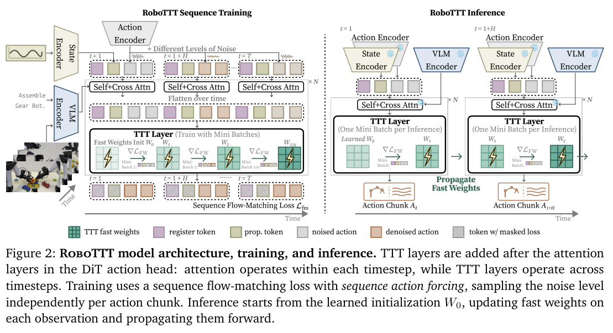

每个时间步包含视觉语言特征 Φ_t、状态 token q_t、带噪动作 token，以及 16 个可学习 register tokens。register tokens 是汇集当前信息的额外槽位。自注意力处理当前步的 register、状态和动作 token，交叉注意力读取当前步的视觉语言特征；随后这些注意力输出沿时间排列，进入 TTT。

大量视觉语言 token 不直接全部送入时序层，作者依赖 register tokens 携带视觉语言信息。这减少跨时间处理量，同时让历史包含感知、状态和动作相关表示。它不是纯历史视觉编码器，也没有显式预测未来图像。

继续用电钻例子：当前视觉说明工具现在在哪，状态说明机器人当前姿态；之前尝试留下的表示通过快权重参与当前动作计算，让策略有机会区分“首次接近”和“失败后重试”。这是结构提供的能力，是否实际学会需要后面的纠正数据与实验支持。[§3.1，PDF p.4](https://research.nvidia.com/labs/gear/robottt/robottt.pdf#page=4)

### 1.3 为什么增加门控，而不是直接叠加新分支？

随机初始化的 TTT 输出可能扰乱预训练动作头。作者在注意力输出上加入受控残差，门控参数 α 为逐通道向量，初始化为 0.001：

```text
O = O_attn + tanh(α) ⊙ O_TTT
```

下面的计算图展示了门控在 TTT 之后的位置；它控制的是新分支写回原表示的幅度。

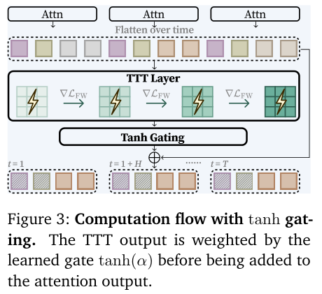

初始 tanh(α) 接近零，因此模型主要保留原有计算，随后通过动作任务训练学习新分支应该贡献多少。这与“预训练表示先稳定、再逐渐利用历史”的目的相符。附录给出的动作头参数量从 538M 增至约 690M，每层新增规模约 10M。固定大小状态意味着每步成本不随已处理历史线性增长，但新增计算和状态存储并非免费。

## 二、核心机制：上下文与动作监督怎样分工？

### 2.1 外层动作目标让内部记忆面向任务

训练样本是完整轨迹或连续子轨迹 ξ={(l,o_t,q_t,A_t)}，其中语言 l 在轨迹内共享。模型从 W₀ 开始，逐步进行内部记忆更新和动作预测，再对各时间步的 flow-matching 损失取平均。投影矩阵与快权重初始化通过外层任务损失学习；论文明确将 W₀ 的学习描述为经过内层更新的元学习。

直觉上，如果把某段历史写入记忆后，后续纠正动作更准确，外层梯度会推动投影与初始化朝有利于这种记忆的方向调整。作者没有给每个历史事件配一个显式“应该记住”的标签，记忆价值通过动作监督间接学习。这也意味着没有足够任务监督时，单纯增加快权重容量不保证模型会使用它。

### 2.2 人类视频：没有动作标签，也可以定义任务

作者在 Circuit 任务中将人类装配视频与同一配置的机器人轨迹拼接。视频段的直接动作损失被屏蔽，但继续更新快权重；机器人段使用视频留下的记忆预测动作，并计算动作损失。每种训练配置收集 5–20 段人类视频，初始布局有变化。

下面先看上排的人类装配，再看重置场景后的机器人执行。所有配置都用同一句“assemble circuit”，因此目标零件和顺序只能来自演示。

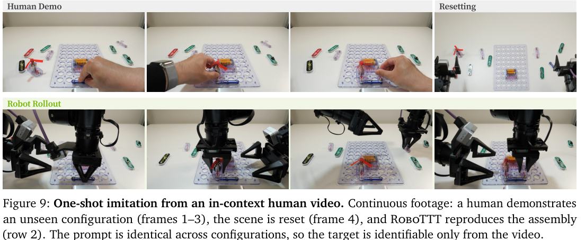

这不是把人类动作直接当机器人关节标签。训练要求策略从视频中提取配置，之后在自己的动作空间完成任务。测试时给一次未见配置的视频，模型再执行；one-shot 指测试条件，不代表训练前从未见过视频—机器人配对。

还要区分两种梯度语义：视频段不产生直接模仿损失，不等于它永远对慢权重没有训练影响。在未被分段截断的计算图内，后续机器人动作损失仍可能通过记忆更新路径影响相关参数。人类视频缺失动作、状态时的具体输入填充方式，论文未充分说明，不能据此编造 tensor 接口。[§3.3、§4，PDF p.6、9](https://research.nvidia.com/labs/gear/robottt/robottt.pdf#page=6)

### 2.3 DAgger Distillation：失败作为上下文，纠正作为目标

DAgger 数据包含机器人执行与人类接管。传统纠正训练主要使用人类动作；这里作者保留失败前后的完整过程，让模型知道纠正回应了什么。

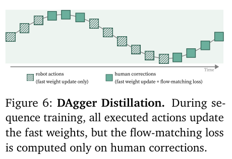

斜线方块表示机器人动作，仅参与记忆更新；实色方块表示人类纠正，同时提供动作监督。电钻尝试失败的过程被保留，人类“抬起—调整—再尝试”的动作成为目标。训练由此学习条件关系：已经这样尝试过且没有成功时，应当怎样改变行为。

下面是用于理解监督角色的教学表达，不是作者公开代码：

```text
for each step in an ordered trajectory:
    update fast memory using the current context
    if action_source == human_correction:
        contribute flow-matching action loss
    else:
        contribute no direct imitation loss
```

这个表达省略了具体 TTT 内层、去噪与梯度实现。尤其在含 mask 的 batch 中，损失除以全部时间步还是有效监督步会改变尺度；论文未充分披露该归约细节，复现时必须明确，而不能默认两者等价。

对异质数据最有价值的启发是：**上下文有效性与动作标签有效性可以分别标记。** 但这不能推出任意噪声数据都适合无条件写入记忆。失败—纠正具有连续因果背景；随机噪声、时间错位和严重标定错误可能同时污染上下文与目标，仍需区分。

## 三、训练与推理：长序列怎样训得动，部署时更新什么？

### 3.1 每个动作 chunk 独立采样噪声等级

在 flow matching 中，真实动作 chunk A_t 与高斯噪声 ε_t 混合为 A_t^τ，动作头预测从噪声向数据移动的速度。论文式 5 的核心计算为：

```text
A_t^τ = τ_t · A_t + (1 − τ_t) · ε_t
velocity target = A_t − ε_t
L = (1/T) Σ_t E[ ||vθ(Φ_t, A_t^τ, q_t; W[t−1]) − (A_t−ε_t)||² ]
u_t ~ Beta(1.5, 1)
τ_t = 0.999 · (1 − u_t)
```

关键在每个时间步的 τ_t 独立采样，而不是一条序列共享一个值。这样相邻动作 chunk 可以具有不同难度。作者称之为 sequence action forcing，并观察到共享噪声等级的版本训练不稳定；他们提出的解释是整条序列同时太容易或太难，影响学习。

τ 接近 1 表示较接近真实动作，接近 0 表示噪声占主导。因此把单步代码改成 [batch,time,…] 形状时，必须检查 τ 是否被错误广播到全部时间步。不能仅凭代码可以运行，就认为实现了论文的序列训练。

### 3.2 TBPTT 保留历史状态，截断远距离梯度

完整时间反向传播需要保存整条轨迹的激活。作者将长序列切成多个片段，只在片段内反传；片段之间保留快权重数值，但 detach 梯度。

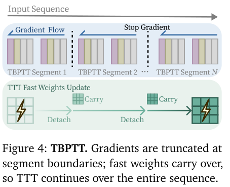

上半部分的蓝色箭头表示局部梯度范围，下半部分表示跨片段保留的状态。后面的动作仍可读取之前形成的记忆，但不能沿全部历史直接反传；W₀ 通过第一段得到梯度。显存主要受片段长度控制，训练总计算量仍随处理序列增长。

因此“8K 上下文”不等于“完整反向传播 8K 步”。论文未充分公开 TBPTT 片段长度、片段间外层优化步安排等细节。若用于现有训练系统，应把这些参数以及 episode reset 明确写入训练协议。[§3.2，PDF p.5](https://research.nvidia.com/labs/gear/robottt/robottt.pdf#page=5)

### 3.3 先训练新增时序模块，再联合后训练

预训练混合双臂桌面机器人数据与第一视角人类数据，并特别强调长轨迹。先看长度分布，确认模型确实有机会接触较长连续过程。

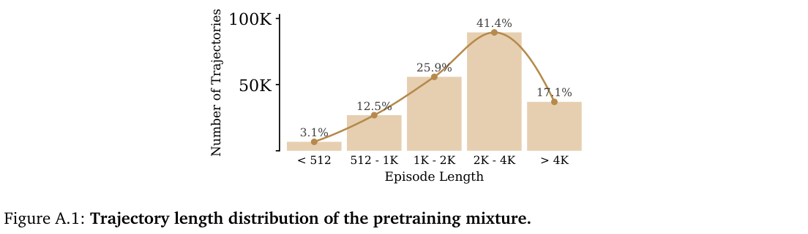

图中 2K–4K 占 41.4%，超过 4K 占 17.1%；总数据小时数和详细源混合比例没有完整披露。也不能仅由这张分布图推断每条 8K 训练样本如何构成，跨轨迹拼接等策略需要额外实现证据。

| 配置 | 预训练 | 任务后训练 |
|---|---|---|
| 可训练部分 | 新增 TTT/GDN 时序模块；冻结其余 GR00T 组件 | 全参数 |
| 上下文 | 逐步增至目标，最高 8K | 1K |
| 优化步数 | 30K | 20K |
| 硬件 | 16 × NVIDIA GB200 | 8 × NVIDIA GB200 |
| 每卡 batch | ≤4K 为 4；>4K 为 1 | 1 |
| 全局 batch | 对应 64 或 16 | 8 |
| 峰值学习率 | 2e-5 | 5e-5 |
| 调度 | Warmup–Stable–Decay | Cosine |
| 优化器、weight decay | AdamW，1e-5 | AdamW，1e-5 |

其他已公开参数包括 16 个 register tokens、RoPE θ=10000、内层基础学习率 0.1。内层学习率与表中外层 AdamW 学习率作用不同，不能互换。分阶段冻结策略意味着长上下文能力先在新增模块中学习，再在任务数据上联合适配。[附录 A，PDF p.20](https://research.nvidia.com/labs/gear/robottt/robottt.pdf#page=20)

### 3.4 推理中的状态生命周期仍有复现缺口

每条 rollout 从 W₀ 起步，接收当前观察后更新快权重，用 k 步去噪生成动作 chunk，再向后传递快权重。作者在 YAM 双臂上部署，四路 RealSense D405 提供 480p RGB，推理工作站使用 RTX 5090，报告控制频率为 30 Hz。

但控制频率不等于每秒完整执行 30 次 VLM 加多步去噪。原图用 t 与 t+H 展示 chunk 推进，正文未充分说明 H、k、执行步数，以及多次去噪评估中快权重究竟何时提交。因此不能给出未经证实的单步延迟、TTT 更新频率或额外开销百分比。

对实际工程，尤其需要明确：去噪过程中哪些快权重是临时状态，哪些状态跨控制请求保存；每个环境实例是否独立持有状态；episode 结束如何重置。固定状态大小解决历史增长成本，并不自动解决这些接口。

## 四、实验结果：改善了什么，哪些比较仍有限？

### 4.1 完成得分与完整成功率分别回答什么？

实验包含 Pup Go Car、Circuit、Gear Bot 三个双臂装配任务，分别收集 8、6、5 小时真机数据，平均轨迹约 2、1、5 分钟。Circuit 约有 80 种配置，其中 20 种训练，其余 60 种作为测试配置池；实际 rollout 次数远少于 60，因此不能说逐一验证了全部测试配置。

主结果先看完成得分：这是按任务步骤的 rubric 评分，允许部分完成。

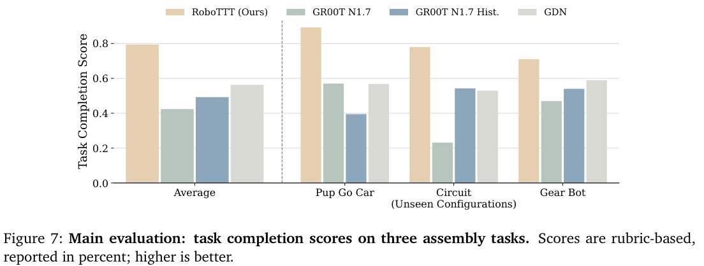

RoboTTT 平均约 79%，GR00T N1.7 约 42%，GDN 约 56%。摘要的“提升 87%”指相对得分提升；它不是成功率提高 87 个百分点。具体评分规则也不同：Gear Bot 多个步骤各加 0.1，Circuit 的装配顺序错误不给部分分，Pup Go Car 则对抓取、定位和拧紧设置不同分值。

接下来检查完整成功次数，避免把阶段进步当成可靠完成整项任务。

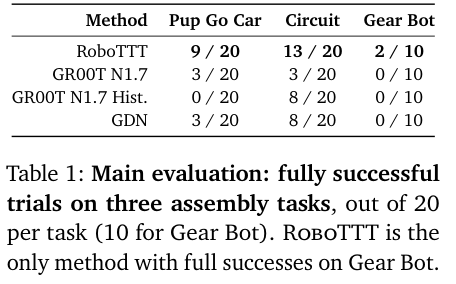

RoboTTT 在三个任务分别为 9/20、13/20、2/10；最难的五分钟 Gear Bot 仍只有两次完整成功。单步基线分别为 3/20、3/20、0/10。GDN 使用匹配层位置、门控和参数量的结构，后训练数据相同；非序列基线按计算预算匹配。这比跨不同视觉输入比较更有说服力，但评估数量仍有限，不能推出对所有长任务普遍有效。[§4、附录 B](https://research.nvidia.com/labs/gear/robottt/robottt.pdf#page=7)

### 4.2 上下文长度增加：有收益，但不是等算力定律

下面比较预训练上下文从 128 扩展到 8K 的闭环得分。该实验在主结果使用的 DAgger 训练之前完成，不能把两组数字直接拼接归因。

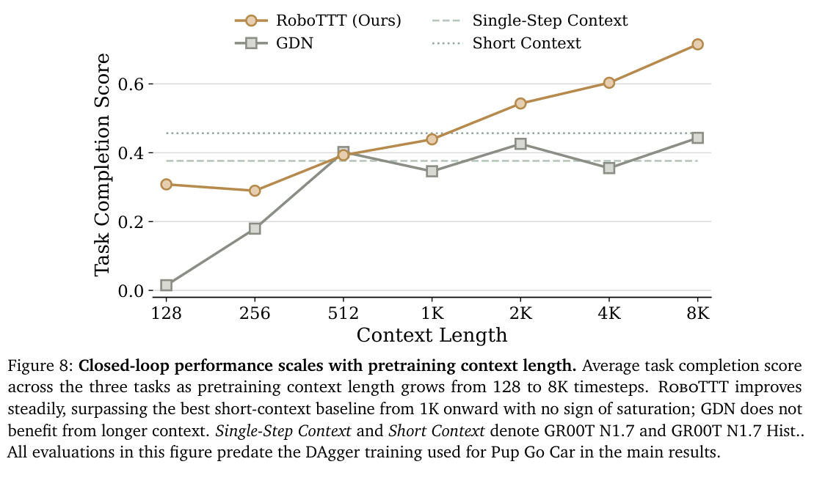

正文报告 RoboTTT 从 1K 的 43.9% 提高到 8K 的 71.5%，约 63% 相对提升；摘要使用 62%，这里保留正文具体数值与差异。曲线在 128 到 256 略有下降，整体趋势尤其在 512 以后向上，所以“每个点都单调提高”并不准确。GDN 没有相同的持续增长趋势。

这个实验支持：在作者配方下，更长上下文预训练有实际收益。但长序列增加训练成本，且不同长度使用不同 batch，尚不能据此建立等数据、等算力的纯上下文 scaling law。作者关于非线性快模型更适合压缩重复机器人流的解释是合理假设，需要结合消融判断。

### 4.3 视频模仿与外部扰动：数据条件不能省略

视频条件的实验中，所有配置使用同一语言指令，只让演示视频指定目标；测试在未见配置上进行。

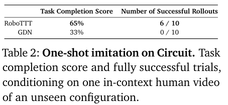

RoboTTT 完整成功 6/10、得分 65%；GDN 为 0/10、得分 33%。这说明该训练配方能在特定装配族中利用演示上下文，不等于跨任意任务、人类视角和机器人形态的通用视频模仿。

扰动实验在机器人装上车顶或轮胎后，由人取下零件，检查是否重新安装。

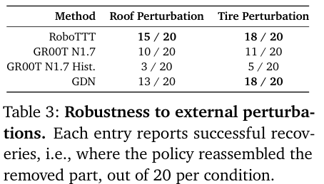

RoboTTT 分别为 15/20 与 18/20，GDN 为 13/20 与 18/20。作者额外收集 30 分钟扰动数据参与共同训练，不能把恢复能力描述为完全零样本涌现。轮胎条件下两种长上下文方法持平，也说明恢复收益并非全部独属于 TTT。

### 4.4 失败数据怎样使用，比是否保留更重要

DAgger 实验使用共同的 100 条轨迹：50 条由 RoboTTT 收集，50 条由 GR00T N1.7 收集。各方法使用同一数据池，比较只监督纠正与保留完整上下文的差异。

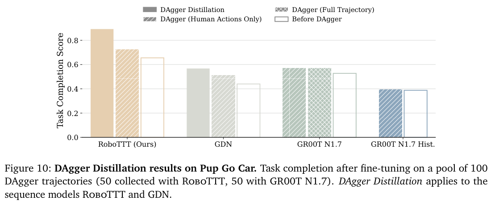

RoboTTT 的 DAgger Distillation 相对训练前提高约 36%，GDN 提高约 29%；标准 DAgger 在两个序列模型上平均约提高 13%。对于 GR00T N1.7，把机器人次优动作也当标签，与只监督人类纠正都得到 57% 得分。这个对照支持作者的关键判断：次优动作的价值在提供纠正背景，直接模仿它们没有带来相同收益。

下面的例子展示行为层面的含义：工具错过螺丝后抬起重试，再次调整，最终完成。

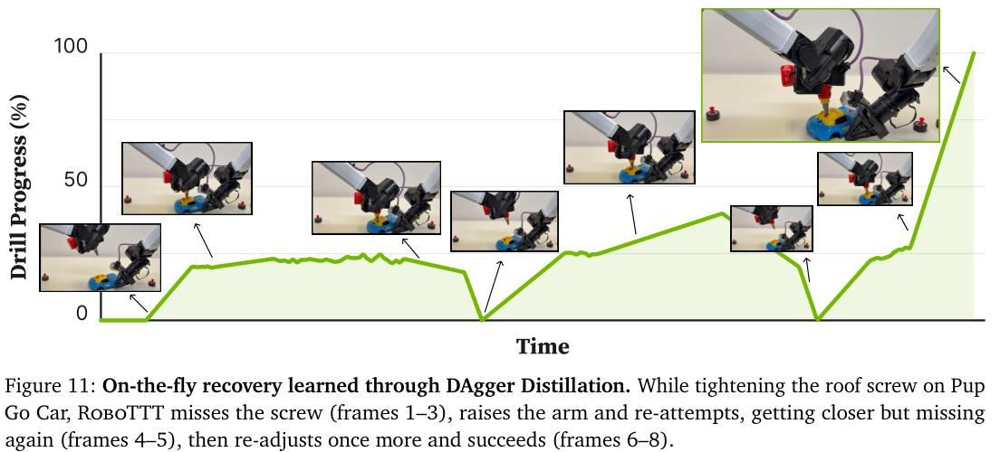

这张图是定性案例，不能单独量化恢复概率；它把前面的得分提升与实际行为联系起来。测试时没有人类持续提供正确动作或奖励，策略使用的是训练时学到的纠正模式和当前历史，不能描述为现场无限自主强化学习。

### 4.5 哪些组件真正影响表现？

消融同时检查独立噪声等级、快模型容量，以及状态、动作、register tokens 的作用。

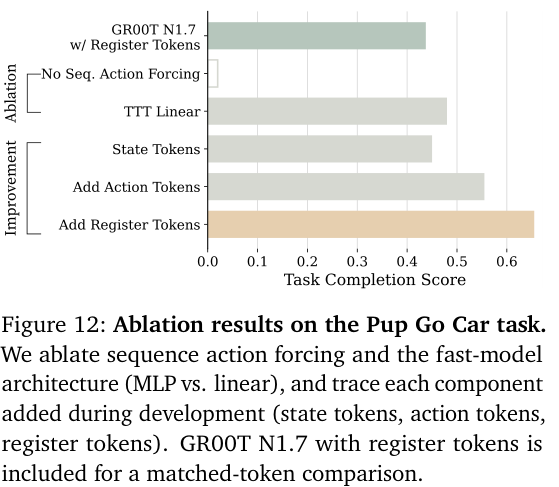

去掉 sequence action forcing 后几乎无法形成有效进展；线性快模型仍优于基础策略，但正文报告比 MLP 版本低约 27%。在仅有状态 token 的版本上增加动作 token 带来约 23% 相对提升，再加 register tokens 提高约 18%。给基础 GR00T 直接加 register tokens 没有相同收益，支持它们与时序模块协同，而非“多几个 token 自然更好”。

这些消融集中在 Pup Go Car，不能视为所有任务上的普遍因果定律。但它们明确提醒实现者：**只复制 TTT 层、忽略序列噪声与输入组织，不是论文验证过的完整方法。**

## 总结：对 XR1，先重建序列与监督接口，再决定快权重架构

RoboTTT 的主要贡献是将可学习快权重、长序列训练和上下文监督分离组合起来。它与显式关键帧记忆的区别在于：前者把连续过程压缩到参数状态，后者保留可检索图像。固定状态利于长时间运行，但也带来内层梯度、状态生命周期、记忆干扰与调试难度。

以下是针对 XR1 的迁移建议，并非论文已完成的实验。继续使用 Lance 可以满足数据存储需要，重要变化在采样与训练接口：

| 顺序 | 需要做的事 | 希望回答的问题 |
|---|---|---|
| 1 | 保留 episode、连续片段、时间顺序与重置边界 | 后面的监督是否真正看到同一条轨迹的历史？ |
| 2 | 区分 context-valid 与 action-loss-valid，记录人类接管和动作来源 | 哪些失败值得作为背景，哪些动作值得模仿？ |
| 3 | 在已有时序策略比较只用纠正与保留完整上下文 | 数据组织本身是否改善恢复能力？ |
| 4 | 加入带近零门控的快权重分支，从短序列开始 | 新模块是否稳定利用历史，而非扰乱原策略？ |
| 5 | 比较不同上下文并记录有效样本量、算力和时延 | 增益来自历史长度，还是额外训练计算？ |

完整接入前还需明确动作 chunk 长度、去噪期间的快权重提交规则、TBPTT 片段长度、带 mask 损失的归约，以及视频缺失状态/动作的填充方式。它们是公开材料中的复现缺口，不应凭经验冒充作者实现。

最值得优先采用的思想是：**保留执行过程提供的因果背景，同时精确控制哪些动作产生监督。** 这项改动不必等待完整 RoboTTT 架构，也不要求先换掉现有存储格式。

原图表均来自作者论文，版权归作者所有；正文为原创解读。[来源与边界记录](source_map.json) · [全量图表清单](assets/visual_manifest.json)。
