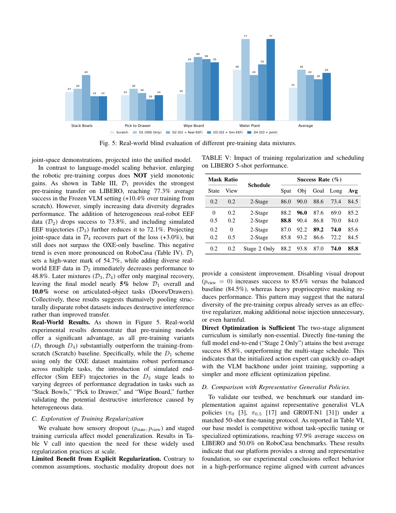
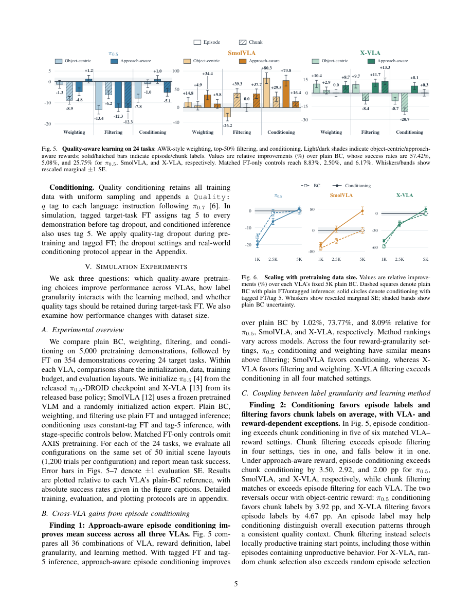
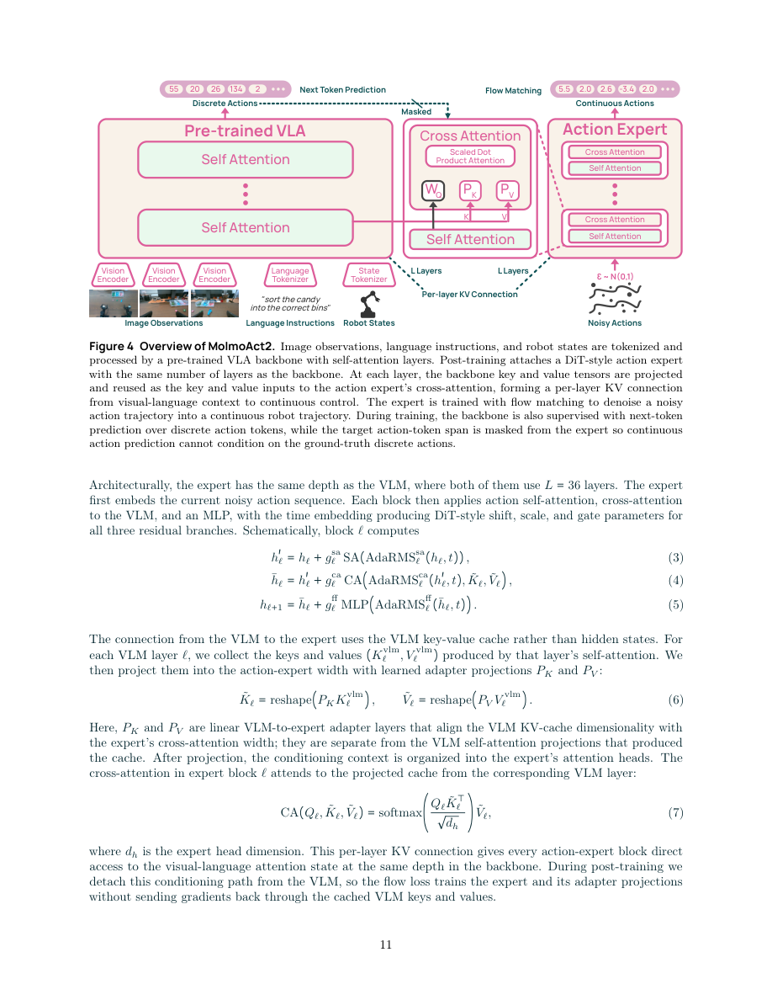
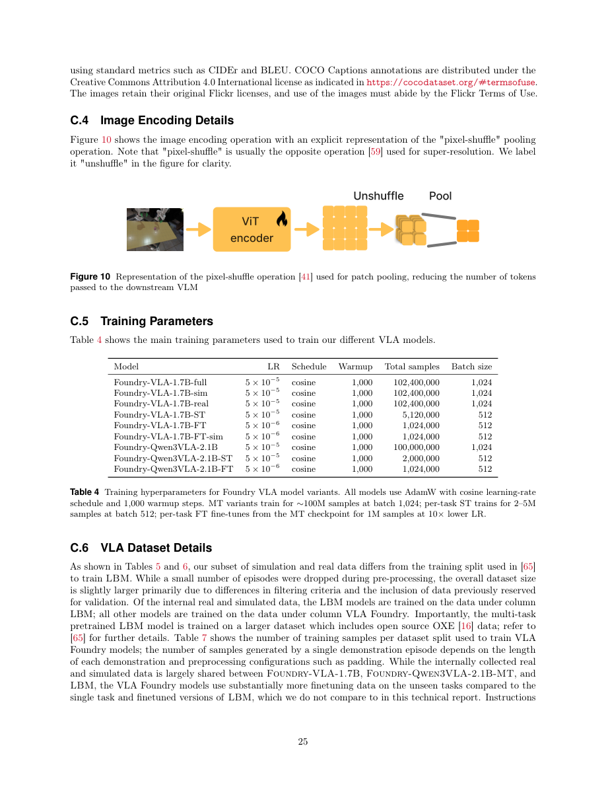

# VLA 预训练深读：数据怎样真正变成操作能力？

五篇论文的定向精读 · 数据配方 / 张量与掩码 / 损失与梯度 / 训练预算 / 复现边界 · 更新于 2026-11-04

> **先给结论**：值得组合的是动作语义对齐、可审计的数据混合、明确的梯度分工和精细任务评估。没有一篇论文证明“把所有 UMI 数据按固定比例混入真机数据”就能同时获得泛化与精度。MolmoAct2 的两阶段实现最值得拆；Scaling 的负结果最值得警惕；质量感知研究提供了保留多样性的办法，但其评分不是传感器噪声估计。

本文聚焦前述五篇工作的**预训练相关方法、附录及公开代码**，不是五篇全文的逐图复述。下文用「论文事实」「代码核对」「分析」「建议」区分证据层级。没有运行模型训练、推理或机器人实验。原图归作者所有，点击可放大。

## 1 先区分：这五篇的“预训练”在训练什么？

**VLA** 是把视觉、语言和机器人状态变成动作的模型。**VLM** 是已有的视觉语言模型；在它上面训练机器人策略，通常仍被称为 VLA 预训练，但不意味着从随机参数训练整个模型。**动作块**是未来 H 步、每步 d 维的动作，张量为 H×d。**行为克隆（BC）**用示教动作作为监督目标。**流匹配**训练网络把随机噪声逐步变为动作；这里的流时间不是视频时间。

| 工作与固定论文版本 | 研究对象 | 最值得读的部分 | 不能据此断言 |
| --- | --- | --- | --- |
| [Rethinking VLA Scaling · 2602.09722v1](https://arxiv.org/pdf/2602.09722v1) | 统一架构下改变动作表示、来源混合、正则与训练阶段 | §III–IV；表 III–V；附录 A–B | 更多数据一定有害，或者所有 delta 控制都不行 |
| [Quality-Aware VLA Pretraining · 2610.18869v1](https://arxiv.org/pdf/2610.18869v1) | 固定训练预算，比较质量加权、过滤、条件化 | §III–V；图 5–7；训练附录 | 任务进展分数等于动作测量精度 |
| [MolmoAct2 · 2605.02881v1](https://arxiv.org/pdf/2605.02881v1) | 具身 VLM → 离散 VLA → 连续动作专家 | §3、4.1、4.2；图 4 | 离散标签天然无噪声，或隔离梯度能修复错误动作 |
| [OpenVLA · 2406.09246v1](https://arxiv.org/pdf/2406.09246v1) | Prismatic VLM → 离散动作预测 | §3；附录 A | 一套离散动作格式覆盖了任意机器人控制接口 |
| [VLA Foundry · 2604.19728v1](https://arxiv.org/pdf/2604.19728v1) | LLM→VLM→VLA 的统一训练框架及对照 | §3、VLA 实验；附录 A、C.5–C.6 | 开源框架等于公开全部机器人训练数据 |

**阅读顺序建议**：先看第 4 节 MolmoAct2 的训练分工，再看第 2 节的失败证据；用第 5 节建立简单可复现基线，用第 6 节补齐数据系统，最后决定是否引入第 3 节的质量标签。

## 2 Rethinking Scaling：先对齐动作，再讨论规模

### 动作对齐改变了模型必须学习的函数

**论文事实。** 架构用 InternVL-3.5-2B 语义专家和约 0.7B 动作专家；两者隐藏维度分别为 2048、1024，在对齐注意力头维度后组合 Q/K/V。动作表示覆盖末端位姿、关节、夹爪、灵巧手和辅助子空间；有效维度掩码标记每条数据真正存在的动作坐标。不能把“补零到同一维度”当成同一种物理语义。[§III](https://arxiv.org/html/2602.09722v1)

论文比较世界坐标与末端坐标，以及相对于动作块起点的 relative 表示、相邻帧增量 delta 表示。前者让未来每一步都参照同一个锚点；后者每一步参照上一时刻。旋转需要用旋转群的组合与逆变换，不能直接相减欧拉角。

**分析。** 同样“向物体移动”，在世界坐标中会随机器人朝向变化；转换到当前末端坐标可消除一部分无关变动。但坐标一致并不消除延迟、动力学、夹爪开合定义和标定误差。相邻增量在低频数据中还会改变数值尺度：同样 2 cm/s 的速度，10 Hz 是 2 mm/步，30 Hz 约 0.67 mm/步。直接混合会把采样频率差误当动作风格。

### 一次训练更新：哪些元素应该贡献梯度？

论文使用从噪声到数据的约定：xτ=(1−τ)ε+τa，τ∈[0,1]，目标速度 a−ε。a 为归一化动作块，ε 为高斯噪声。动作专家读入噪声动作与视觉语言上下文，预测速度，利用有效动作维度监督。

**实现建议，不冒充作者源码。** 统计每个来源的有效元素数；明确实际 loss 是“每条样本先对有效元素平均，再对样本平均”，还是“全 batch 对全部有效元素平均”。例如一条 7 维轨迹和一条 14 维轨迹，前一种默认每条样本等权，后一种会让后者占更多权重。两者都是可定义的目标，但不能在 padding 后直接 mean，令补零比例偷偷改变混合权重。

### 数据配方与预算：有效帧不等于独立示教

附录统计约 **182.4M 有效帧转移**，部分高密度来源经过帧采样。例如 OXE 子集约 47.70M；Agibot Gripper 从 249.04M 原始帧按因子 7 降为约 35.58M。这里不是 182.4M 条独立轨迹，也不能直接折算成机器人小时数。帧采样改变单来源的重复度，但不自动保证各来源覆盖相同物理时间。[附录 A，PDF p.12](https://arxiv.org/pdf/2602.09722v1#page=12)

| 阶段 | 更新模块 | 步数 / 全局 batch | 优化设置 |
| --- | --- | --- | --- |
| 默认阶段 1 | 冻结 VLM，训练动作专家 | 40,000 / 256 | LR 1e−4 |
| 默认阶段 2 | 全模型 | 200,000 / 256 | LR 2e−5 |
| 两阶段共同设置 | — | 8 张 A800 | AdamW；cosine；warmup 比例 0.05；weight decay 1e−5 |
| 下游 LIBERO 5-shot | 全模型 | 30,000 / 128 | LR 1e−4；完整 LIBERO / RoboCasa 为 60,000 步 |

这些是论文的**默认配方，不是所有消融中的最佳设置**。[附录 B](https://arxiv.org/pdf/2602.09722v1#page=12)

### 关键证据：增加来源和增加正则都没有单调收益

读下面页面时，上半看真实机器人不同数据混合的平均表现，右侧表 V 看训练阶段和输入丢弃的变化。它把“论文采用了什么”与“消融发现什么”分开了。



**图表解读。** 图 5 的真实机器人平均值中，OXE-only 为 48，而加入后续来源的几组为 43、39、45；说明来源更丰富没有在该设置下自动变好。表 V 默认状态 mask=0.2、视图 dropout=0.2、两阶段训练为 84.5%；去掉状态 mask 为 85.2%，去掉视图 dropout 为 85.6%，仅阶段 2 为 85.8%。这反对“先冻结、再解冻必然更好”的照抄式结论。[图 5、表 V，PDF p.7](https://arxiv.org/pdf/2602.09722v1#page=7)

表 III 的 LIBERO 5-shot 冻结 VLM 条件下，Scratch 为 66.9%，OXE-only 为 77.3%，依次加入真实末端、仿真末端、关节数据后为 73.8%、72.1%、75.1%。解冻版本分别为 81.9%、86.4%、84.0%、83.7%、84.5%。RoboCasa 表 IV 也出现 OXE-only 54.7% 高于更大混合的 48.8%–50.0%。这些是**下游任务、混合策略和预算共同限定的结果**，没有单独证明新增数据的测量噪声导致下降。

**对 UMI＋真机的启发。** 先用动作接口一致的干净子集建立基线，再逐类加入来源；保持训练更新数和目标数据曝光量可解释。若直接同时增加 UMI、仿真、关节数据和训练步数，就无法知道收益来自哪里。论文没有给出可直接迁移的 UMI 最优比例。

## 3 Quality-Aware：保留低质量数据，给模型一个可区分的条件

### 作者估计的是任务进展，不是测量误差

**论文事实。** AXIS 用仿真状态构造质量信号。Object-centric 奖励组合任务进度 p 与接近程度 c：r=0.8p+0.2c，其中 c=1−tanh(5d)，d 是相应距离。Approach-aware 版本把接近、接触、操作进展分开：持续接触需连续 3 帧成立；接触前按距离下降衡量接近，接触后用任务进度变化计算奖励，采用 λ=0.5、接触奖励 b=0.1。[§III–IV](https://arxiv.org/html/2610.18869v1)

用长度 H=10 的窗口计算局部进展 Δt。接触跨越窗口需截断，避免接触奖励跳变把片段误判为高质量；短窗口按有效长度重标定，有效跨度小于 3 或无效情况记 0。整条轨迹的 Pe 是“保留时刻中 Δt>0 的比例”，不是最终成功率，也不是轨迹绝对误差。

**为什么要这样设计？** 一条最终成功的轨迹可能长时间停顿；逐片段评分能识别局部无效行为。但接近物体、等待接触稳定、调整抓取都可能是必要动作。只奖励物体位移会把接近阶段错当无用数据，因此论文补充接近与接触信号。

**人工参与在哪里？** 三名标注者对 50 条仿真示教的无效区间做判断，用于检验自动分数；不是人工逐条筛掉整个训练集。两类自动分数与人工评分的相关系数约为 0.612、0.526，相关性高也不意味着训练收益一定更高。真实 UMI 若没有物体状态、任务进度与接触事件，不能直接运行这一评分公式。

### 三种方法的差别，最终落在采样和梯度上

| 方法 | 数据如何进入 batch | 损失 / 条件如何变化 | 保留什么，损失什么 |
| --- | --- | --- | --- |
| 加权 | 保留数据 | chunk 权重 w=min(exp(10Δ),2)；L=Σwℓ/Σw | 放大正进展的梯度，但标签分数错误也会被放大 |
| 过滤 | 保留质量前 50% 的训练时刻 | 普通 BC；重复被选数据以匹配更新次数 | 增强局部生产性，可能丢掉罕见场景和恢复动作 |
| 条件化 | 保留全部数据，均匀采样 | 指令追加 Quality: q，q∈{1,…,5} | 不直接删除低分动作；让模型有机会按质量条件分离策略 |

episode 加权不是简单将 Pe 填入 exp：论文将按时刻加权的 Pe 百分位映射到 chunk 权重的经验分布，以减少两种粒度的权重分布差异。episode 过滤也按训练**时刻预算**对齐，边界轨迹必要时只留一部分。质量标签通过五个等频分位箱生成，整轨迹标签由其各时刻共享。[§IV](https://arxiv.org/html/2610.18869v1)

**最小例子。** 两个 chunk 分数 Δ=0.1 和 −0.1，权重分别约为 2 和 0.368，归一化后约占 84.5% 与 15.5%。条件化则不改变其抽样机会，而是给出不同 q。条件化的作用依赖模型真正利用 q；如果所有高分样本都来自一个机器人，q 也可能学成来源标识，而不是跨来源的质量概念。

### 训练协议与结果：不能只抄“提升73.8%”

仿真受控比较使用 5,000 条预训练示教，约 35.3 小时；下游 24 个任务共 354 条示教。π0.5 从 DROID checkpoint 出发，X-VLA 从其 base policy 出发，SmolVLA 的 VLM 预训练但动作专家随机初始化。三者不是等价的从零初始化。

| 模型 | 预训练 / 微调步数 | batch | 关键梯度设置 |
| --- | --- | --- | --- |
| π0.5 | 20,605 / 13,580 | 64 / 32 | 预训练全参数；微调语言和动作侧 LoRA、视觉可训练；LR 5e−5 / 2.5e−5 |
| SmolVLA | 20,621 / 6,790 | 64 / 64 | VLM 与视觉冻结，动作专家与状态投影训练；LR 1e−4 |
| X-VLA | 20,621 / 6,790 | 64 / 64 | 全模型，VLM 学习率为其他部分的 1/10；主 LR 1e−4 |

**标签协议也是方法的一部分。** 仿真微调给目标示教最高标签 5，并使用标签 dropout；条件推理用标签 5。没有这个阶段对齐，不能把结果归因于单纯“预训练加一个 token”。评分窗口 10 也不等于每个模型的原生动作 horizon：π0.5、SmolVLA、X-VLA 分别为 10、50、30；比较时使用前 10 步输出、执行前 8 步。[训练附录](https://arxiv.org/pdf/2610.18869v1)

读图 5 时先看每个模型自己的 BC 基准，再看相对增幅；三个面板不是同一条基线。



**关键观察。** BC 成功率分别是 57.42%、5.08%、25.75%。Approach-aware episode conditioning 的相对提升为 1.02%、73.77%、8.09%，折算约为 58.01%、8.83%、27.83%，绝对增加约 0.59、3.75、2.08 个百分点（本文按论文数值计算）。SmolVLA 的相对增幅大，但绝对成功率仍不高；X-VLA 多组过滤/加权优于条件化。π0.5 上多种方案反而下降，不能把“质量学习”宣传成稳定的普适增益。[图 5–6，PDF p.5](https://arxiv.org/pdf/2610.18869v1#page=5)

**可迁移性边界。** 仿真预训练与目标任务共用身体、渲染器、物体库等条件；task ID 分离也不完全等于语义任务不重叠。论文报告 5,000 条中 22 条涉及与目标相同的三个指令。真实阶段使用更大约 19,250 条预训练集；17,758 条可评分，1,492 条无法评分，后者赋中性标签 3。这里没有证明“跨来源相同分位标签代表相同物理精度”。

**对混训的建议。** 把任务质量、观测可靠性、动作精度拆成不同字段。先为有可靠证据的样本加标签；未知值显式保留，避免把“无法评分”误当“中等质量已确认”。条件化可以作为保留多样性的实验项，不能替代 UMI 标定、时间同步和动作坐标检查。

## 4 MolmoAct2：离散预训练与连续控制怎样分工？

### 数据配方有两层：tokenizer 配方不等于 VLA 配方

**论文事实。** OpenFAST 将一秒动作先变换到频域，再量化系数，用字节对编码 BPE 压缩为 2048 种动作 token。训练 tokenizer 用约一百万动作序列：YAM、SO-100/101、DROID 各 30%，Fractal、BC-Z、Bridge 各约 3.33%。连续动作先按 1%–99% 分位统计归一化，padding 到 32 维；夹爪独立处理。不同控制频率的一秒动作包含不同步数。[§4.1.1、表 2](https://arxiv.org/pdf/2605.02881v1#page=9)

VLA 预训练的抽样是 **90% 机器人、10% 多模态**；机器人内部 YAM、SO-100/101、DROID 各 30%，其他来源合计 10%。换算为整体概率，三个主来源各占 27%，不是各占总 batch 的 30%。多模态内部又是 Molmo2-ER、原 Molmo2、文本 SFT 的 46%/46%/8%。不能把这些不同层级比例加在一张平表中。

新增 YAM 数据约 34.5k 条、720 多小时、28 多种任务；它只是数据混合的一部分。“百万序列训练 tokenizer”也不代表新采集了百万条独立示教。[§3、4.1.2](https://arxiv.org/pdf/2605.02881v1)

### 从一条样本追到预训练 loss

例如一段 15 Hz 的单臂示教：取当前图像、任务语言、当前机器人状态，以及未来一秒的 15×d 动作（此为教学例子）。连续维度归一化、补至 32 维，经 OpenFAST 变成长度可变的动作 token；状态则逐维量化为 256 档，走单独的 state token 表示。

输入包括图像、语言、setup 描述、control 描述、状态 token，以及 action_output 标记。setup 描述身体，control 描述 absolute joint pose 或 delta end-effector pose。**动作数字相近但控制语义不同，需要通过显式条件区分。** 预训练阶段只用自回归下一个 token 监督，尚未训练连续动作专家。

视觉采用单裁剪；视频最多 8 帧、最高 2 FPS；多相机顺序在 episode 级随机化，减少相机槽位捷径。图像 patch 经池化后进入语言模型。最长 4200 token，动态 packing 把短样本拼入一条序列；注意力 mask 隔离不同样本，不能让一个任务的动作读到另一个任务的图像。[§4.1.2](https://arxiv.org/pdf/2605.02881v1#page=9)

### 梯度分工：连续专家读取上下文，但不反传 VLM

先读图 4 的左侧：VLA 仍预测离散动作；右侧动作专家通过每层 KV 连接读取上下文。两种监督共享一个样本，但不能共享答案可见性。



**论文事实。** 动作专家与 VLM 都有 36 层。每层从 VLM 取 key/value，经可学习 P_K、P_V 投影给专家的交叉注意力。专家还对噪声动作做自注意力，流时间通过条件化缩放、平移、门控影响各残差分支。[§4.2.1、图 4，PDF p.11](https://arxiv.org/pdf/2605.02881v1#page=11)

后训练继续保留离散动作监督，同时优化 Lpost=LLM+Lflow。这里有两个独立限制：

1. **目标遮挡**：连续专家的上下文不能看到 ground-truth 离散动作 token，否则训练时可偷看答案、推理时却没有。
2. **梯度隔离**：送给连续专家的 VLM KV detach；Lflow 更新动作专家和 KV 投影，不更新 VLM。VLM 仍由离散动作/多模态的 LLM 更新，绝非整个 VLM 冻结。

**分析。** 这样把“怎样理解观测和任务”与“怎样拟合连续轨迹”部分解耦，降低连续损失对通用表征的干扰。但坏动作仍会通过离散标签更新 VLM，也会通过流损失更新动作专家；梯度隔离不是数据去噪。拿它保护 UMI 泛化能力是可检验假设，不能声称论文已证明 UMI 和真机的最优分工。

### 连续损失实现：三种 padding 和四次流采样

每条动作采 K=4 组独立噪声 ε 和流时间 t，构造 xt=(1−t)ε+ta，监督速度 a−ε，复用同一视觉语言上下文。动作张量 pad 到最多 30 步、32 维；mask 分别排除时间 padding 和维度 padding。维度 mask 用于噪声输入、目标和预测，loss 按有效维度归约。

packing 后还多出一个“每条语言序列含几个机器人 chunk”的轴。论文尽可能将其 pad 到 5 个 chunk，虚拟行不参与 loss；超过 5 个仍使用，走不固定上限 padding 的处理。每个真实 chunk 只能关联所属子样本的上下文。[§4.2.2](https://arxiv.org/pdf/2605.02881v1#page=12)

```text
一条机器人样本
  ├─ 图像 / 指令 / setup / control / state → VLM
  │    ├─ 离散动作 CE → 更新 VLM
  │    └─ 分样本、屏蔽动作答案的 KV → detach → 可学习 KV 投影
  └─ 连续动作 a → 4 组 (ε,t) → 动作专家 → masked flow loss
                                           └─ 更新专家与 KV 投影
多模态样本 → VLM 文本监督；没有连续动作 loss
```

**推理闭环。** 连续分支从高斯噪声积分得到动作块，再用对应动作语义与统计量反归一化交给执行接口。任务微调采用 K=8，而后训练 K=4 的主要原因是显存限制；不能把 8 次训练噪声采样误读为执行 8 步控制。

### 可复现预算与默认参数陷阱

| 阶段 | 更新数 / batch | 序列长度 | 学习率 | 作者资源 |
| --- | --- | --- | --- | --- |
| 离散 VLA 预训练 | 200k / 128 | 4200 | ViT+connector 5e−6；LLM 1e−5 | 64 H100；约 5760 GPU-hours |
| 连续后训练 | 100k / 128 | 机器人 2100，多模态 4200 | VLM 同上；专家 5e−5 | 64 H100；约 2300 GPU-hours |

GPU-hours 是所有卡累计，不是墙钟时长；也不含此前训练 Molmo2 / Molmo2-ER 的全部成本。packing 下 batch=128 指打包序列，不能简单解释成每步 128 条原始示教样本。

**代码核对。** 固定提交 `6070080a20321b4f498ab30f28e1d09ac465edb7` 的 [train_lerobot.py](https://github.com/allenai/molmoact2/blob/6070080a20321b4f498ab30f28e1d09ac465edb7/experiments/launch_scripts/train_lerobot.py) 提供 `add_action_expert`、`num_flow_timesteps`、`action_expert_detach_vlm` 等开关。但 parser 默认分别存在：流采样数 1、detach=False、专家 LR=1e−4，**均不等于论文后训练配方的 4、True、5e−5**。必须查看具体启动命令/导出配置，显式覆盖。文件名为 `pretrain.py` 的另一个入口含通用 VLM 预训练配置，不能只凭名称当成 VLA 配方。

本次核对到参数入口与动作专家模块，未逐行追踪全部 trainer 的 reduction、分布式归约及发布训练命令，因此不宣称已经完成端到端源码复现。论文与代码快照有共同可读接口，不等于当前默认执行就复现论文。

## 5 OpenVLA：一个简单但不便宜的预训练基线

### 样本到 token：有损压缩直接决定动作分辨率

**论文事实。** 从 Prismatic-7B VLM 初始化，视觉融合 DINOv2 与 SigLIP 特征。输入图像和语言指令；动作每一维在训练数据 1%–99% 分位区间均匀分为 256 档，用词表末尾 256 个低频 token 表达动作，而不是新建任意长度词表。只对动作 token 计算交叉熵，图像/指令作为条件。[§3.1–3.2](https://arxiv.org/pdf/2406.09246v1#page=4)

**分析。** 假设某一维有效区间宽 0.2 m，256 档的分辨率量级约 0.78 mm；若区间宽 2 m，则约 7.8 mm（教学估算，不是作者测得的误差）。所以“同样 256 档”不意味着不同来源相同物理精度；分位数缩放能控制离群值，却也会压缩或裁掉尾部动作。执行时必须选对数据集统计量进行反归一化。

7 维动作可以看作依次预测 7 个动作符号，动作 token 之间自回归依赖。它与 MolmoAct2 的“一秒轨迹做频域压缩”不同；也与直接预测连续向量的流匹配不同。CE 对错误档位不是天然的几何距离惩罚，相邻档和远端档都先作为错误类别处理。

### 数据筛选已经承担了一部分对齐工作

从 OXE 中限制为至少有第三人称相机、单臂末端控制的操作数据，最终训练规模约 970k 轨迹。混合权重沿用 Octo 的多样性启发式，较单一来源降权，多任务多场景来源升权。这不是对任意 action space 的原样混合。[§3.3、附录 A](https://arxiv.org/pdf/2406.09246v1#page=5)

DROID 曾按约 10% 混入，但动作 token 准确率持续偏低；作者在最后三分之一训练中移除它。这个观察不能反推出“DROID 噪声大”：模型容量、训练预算和高多样性都可能造成欠拟合。启发是记录每来源拟合与迁移指标，而非遇到高 loss 就贴坏数据标签。

### 训练细节与代码入口

| 项目 | 作者报告 | 对复现的含义 |
| --- | --- | --- |
| 输入分辨率 | 224×224 | 384 在其比较中无收益且训练约慢 3 倍；不是所有精细任务的普遍结论 |
| 参数更新 | 包括视觉编码器 | 冻结视觉在其设置中不利于控制；不能照搬 VLM 常用冻结策略 |
| LR | 固定 2e−5，无 warmup 收益 | 与很多 cosine 配方不同 |
| 训练长度 | 约 27 epochs | 多次遍历示教；不是网页多模态语料的一次遍历习惯 |
| 资源 | 64 A100，14 天，约 21,500 A100-hours | 全局 batch 2048；非单卡微调成本 |

作者观察到动作 token 准确率超过约 95% 前真实机器人表现持续提升；这只是该训练中的诊断信号，不能把 95% 当所有任务的部署阈值。[§3.4–3.5](https://arxiv.org/pdf/2406.09246v1#page=6)

**代码核对。** 固定提交 `c8f03f48af692657d3060c19588038c7220e9af9`：[vla-scripts/train.py](https://github.com/openvla/openvla/blob/c8f03f48af692657d3060c19588038c7220e9af9/vla-scripts/train.py) 从配置读取 batch、LR、冻结策略，并显式调用 `freeze_backbones`，训练前保存数据统计；[prismatic/conf/vla.py](https://github.com/openvla/openvla/blob/c8f03f48af692657d3060c19588038c7220e9af9/prismatic/conf/vla.py) 定义模型变体；[mixtures.py](https://github.com/openvla/openvla/blob/c8f03f48af692657d3060c19588038c7220e9af9/prismatic/vla/datasets/rlds/oxe/mixtures.py) 定义混合项。配置表中的原始 weight 不应直接读成最终百分比，必须继续核对数据集长度、采样器重标定和具体 mixture 名。当前源码默认 epochs 也不能替代论文最终运行记录。

**适用判断。** OpenVLA 适合建立“接口一致、监督简单、训练可追踪”的强基线；若目标是长动作块和高频精密控制，需要单独评估量化、输出串行性和执行频率的代价，不能仅据开放权重就认定最合适。

## 6 VLA Foundry：把数据语义固化进训练系统

### 动作条件不是只能取一个最后层特征

**论文事实。** Foundry-VLA-1.7B 在 VLM 序列末尾添加 observation token，取其最后 N=4 层隐藏特征，条件化一个 325M 的 flow transformer；另可输入线性编码的本体状态，和线性编码的噪声动作序列。损失为动作流匹配。[§4，PDF p.8–9](https://arxiv.org/pdf/2604.19728v1#page=8)

正文说明使用最后四层，图 4 图注简写为最后层；这里按正文描述保留多层信息，并提醒复现时核对所选配置。它与 MolmoAct2 的每层 KV 连接不相同，不能把两者都简单称作“接一个动作头”后忽略接口差别。

训练混合含 42 个仿真任务、361 个真实任务，其中 39 个在两域有对应版本。**这一组 Foundry 模型没有加入 OXE 或 UMI**；论文对比的既有 LBM 预训练数据更广。因此其 sim-real 结论不能直接当成 UMI 混合结论，LBM 对比也不是完全同数据预算的纯架构对照。[§4；附录 C.6](https://arxiv.org/pdf/2604.19728v1)

### 系统实现：统计、相对位姿、时间因果约束

原始数据按模态预处理，用 Ray 并行产生 WebDataset tar shards，同时输出归一化统计。训练 dataloader 按权重组合各数据集；共享 batch handler 负责组 batch、构造 loss 和输出归约，训练循环不为每一种模型复制一份。[§3.2](https://arxiv.org/pdf/2604.19728v1)

RoboticsNormalizer 支持全局与按时间步统计，包括分位数版本；用 t-digest 估计和合并分位数。**分析：分位数不能像均值那样直接平均。** 两个来源样本量或分布差别很大时，“各自 p99 的平均”不等于混合数据 p99；合并统计还必须先确认维度有相同单位、物理语义。

动作支持绝对世界坐标或相对锚定末端位姿，旋转采用连续 6D 表示，相对位姿用 SE(3) 组合。窗口围绕锚点包含过去和未来：未来用来监督，过去可作输入；本体状态只允许当前与过去，防止未来状态泄漏。对于 UMI 轨迹，离线平滑若使用未来帧，也应区分它是生成监督还是生成部署时不可获得的输入。

### 训练预算：samples 是曝光次数，不是数据集去重规模

看下图表 4 的 Total samples 和 Batch size 两列，再区分 full/sim/real、ST（单任务训练）与 FT（预训练后微调）。



full/sim/real 版本各训练 102,400,000 samples，batch 1024，LR 5e−5；AdamW、cosine、warmup 1000 步。按每步一个全局 batch 推算约 100k updates。ST 是 5.12M/batch512；FT 为 1.024M/batch512、LR 5e−6，即约 2000 updates。**这些推算是曝光量除以 batch，不是作者额外披露的独立数据条数。** Qwen 变体预算也有不同，不能混用。[表 4、附录 C.5，PDF p.25](https://arxiv.org/pdf/2604.19728v1#page=25)

**边界。** 框架公开不意味着内部真实/仿真示教全部公开；论文也说明基础模型与不同 FT 数据条件的差异。关于其数据系统，本次以论文附录为主要证据，只固定并核对仓库 README 与版本，没有审计每条转换和归约函数。[官方仓库固定版本](https://github.com/TRI-ML/vla_foundry/tree/77d2866757b128c77f294d2ad2c5321978943956)

## 7 合在一起看：哪些结论有证据，哪些仍需实验？

| 问题 | 最直接的证据 | 对当前决策的意义 | 尚未解决 |
| --- | --- | --- | --- |
| 更多来源一定更好？ | Scaling 的逐来源消融多次下降 | 扩数据要逐来源检查迁移收益 | 不能把下降单独归因于噪声 |
| 坏数据必须丢掉？ | AXIS 条件化可优于 BC，但骨干依赖显著 | 可以保留数据并显式给质量上下文 | 无可靠评分时，标签可能制造偏差 |
| 语义与精细动作能分开优化？ | MolmoAct2 离散 CE＋detach 的连续专家 | 具体可实现的梯度分工 | 未证明对 UMI＋真机必然更好 |
| 动作归一化只是工程细节？ | OpenVLA 分位离散、Foundry SE(3)/统计 | 表示决定分辨率与跨源一致性 | 统一范围不修复标定和延迟 |
| 预训练后如何看是否有用？ | 多篇用目标任务 FT 后闭环评估 | 固定 FT 预算，比较精度和泛化 | 训练 loss 下降不等于部署变好 |

**最强的可迁移结论**是先统一可比较的动作与时间语义，再显式管理采样、mask 和训练阶段。**最容易被夸大的结论**是“按质量标签混训即可得到更精确的控制”：AXIS 的主要标签描述任务生产性，没有测量 UMI 位姿误差。

### 为什么高噪声数据仍可能伤害精确动作？

用教学简化表示观测动作 ã=a+δ，其中 δ 是测量或处理误差。在 xt=(1−t)ε+tã 的流匹配中，输入受到 tδ 影响，监督速度 ã−ε 仍含完整 δ。接近纯噪声时，输入中的误差减弱，**目标里的误差并不会自动消失**。模型、条件、误差分布和采样区间共同决定它学到什么。

这解释了为什么不能将“高噪声数据用于高流噪声区”直接当成已证明的去噪定理。另见已有的 [ε4P 深读](../epsilon4p/)：那是特定任务与来源关系下的区域监督方案，不替代本专题的通用预训练比较。不同论文流时间方向还可能相反，移植前先明确 t=0 是噪声还是干净动作。

## 8 面向 UMI＋真机：把论文转成可执行的决策流程

以下是**本文提出的实验方案，尚未运行**。不声称已经有数据支持某个固定混合比例，也不公开任何内部数据清单。

### 第一步：全量建立可比较的元数据，不急着打一个总分

每个 episode 保留来源、机器人/夹爪、控制模式、动作单位、坐标锚点、采样频率、时间戳、相机标定、语言、任务类别、有效维度与缺失字段。保留原始值及转换版本。对每源统计轨迹时长、有效动作块数、截断/饱和比例、时序异常和场景覆盖。

| 维度 | 可计算信号 | 能回答的问题 | 不能据此断言 |
| --- | --- | --- | --- |
| 观测可靠性 | 丢帧、时间间隔、重投影/跟踪残差（若可得） | 哪些记录可能不稳定 | 残差小就能精确执行 |
| 动作一致性 | 单位/坐标、速度加速度、重复帧、夹爪事件 | 转换是否自洽，异常集中在哪 | 慢动作或停顿就是坏数据 |
| 任务质量 | 成功、阶段进展、恢复事件；人工抽样审计 | 示教在做有效任务吗 | 成功就没有动作测量误差 |
| 多样性 | 任务、物体、场景、视角覆盖 | 来源是否补充新的条件 | 多样性多必然提升当前目标 |

对于不可配对来源，使用各自内部一致性和少量分层人工抽查，避免把来源分类器的准确率直接当噪声量级。可识别来源，可能只是相机、场景或身体不同。

### 第二步：统一动作接口与统计，冻结数据版本

先定义共同的任务空间动作与物理时间窗口；关节控制不能靠 padding 假装变成末端控制。确定哪些来源可以可靠转换，哪些只能共享表征或使用独立控制条件。分位统计只用训练集拟合，冻结到清单中；保留按来源/身体反归一化所需的信息。

检查三层 mask：动作维度、动作时间、样本 packing。明确 reduction 与有效分母，再设数据源权重。否则 30 Hz 来源、长轨迹和更多有效动作维度都可能获得额外权重，却被误以为是“50:50 混合”。

### 第三步：用最小对照决定是否需要复杂训练

| 对照 | 改什么 | 必须固定什么 | 用来判定什么 |
| --- | --- | --- | --- |
| A：精确真机基线 | 不加 UMI | 初始化、FT 数据与预算、评估集 | 精度下限与泛化缺口 |
| B：普通混合 | 加接口合格 UMI，扫描少量来源概率 | 总更新数；额外记录真机实际曝光次数 | UMI 是否改善泛化，是否损害精度 |
| C：质量条件化 | B 上加可靠质量条件，保留全部样本 | 与 B 相同样本及采样；FT/推理标签协议一致 | 收益来自条件还是数据变化 |
| D：梯度分工 | 离散预训练＋连续专家隔离；或适合已有架构的可比变体 | 匹配资源并报告新增计算成本 | 表征保护与动作拟合能否兼得 |
| E：精确数据收尾 | B/C/D 后增加明确预算的真机阶段 | 与等额继续混合的对照配对 | 精度恢复是否牺牲泛化 |

不把来源采样比例当成动作可信度。每个比例同时报告：来源抽样概率、真实抽取的有效 chunk 数、目标数据曝光、有效动作维度、计算时间。若总步数固定后真机曝光减少，再补一个“真机曝光匹配”的对照，分清负迁移和真机欠训练。

### 第四步：评估同时拆开泛化和精度

设置固定的未见物体/背景/视角场景看泛化，设置接触、插入、对齐等目标看操作能力；记录成功率、末端误差、接触失败、重试次数与闭环抖动。按任务和来源分别看，不只报一个总平均。相同目标 FT 预算下比较预训练，避免大规模 FT 把预训练差异抹平。

若 B 已改善泛化且精度不退，不必立即引入条件化与新专家。若 B 泛化好但精度下降，先排除单位、频率、标定、有效权重和曝光量变化，再比较 C/D/E。若泛化也没提升，质量标签未必能挽救缺少目标相关信息的数据。

**目前能确定的是流程与对照，不能确定最优比例或噪声阈值。** 这五篇提供了值得检验的机制，没有提供当前 UMI＋真机数据的实测结论。

## 9 来源、版本与可复现缺口

本页固定论文 v1，避免滚动版本混用；PDF SHA-256 与代码提交存入 [source_map.json](source_map.json)。图页的来源、用途及视觉检查记录见 [visual_manifest.json](visual_manifest.json)。本文 Markdown 可直接 [下载/查看](report.md)。

| 来源 | 本次使用范围 | 仍缺的证据 |
| --- | --- | --- |
| Scaling | 正文方法、混合与消融、附录超参 | 未完成官方训练代码逐行核验；缺当前数据的对照 |
| AXIS | 自动评分、学习方式、初始化/FT 协议、主结果与附录 | 未核验完整评分代码；不等同测量误差评估 |
| MolmoAct2 | 数据与阶段、mask/梯度、资源；固定源码入口与专家模块 | 未复现导出配置与整个分布式 loss 路径 |
| OpenVLA | 论文配方；固定训练入口、变体配置、混合表 | 未跑数据读取和最终采样概率；论文运行不等于当前默认 |
| Foundry | 正文与系统/超参附录；固定仓库版本 | 私有数据不可完整复现；未逐行审计训练框架 |

**最终判断**：用 OpenVLA 理解简单监督如何落地，用 MolmoAct2 学习阶段和梯度分工，用 Foundry 固化数据语义与统计；再用 Scaling 与 AXIS 的受控对照约束“扩数据”和“质量学习”的乐观假设。真正需要抄的是可定位的接口、损失和评估协议，而不是脱离来源关系的一个混合比例。
